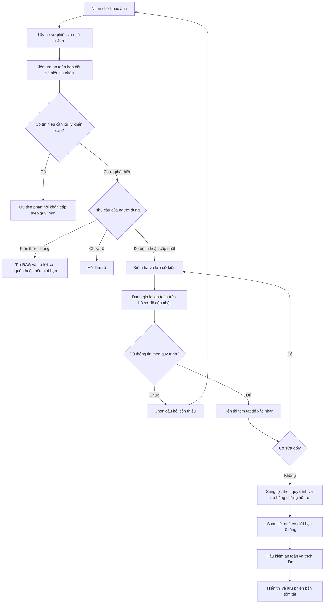

# Lộ trình triển khai MediMind: hỏi bệnh, sàng lọc và tóm tắt trước khám

Ngày lập: 03/11/2026.

Tài liệu này là kế hoạch triển khai, không phải xác nhận hệ thống đã hoàn thành hoặc được thẩm định lâm sàng. Các nhận xét hiện trạng dựa trên những phần mã nguồn đã được đọc; chưa có benchmark toàn bộ hệ thống.

## 1. Mục tiêu và phạm vi

Xây chatbot end-to-end tiếp nhận mô tả bằng chữ hoặc ảnh, hỏi bổ sung, ghi nhận bệnh sử, hỗ trợ sàng lọc sơ bộ và tạo bản tóm tắt trước khám.

### Chức năng được phép

- Giải thích kiến thức sức khỏe có nguồn hỗ trợ.
- Thu thập triệu chứng, diễn tiến, tiền sử, dị ứng và thuốc đang sử dụng do người bệnh khai báo.
- Hỏi thêm thông tin còn thiếu theo quy trình được chuyên môn rà soát.
- Phát hiện dấu hiệu cần ưu tiên xử lý khẩn cấp theo quy trình.
- Hướng dẫn chăm sóc không dùng thuốc và định hướng tiếp cận nhân viên y tế phù hợp.
- Tạo bản tóm tắt để người bệnh kiểm tra, xác nhận và mang đi khám.

### Chức năng bị cấm trong dự án

- Kê đơn hoặc chọn thuốc cho người bệnh.
- Đề xuất liều, tăng/giảm liều hoặc hướng dẫn tự thay đổi điều trị đang dùng.
- Kết luận chẩn đoán xác định từ hội thoại hoặc hình ảnh.
- Tạo dữ kiện bệnh sử mà người bệnh chưa cung cấp.
- Dùng lỗi hệ thống hoặc thiếu thông tin làm căn cứ kết luận nguy cơ thấp.

Việc ghi nhận tên thuốc người bệnh đang dùng không đồng nghĩa với đề xuất dùng thuốc. Không dùng bộ lọc xóa mọi tên thuốc vì sẽ làm sai bệnh sử.

## 2. Hướng kiến trúc được chọn

Giữ nền tảng hiện tại, bổ sung quản lý phiên và điều phối hỏi bệnh. Chưa chuyển toàn bộ sang Bedrock hoặc bổ sung nhiều dịch vụ AWS.

| Thành phần | Công cụ | Trách nhiệm |
|---|---|---|
| Giao diện | HTML/CSS/JavaScript | Chat, ảnh, hồ sơ đang ghi nhận, xác nhận tóm tắt |
| Backend chính | Flask + Python | Xử lý API, phân quyền và điều phối |
| Hiểu ngôn ngữ/ảnh | Gemini API | Trích xuất dữ kiện, diễn đạt câu hỏi, quan sát ảnh sơ bộ |
| Kiểm tra cấu trúc | Pydantic | Kiểm tra kiểu dữ liệu và hợp đồng đầu ra; không xác nhận đúng y khoa |
| Quy trình hỏi bệnh | Python + cấu hình JSON | Chọn thông tin cần hỏi và chuyển trạng thái |
| Lưu trữ bản thử nghiệm | SQLite + SQLAlchemy | Phiên, tin nhắn, dữ kiện và bản tóm tắt |
| RAG | ChromaDB + embedding được cấu hình rõ | Truy xuất tài liệu hỗ trợ |
| An toàn | Quy tắc Python, prompt và hậu kiểm | Kiểm tra xuyên suốt, thực thi giới hạn chức năng |
| Kiểm thử | pytest | Kiểm tra logic, hợp đồng API, phân quyền, lỗi và hồi quy |
| Đóng gói | Docker | Đóng gói nhất quán; dữ liệu phải nằm trên lưu trữ bền vững |
| AWS | Nơi chạy ứng dụng, S3, theo dõi vận hành/chi phí | Chọn cấu hình sau khi kiểm tra ưu đãi và giá thực tế |

Flask là đường triển khai chính của phiên bản đầu. Nếu giữ FastAPI, hai lớp API phải gọi chung nghiệp vụ và có kiểm thử tương đương; không phát triển hai bộ logic hỏi bệnh riêng.

## 3. Hiện trạng và khoảng trống

### Đã có nền tảng

- `core/chat_service.py`: điều phối kiểm tra cấp cứu, truy xuất, Gemini/fallback và hậu kiểm.
- `core/rag_service.py`: ChromaDB, mở rộng từ khóa Việt–Anh, lấy hai đoạn và lọc ngưỡng.
- `core/gemini_service.py`: gọi Gemini với lịch sử, tài liệu và ảnh.
- `core/models.py`: người dùng, tài liệu và lượt tư vấn.
- `ingest.py`: nạp JSON curated, chia đoạn và tạo collection phiên bản.
- Endpoint tóm tắt và bộ kiểm thử nền.

### Cần bổ sung hoặc sửa

- Phiên hội thoại có mã riêng, hồ sơ tích lũy và nguồn của từng dữ kiện.
- Điều phối hỏi bệnh thay cho trả một kết luận độc lập ở mỗi lượt.
- Cập nhật thông tin sửa đổi, xử lý mâu thuẫn và tránh hỏi lặp.
- Tách dữ kiện người bệnh khỏi quan sát ảnh và kết quả sàng lọc.
- Trích dẫn nguồn trung thực, xử lý rõ khi RAG không có bằng chứng.
- Bộ đánh giá hội thoại và RAG có đáp án được chuyên môn rà soát.

Các con số về số chunks, chủ đề và nguồn trong database phải được kiểm kê trực tiếp, không lấy từ báo cáo chưa đối chiếu.

## 4. Luồng xử lý mục tiêu



Đây là sơ đồ tổng quát. Ở mọi trạng thái, kể cả hỏi kiến thức hoặc xác nhận, thông tin nguy hiểm mới phải được ưu tiên xử lý. “Chưa phát hiện” không có nghĩa là đã xác nhận an toàn.

Một tin nhắn có thể vừa trả lời câu trước, vừa hỏi kiến thức hoặc sửa thông tin. Không ép mỗi tin nhắn vào một ý định duy nhất.

### Thứ tự xử lý một lượt

1. Xác thực phiên/người dùng; kiểm tra kích thước và định dạng đầu vào.
2. Lấy hồ sơ phiên và các tin nhắn liên quan.
3. Kiểm tra tín hiệu nguy hiểm rõ ràng, không chờ một chuỗi gọi mô hình dài.
4. Trích xuất ý định, dữ kiện mới, sửa đổi và thông tin không chắc chắn.
5. Kiểm tra schema, gắn tin nhắn nguồn, cập nhật hồ sơ có kiểm soát.
6. Kiểm tra an toàn lại với dữ kiện mới và hồ sơ tích lũy.
7. Chọn hành động: trả lời kiến thức, hỏi rõ, hỏi thêm, xác nhận hoặc tạo kết quả.
8. Truy xuất tài liệu khi cần; không bắt buộc gọi RAG ở mọi lượt.
9. Soạn phản hồi, hậu kiểm, lưu dữ liệu và trả giao diện.

## 5. Mô hình dữ liệu đề xuất

| Đối tượng | Nội dung chính |
|---|---|
| Conversation | ID, chủ sở hữu, trạng thái, thời điểm, phiên bản cập nhật |
| Message | ID, conversation_id, vai trò, nội dung, thời điểm, tham chiếu ảnh |
| ClinicalFact | Loại dữ kiện, giá trị, đơn vị, trạng thái, nguồn tin nhắn, nguồn chữ/ảnh, thời điểm |
| IntakeState | Nhóm triệu chứng, thông tin cần hỏi, câu đang chờ, thông tin đã hỏi nhưng chưa rõ |
| ScreeningResult | Kết quả sơ bộ, lý do, giới hạn, phiên bản bộ quy tắc, nguồn hỗ trợ |
| SummaryVersion | Bản dữ kiện tại thời điểm tạo, nội dung tóm tắt, xác nhận của người bệnh |

Các trạng thái dữ kiện cần phân biệt: có/được khai báo, người bệnh phủ nhận, chưa biết, mâu thuẫn hoặc đã được sửa. Không dùng giá trị mặc định `false` để đại diện thông tin chưa hỏi.

Nếu người dùng nói “tối qua”, giữ nguyên câu khai báo và thời điểm tin nhắn. Chỉ chuẩn hóa thời gian khi đủ căn cứ; không tự tạo giờ bắt đầu chính xác.

Hồ sơ phiên là nguồn dữ liệu chuẩn do backend quản lý. Không tin hồ sơ hoặc lịch sử do trình duyệt gửi lên mà chưa kiểm tra quyền sở hữu.

## 6. Bộ điều phối hỏi bệnh

Tạo module đề xuất `core/intake_service.py`; tách schema vào `core/intake_models.py` và cấu hình quy trình vào thư mục riêng, ví dụ `data/intake_protocols/`.

Mỗi quy trình cần định nghĩa:

- Phạm vi áp dụng và đối tượng cần loại trừ/chuyển tiếp.
- Dữ kiện cần thu thập và thứ tự ưu tiên.
- Điều kiện hỏi câu tiếp theo dựa trên thông tin đã biết.
- Tín hiệu cần ưu tiên xử lý khẩn cấp.
- Điều kiện đủ thông tin, thông tin còn thiếu có thể chấp nhận và cách chuyển tiếp khi không đủ.
- Cách xử lý người dùng không biết, không muốn trả lời hoặc rời phiên.
- Nguồn, phiên bản và người rà soát chuyên môn.

Backend chọn mục cần hỏi; Gemini có thể diễn đạt câu hỏi trong phạm vi đó. Mỗi lượt hỏi một nhóm nhỏ, tránh hỏi lại và tránh thu thập dữ liệu không liên quan.

Không mặc định đủ số câu là đủ để sàng lọc. Không cố ép hoàn thành khi thiếu thông tin quan trọng.

### Ví dụ hành vi, không phải phác đồ y khoa

| Đầu vào | Hành vi mong muốn |
|---|---|
| “Sốt là gì?” | Trả lời kiến thức; không ghi bệnh sử sốt |
| “Tôi sốt 38°C từ hôm qua” | Ghi nhận triệu chứng, nhiệt độ, thời gian; hỏi phần còn thiếu |
| “Từ tối qua” trong phiên đang hỏi thời gian | Gắn câu trả lời với câu hỏi đang chờ |
| “Tôi nói nhầm, ba ngày rồi” | Cập nhật dữ kiện, giữ lịch sử sửa và đánh giá lại |
| Ảnh kèm “ngứa hai ngày” | Ghi lời khai riêng, quan sát ảnh riêng; không khẳng định bệnh từ ảnh |
| Yêu cầu chọn thuốc hoặc đổi liều | Không thực hiện; hỗ trợ hỏi bệnh và định hướng chuyên môn trong phạm vi |

## 7. Hoàn thiện RAG hiện tại

### 7.1. Kiểm kê dữ liệu trước

- Xuất tên collection đang dùng, số đoạn, nguồn, chủ đề và metadata thực tế.
- Đối chiếu dữ liệu đầu vào với dữ liệu đã lập chỉ mục.
- Xác định PDF có thực sự được nạp hay chỉ đang nằm trong thư mục.
- Không mặc định tài liệu mang nhãn MedlinePlus đã được xác minh nguồn hoặc được rà soát cho mục đích sàng lọc.

PDF `data/Medical_book.pdf` đã được kiểm tra phần đầu và cuối: The Gale Encyclopedia of Medicine, Second Edition, tập 1 A–B, bản quyền 2002, 637 trang PDF. Đây không phải MedlinePlus hay Dược thư Quốc gia. Không dùng làm nguồn duy nhất cho hướng xử trí hiện tại.

### 7.2. Quản lý nguồn

- Chỉ nạp tài liệu được lựa chọn cho phạm vi hỗ trợ.
- Lưu tên tài liệu, nhà xuất bản, URL/tệp, phiên bản, ngày cập nhật nếu có, mục, trang và mã đoạn.
- Phân biệt tài liệu nền với hướng dẫn dùng để hỗ trợ hướng xử trí.
- Có trạng thái duyệt và quy trình cập nhật/thay thế nguồn cũ.
- Khi nguồn mâu thuẫn hoặc không phù hợp đối tượng, không tự gộp thành một khuyến cáo.

### 7.3. Sửa truy xuất

- Tạo truy vấn từ câu hỏi hiện tại và bệnh sử liên quan, không gửi toàn bộ dữ liệu cá nhân không cần thiết.
- Sửa khớp từ kiểu chuỗi con; xử lý phủ định.
- Chia đoạn theo mục/đoạn văn, giữ điều kiện áp dụng cùng nội dung.
- Cấu hình và ghi phiên bản embedding nhất quán giữa nạp và truy vấn.
- Đánh giá tiếng Việt, không dấu, lỗi chính tả và truy vấn sang tài liệu tiếng Anh.
- Chỉ quyết định top-k, ngưỡng và reranking sau khi có bộ đánh giá. Ngưỡng khoảng cách không phải xác suất đúng y khoa.

### 7.4. Trung thực về bằng chứng

- Trả trạng thái riêng: `found`, `no_match`, `unavailable`.
- Gán mã nguồn cho đoạn; kiểm tra mã trích dẫn tồn tại và nội dung có hỗ trợ khẳng định.
- Bỏ việc gắn trang chủ làm nguồn mặc định.
- Không gắn nguồn RAG vào fallback nếu fallback không sử dụng nội dung đó.
- Thiếu bằng chứng: hỏi thêm, giới hạn phản hồi hoặc chuyển tiếp phù hợp; không tự tạo hướng dẫn cụ thể.

RAG không tạo bệnh sử, không tự chọn câu hỏi toàn bộ quy trình và không thay thế bộ quy tắc sàng lọc.

## 8. Tóm tắt trước khám

### Phần A — Thông tin đã thu thập

- Lý do tư vấn.
- Triệu chứng, thời gian, diễn tiến, mức độ và chỉ số tự đo.
- Triệu chứng kèm theo và những triệu chứng người bệnh đã phủ nhận.
- Tiền sử, dị ứng, thuốc đang dùng đã khai báo.
- Ảnh đính kèm và quan sát sơ bộ được ghi rõ nguồn.
- Thông tin thiếu, chưa rõ hoặc mâu thuẫn.

### Phần B — Kết quả hệ thống

- Trạng thái sàng lọc, hướng tiếp cận chăm sóc và lý do theo quy trình đã duyệt.
- Nguồn hỗ trợ hướng dẫn và giới hạn của kết quả.
- Thời điểm tạo, phiên bản và trạng thái xác nhận của người bệnh.

Dựng phần bệnh sử từ dữ kiện đã lưu. Nếu dùng Gemini để diễn đạt, phải kiểm tra không thêm khẳng định mới. Xác nhận của người bệnh chỉ xác nhận lời khai, không phải xác nhận đúng chuyên môn.

Không hiển thị điểm 0–100 như xác suất mắc bệnh hoặc thước đo được thẩm định nếu chưa có cơ sở. Không bắt buộc chẩn đoán phân biệt trong phiên bản đầu.

## 9. API và giao diện

API đề xuất, chưa phải tất cả đã tồn tại:

- Tạo phiên tư vấn.
- Gửi tin nhắn/ảnh vào phiên.
- Lấy hồ sơ và bản tóm tắt của phiên.
- Gửi sửa đổi và xác nhận một phiên bản tóm tắt.
- Xem lại các phiên thuộc người dùng.

Phản hồi mỗi lượt gồm: `conversation_id`, `status`, `answer`, `summary`, `missing_information`, `sources` và trạng thái dịch vụ cần thiết.

Giao diện gồm khung chat và bảng “Thông tin đã ghi nhận”. Cho phép sửa thông tin; khi sửa dữ kiện quan trọng, bản xác nhận/kết quả trước đó phải được đánh dấu cần đánh giá lại.

Không hiển thị “trực tuyến”, “đã xác minh”, “xử lý hoàn toàn cục bộ” hoặc “đã mã hóa” như cam kết nếu kiến trúc và vận hành chưa chứng minh. Khi gọi Gemini, dữ liệu gửi trong yêu cầu đi tới dịch vụ bên ngoài.

## 10. Kiểm thử và tiêu chí nghiệm thu

Khởi đầu với khoảng 100 ca trong phạm vi giới hạn, có dữ kiện mong đợi và nguồn được chuyên môn rà soát. Đây là mốc tổ chức công việc, không phải chứng nhận đủ an toàn.

| Nhóm | Điều phải kiểm tra |
|---|---|
| Trích xuất | Không thêm dữ kiện, đúng đơn vị, đúng phủ định và chủ thể |
| Hội thoại | Hiểu câu nối tiếp, sửa thông tin, không hỏi lặp vô tận |
| An toàn | Xử lý dấu hiệu nguy hiểm mới ở mọi trạng thái |
| Giới hạn | Không chọn thuốc, kê đơn hoặc đề xuất đổi liều |
| Ảnh | Xử lý ảnh không rõ, không khẳng định chẩn đoán, tách quan sát khỏi lời khai |
| RAG | Tìm đúng đoạn, nhận diện ngoài phạm vi, không tạo nguồn giả |
| Tóm tắt | Khớp hồ sơ, không nhầm “chưa biết” thành “không có” |
| Quyền truy cập | Không xem/sửa phiên của người khác |
| Sự cố | Timeout, lỗi JSON, mất RAG/Gemini không tạo kết quả an toàn giả |
| Lưu trữ | Khởi động lại không mất hồ sơ; sao lưu và khôi phục được |

Đo riêng chất lượng trích xuất, retrieval, mức bám nguồn, hành vi khi thiếu dữ liệu, lỗi sàng lọc, độ trễ và chi phí mỗi phiên. Định nghĩa tiêu chí chấp nhận cùng người rà soát trước khi thử với người bệnh thật; không dùng một điểm trung bình để che lỗi nghiêm trọng.

## 11. Triển khai AWS trong ngân sách tổng 150 USD

### Nguyên tắc

- Phát triển và kiểm thử bằng dữ liệu giả lập trên máy trước.
- Kiểm tra credit, ngày hết hạn, region, ưu đãi tài khoản và giá hiện hành trước khi tạo tài nguyên.
- Chưa cần Bedrock Knowledge Bases, OpenSearch, Aurora hoặc HealthLake cho phiên bản đầu.
- Gemini có cơ chế tính phí riêng; không mặc định được thanh toán bằng credit AWS.
- Cảnh báo ngân sách không phải giới hạn cứng tự động chặn chi phí.

### Kiến trúc triển khai tối thiểu

```text
Trình duyệt qua HTTPS
        |
Ứng dụng Flask được đóng gói
        |-- Điều phối hỏi bệnh và kiểm tra an toàn
        |-- Gemini API
        |-- ChromaDB trên lưu trữ bền vững
        |-- SQLite trên lưu trữ bền vững cho bản thử nghiệm

S3: tài liệu nguồn và bản sao lưu được kiểm soát truy cập
Theo dõi: lỗi, độ trễ, số lượt gọi và chi phí
```

Với SQLite và ChromaDB local, ưu tiên một instance cho bản demo; chưa nhân bản nhiều instance ghi chung tùy tiện. Không lưu database chỉ trong lớp ghi tạm thời của container. Khi cần nhiều người dùng đồng thời hoặc nhiều instance, đánh giá lại mô hình lưu trữ.

### Kiểm soát chi phí và dữ liệu

- Giới hạn lượt gọi theo phiên/tài khoản, kích thước ảnh và token đầu ra.
- Gửi hồ sơ rút gọn cùng ngữ cảnh cần thiết, tránh gửi lại toàn bộ hội thoại.
- Giới hạn retry; không gọi mô hình lặp không kiểm soát.
- Cấu hình cảnh báo và cơ chế giới hạn sử dụng trong ứng dụng.
- Dừng tài nguyên demo khi không dùng, kiểm tra tài nguyên còn tính phí.
- Giữ khóa API phía server, không commit khóa; kiểm soát quyền với ảnh và tài liệu.
- Không ghi nội dung bệnh sử đầy đủ vào log mặc định; có chính sách giữ/xóa dữ liệu và sao lưu.
- Chưa chốt giá hoặc cam kết thời gian chạy với 150 USD trước khi kiểm tra cấu hình thực tế.

## 12. Thứ tự thực hiện và đầu ra

| Giai đoạn | Công việc | Điều kiện hoàn thành |
|---|---|---|
| 1. Kiểm kê | DB vector, nguồn, API, luồng hiện tại | Có báo cáo nguồn thực tế và phạm vi MVP |
| 2. Phiên và schema | Conversation, Message, ClinicalFact, trạng thái | Lưu và cập nhật hồ sơ đúng, phân quyền đúng |
| 3. Hỏi bệnh bằng chữ | Trích xuất, chọn câu hỏi, xử lý sửa đổi | Chạy được một quy trình hoàn chỉnh với ca giả lập |
| 4. Tóm tắt | Hiển thị, sửa, xác nhận, lưu phiên bản | Tóm tắt khớp dữ kiện và có thể xem lại |
| 5. RAG và an toàn | Truy vấn có ngữ cảnh, nguồn thật, trạng thái thiếu bằng chứng | Vượt bộ kiểm thử đã thống nhất, khắc phục lỗi nghiêm trọng |
| 6. Ảnh | Tiếp nhận, quan sát có giới hạn, hỏi bổ sung | Không nhầm quan sát ảnh với chẩn đoán/lời khai |
| 7. Triển khai | Docker, AWS, HTTPS, sao lưu, theo dõi và hạn mức | Chạy được từ giao diện đến lưu hồ sơ, kiểm thử sự cố và chi phí |
| 8. Thử nghiệm có giám sát | Đánh giá chuyên môn và cải thiện | Chỉ mở rộng sau khi đạt tiêu chí đã xác định |

An toàn là yêu cầu xuyên suốt từ giai đoạn đầu; giai đoạn 5 là hoàn thiện và đánh giá, không phải lúc mới bắt đầu kiểm tra an toàn.

## 13. Việc bắt đầu ngay

1. Kiểm kê ChromaDB để biết chính xác nguồn đang dùng.
2. Chốt phạm vi một nhóm triệu chứng và quy trình hỏi bệnh được rà soát.
3. Thêm mã phiên, schema dữ kiện và lưu nguồn tin nhắn.
4. Xây `intake_service` để chọn câu hỏi từ thông tin còn thiếu.
5. Làm một phiên văn bản hoàn chỉnh: nhập → hỏi → sửa → xác nhận → tóm tắt → lưu.

Không cần mua thêm dịch vụ để bắt đầu các việc này. Mục tiêu đầu tiên là một luồng nhỏ hoạt động đúng, có bằng chứng kiểm thử và có thể mở rộng.
