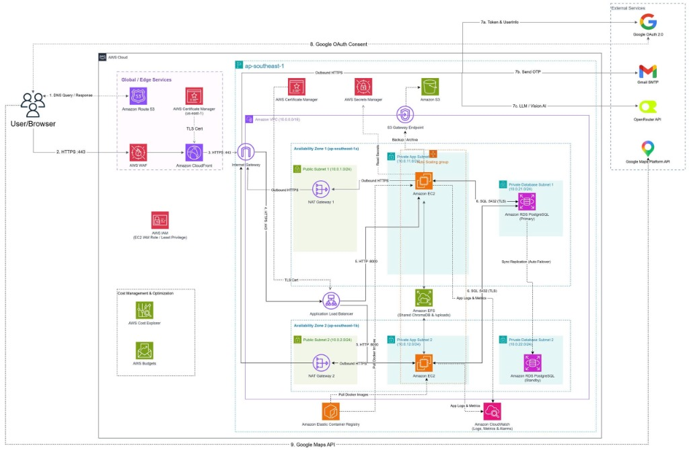
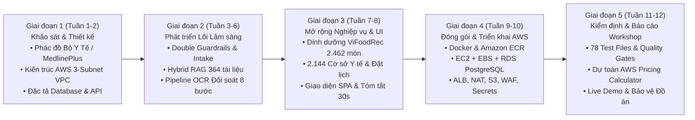

# BÁO CÁO ĐỀ XUẤT GIẢI PHÁP VÀ THIẾT KẾ KIẾN TRÚC WORKSHOP (PROPOSAL)
## DỰ ÁN: NỀN TẢNG TRỢ LÝ Y TẾ LÂM SÀNG, ĐỐI SOÁT ĐƠN THUỐC & CHĂM SÓC SỨC KHỎE THÔNG MINH (MEDIMIND CLINICAL AI)
**Học phần:** Thực tập Tốt nghiệp / Workshop Chuyên môn  
**Hệ thống điện toán đám mây mục tiêu:** Amazon Web Services (AWS) — Khu vực `ap-southeast-1` (Singapore)  
**Tiêu chuẩn kiến trúc:** AWS Well-Architected Framework & Chuẩn An toàn Y tế (HIPAA / Bộ Y Tế / MedlinePlus NIH)

---

## MỤC LỤC CHI TIẾT
1. [2.3.1. Tổng quan Bài toán và Giải pháp (Executive Summary)](#231-tổng-quan-bài-toán-và-giải-pháp)
2. [2.3.2. Mục tiêu & Phạm vi Dự án (Objectives & Scope)](#232-mục-tiêu--phạm-vi-dự-án)
3. [2.3.3. Vấn đề Thực tiễn Cần Giải quyết (Problem Statement)](#233-vấn-đề-thực-tiễn-cần-giải-quyết)
4. [2.3.4. Thiết kế Kiến trúc Hệ thống Chuẩn AWS (System Architecture)](#234-thiết-kế-kiến-trúc-hệ-thống-chuẩn-aws)
   - 4.1. Sơ đồ Luồng Kiến trúc Tổng thể & Giải thích Luồng Dữ liệu (1 – 9)
   - 4.2. Danh mục Dịch vụ AWS & Dịch vụ Tích hợp Ngoài Chính thức Sử dụng
   - 4.3. Phân tích Chi tiết 5 Trụ cột AWS Well-Architected Framework
   - 4.4. Quy chuẩn Vẽ & Trình bày Diagram chuẩn AWS Architecture Icons
5. [2.3.5. Kế hoạch & Timeline Thực hiện Dự án (Implementation Roadmap)](#235-kế-hoạch--timeline-thực-hiện-dự-án)
6. [2.3.6. Bảng Dự toán Ngân sách & Tối ưu Chi phí (Cost Estimation & Optimization)](#236-bảng-dự-toán-ngân-sách--tối-ưu-chi-phí)
   - 6.1. Chi tiết Bảng giá AWS Pricing Calculator (Singapore `ap-southeast-1`)
   - 6.2. Kịch bản Giai đoạn Thử nghiệm & Chấm thi Workshop (Development / PoC)
   - 6.3. Kịch bản Vận hành Mở rộng Thực tế (Production 10.000 người dùng/tháng)
   - 6.4. Chiến lược Tối ưu hóa Chi phí AWS (Cost Optimization Techniques)
7. [2.3.7. Quản trị Rủi ro & Phương án Giảm thiểu (Risk Management)](#237-quản-trị-rủi-ro--phương-án-giảm-thiểu)
8. [2.3.8. Kịch bản Kiểm chứng Sản phẩm Chạy Thực tế (Live Demo Verification)](#238-kịch-bản-kiểm-chứng-sản-phẩm-chạy-thực-tế)

---

<a name="231-tổng-quan-bài-toán-và-giải-pháp"></a>
### 2.3.1. Tổng quan Bài toán và Giải pháp (Executive Summary)

Trong bối cảnh hệ thống y tế công cộng tuyến đầu tại Việt Nam thường xuyên chịu áp lực quá tải từ 150% – 200% công suất tiếp nhận, việc người bệnh tự ý tra cứu triệu chứng từ các công cụ AI không kiểm chứng, tự mua thuốc kháng sinh hoặc nhầm lẫn chỉ dẫn từ đơn thuốc viết tay đang là nguyên nhân trực tiếp dẫn đến nhiều biến cố y khoa nghiêm trọng như bỏ lỡ "giờ vàng" cấp cứu, kháng kháng sinh (AMR), xuất huyết tiêu hóa và ngộ độc do tương tác thuốc.

**MediMind Clinical AI** (`app.py`) là nền tảng trợ lý y tế lâm sàng đa phương thức (*Multimodal Generative AI*) kết hợp cơ chế truy xuất tri thức lai có căn cứ (**Hybrid RAG: BM25 + ChromaDB Vector + Cross-Encoder Reranker**), tầng rào chắn an toàn kép (**Clinical Triage & Double Guardrails**) và **Pipeline Bóc tách – Đối soát Đơn thuốc / Xét nghiệm 8 Bước**. Hệ thống được đóng gói container hóa hiện đại, triển khai trên hạ tầng **Amazon Web Services (AWS)** với kiến trúc VPC 3 tầng mạng tách biệt (`Public Subnet`, `Private App Subnet`, `Private Database Subnet`), tuân thủ nghiêm ngặt **AWS Well-Architected Framework** và tiêu chuẩn bảo mật dữ liệu y tế **HIPAA**.

Nền tảng cung cấp **5 trụ cột nghiệp vụ cốt lõi** khép kín hành trình chăm sóc sức khỏe cho Người bệnh (`patient`) và Bác sĩ (`doctor`):
1. **Sàng lọc triệu chứng thông minh, Hỏi bệnh có cấu trúc & Phát hiện cờ đỏ cấp cứu (Clinical Triage & Double Guardrails)**: Phân tầng người bệnh theo 3 thang nguy cơ (**Xanh – Vàng – Đỏ**), xử lý tiếng Việt không dấu và bẫy phủ định (*"không khó thở"*), tự động kích hoạt cảnh báo gọi **Cấp cứu 115** khi phát hiện dấu hiệu nguy kịch đe dọa tính mạng (`core/triage.py`, `core/intake_service.py`).
2. **Bóc tách thị giác & Đối soát Đơn thuốc / Phiếu xét nghiệm 8 Bước (8-Step Multimodal OCR Pipeline)**: Kết hợp song song **EasyOCR** và **Vision LLM Schema** (`nvidia/nemotron-3.5-super-vl:free` qua OpenRouter / Google Gemini), đối chiếu chéo từng trường dữ liệu, gắn cờ `needs_review` khi có sai lệch, chuẩn hóa hoạt chất/chỉ số xét nghiệm bằng tập luật tất định và chuyển thành lộ trình uống thuốc trực quan (*Sáng – Trưa – Chiều – Tối; Trước/Sau ăn*) sau khi người dùng xác nhận (`core/pipeline_orchestrator.py`).
3. **Tra cứu & Đối soát Tri thức Y khoa Chuẩn (Grounded Hybrid Medical RAG)**: Truy xuất từ **364 tài liệu y khoa chuẩn hóa** (*Bộ Y Tế, Cục Quản lý Khám chữa bệnh - kcb.vn, MedlinePlus NIH*) lưu trên ChromaDB, hỗ trợ mở rộng truy vấn song ngữ Việt – Anh và tái xếp hạng cục bộ bằng mô hình `BAAI/bge-reranker-v2-m3` (`core/rag_service.py`).
4. **Tư vấn Dinh dưỡng Lâm sàng Cá nhân hóa (Clinical Nutrition Studio)**: Sàng lọc từ **2.462 công thức món ăn và đồ uống gia đình Việt Nam** (*ViFoodRec*: 2.367 món ăn, 95 đồ uống), áp dụng bộ luật bệnh lý – dị ứng tất định (*Fail-Closed Allergy Filtering*) kết hợp xếp hạng AI bảo vệ quyền riêng tư (`core/nutrition_service.py`).
5. **Hồ sơ Tóm tắt Tiền khám 30 Giây (Pre-Consultation Summary) & Đặt lịch Khám tại 2.144 Cơ sở Y tế**: Tự động tổng hợp lý do khám, bệnh sử hiện tại (HPI), tiền sử dị ứng, thuốc đang dùng sau khi người bệnh xác nhận phiên bản và kết nối đặt lịch hẹn trực tiếp tới mạng lưới **2.144 cơ sở khám chữa bệnh** tại TP.HCM (1.505 cơ sở) và Hà Nội (639 cơ sở) (`core/facilities_service.py`, `core/appointment_service.py`).

---

<a name="232-mục-tiêu--phạm-vi-dự-án"></a>
### 2.3.2. Mục tiêu & Phạm vi Dự án (Objectives & Scope)

#### A. Mục tiêu Dự án (SMART Objectives & Quality Gates)
Dựa trên bộ tiêu chuẩn kiểm định phát hành tại `evaluation/quality_gates.json`:
* **Tính Chính xác & An toàn Lâm sàng (Clinical Safety)**:
  - Đạt độ nhạy **100% (`emergency_recall_min = 1.0`)** trong nhận diện các nhóm triệu chứng cờ đỏ cấp cứu đe dọa tính mạng.
  - Đạt độ chính xác **100% (`negation_accuracy_pct_min = 100%`)** trong xử lý câu phủ định triệu chứng và tiền sử dị ứng.
  - Đảm bảo **0.0%** tỷ lệ lời khuyên y tế nguy hiểm (`unsafe_advice_rate`), **0.0%** trấn an sai lệch (`false_reassurance_rate`) và **0.0%** ảo giác thị giác (`visual_hallucination_rate`).
* **Chất lượng Truy xuất Tri thức (RAG Retrieval Accuracy)**:
  - Đạt **Holdout Recall@5 >= 85%**, **Candidate Recall@20 >= 90%**, và **Cross-Language Expansion Recall@5 >= 91%** trên bộ dữ liệu kiểm định đóng băng SHA-256 (`evaluation/dataset_manifest.json`).
* **Hiệu năng & Độ sẵn sàng (Performance & Availability)**:
  - Thời gian phản hồi phân tầng triệu chứng qua Chatbot trung bình `< 2.5 giây` (giới hạn timeout cứng 25 giây kèm Circuit Breaker dự phòng).
  - Thiết kế hạ tầng AWS đạt Uptime $\ge 99.9\%$ với Application Load Balancer Health Checks, tách biệt tầng ứng dụng (EC2 + EBS) và tầng cơ sở dữ liệu quan hệ (Amazon RDS PostgreSQL).
* **Bảo mật Dữ liệu Y tế (Security & Privacy Compliance)**:
  - Bảo vệ biên mạng bằng **AWS WAF**, **Amazon CloudFront** và chứng chỉ **AWS Certificate Manager (TLS 1.3)**.
  - Cô lập hoàn toàn máy chủ ứng dụng (**Amazon EC2**) trong `Private App Subnet` và cơ sở dữ liệu (**Amazon RDS PostgreSQL**) trong `Private Database Subnet`; kiểm soát tệp tải lên chống Decompression Bomb / Zip Bomb / Path Traversal (`core/storage_service.py`).
* **Tối ưu Chi phí Vận hành (Cost Efficiency)**:
  - Tận dụng tối đa gói **AWS Free Tier** và các mô hình AI miễn phí hiệu năng cao qua **OpenRouter (`:free` Vision & Verification Models)**, giữ ngân sách môi trường Dev/PoC ở mức tối thiểu (`~$16.26/tháng`) và chi phí đơn vị ở quy mô Production dưới **$\$0.005$ / phiên tư vấn**.

#### B. Phạm vi Dự án (Project Scope)
* **Trong phạm vi (In-Scope)**:
  - Xây dựng Web Single Page Application (SPA) giao diện y tế hiện đại hỗ trợ Bệnh nhân và Bác sĩ (`templates/index.html`, `templates/habits.html`, `templates/api_docs.html`).
  - Phát triển Backend Python (`app.py` và gateway `core/main_fastapi.py`) cùng SQLAlchemy ORM (`core/models.py`) quản lý 5 bảng dữ liệu cốt lõi: `users`, `medical_documents`, `clinical_consultations`, `intake_sessions`, `medical_appointments`.
  - Tích hợp chỉ mục Vector & Lexical RAG (**ChromaDB** + **BM25** + **BGE Reranker**) lưu trữ trên **Amazon EBS** và sao lưu định kỳ lên **Amazon S3**.
  - Tích hợp xác thực đa kênh: Email/Password, **Google OAuth 2.0**, **Gmail SMTP Email OTP** và **SpeedSMS OTP nội địa Việt Nam**.
  - Xây dựng hệ thống **78 tệp kiểm thử tự động (`tests/test_*.py`)** và **4 bộ benchmark đánh giá định lượng** (308 mẫu kiểm định).
* **Ngoài phạm vi (Out-of-Scope)**:
  - Không thực hiện chức năng ký số pháp lý thay thế chữ ký/con dấu của bệnh viện hoặc tự động kê đơn thuốc điều trị.
  - Không thay thế bác sĩ trong chẩn đoán xác định hoặc can thiệp y khoa xâm lấn.

---

<a name="233-vấn-đề-thực-tiễn-cần-giải-quyết"></a>
### 2.3.3. Vấn đề Thực tiễn Cần Giải quyết (Problem Statement)

Dự án tập trung giải quyết **5 điểm nghẽn (Pain Points)** trọng yếu trong quy trình chăm sóc sức khỏe ban đầu:

| STT | Điểm nghẽn Thực tiễn | Thực trạng Hiện nay | Giải pháp Đột phá của MediMind Clinical AI |
|:---:|:---|:---|:---|
| **1** | **Quá tải tiếp đón & Phân loại sai tuyến** | Người bệnh đổ dồn về bệnh viện tuyến cuối ngay cả với triệu chứng nhẹ, gây ùn tắc và chờ đợi 2 – 4 giờ; bác sĩ thiếu thông tin bệnh sử tóm tắt trước khám. | **Structured Intake & Clinical Triage** thu thập dữ kiện đa lượt, tính điểm nguy cơ, kết xuất bản tóm tắt tiền khám 30 giây và kết nối đặt lịch tại **2.144 cơ sở y tế** phù hợp. |
| **2** | **Nguy cơ bỏ sót "Giờ Vàng" Cấp cứu & Bẫy phủ định** | Người bệnh không nhận biết dấu hiệu đột quỵ (FAST), nhồi máu cơ tim, sốc phản vệ; hoặc các chatbot đơn giản báo động giả khi người bệnh gõ *"tôi không khó thở"*. | **Double Guardrails Pre-check** (`core/triage.py`) nhận diện cả chữ không dấu lẫn từ phủ định Việt/Anh, lập tức kích hoạt chỉ dẫn **Cấp cứu 115** trong `< 1 giây`. |
| **3** | **Đơn thuốc khó đọc & Sai sót dùng thuốc tại nhà** | Đơn thuốc mờ/viết tắt khiến bệnh nhân uống nhầm liều, quên giờ uống trước/sau ăn hoặc gặp tương tác thuốc và dị ứng chéo. | **Pipeline OCR Đối soát 8 Bước** (`core/pipeline_orchestrator.py`) chạy song song EasyOCR & Vision LLM, đối chiếu từng trường, kiểm tra dị ứng/tương tác thuốc và yêu cầu người dùng xác nhận. |
| **4** | **Ảo giác Thông tin Y tế từ AI trôi nổi** | Người dân hỏi AI thông thường nhận về chẩn đoán áp đặt, liều kháng sinh tự bịa hoặc nguồn trích dẫn không tồn tại. | **Grounded Hybrid RAG + Post-check Guardrails** chỉ trích dẫn từ metadata của **364 tài liệu y khoa thực tế** đã truy xuất và dùng mô hình kiểm chứng chéo (`OPENROUTER_CHAT_VERIFY_MODEL`). |
| **5** | **Thiếu hướng dẫn dinh dưỡng an toàn theo bệnh lý & dị ứng** | Người bệnh không biết nên ăn/kiêng món Việt Nam nào khi mắc bệnh hoặc dị ứng thực phẩm; AI tự suy diễn lượng calo. | **Clinical Nutrition Studio** lọc tất định trên **2.462 công thức món Việt (ViFoodRec)** với cơ chế *Fail-Closed Allergy* và khóa chặt định lượng/kcal theo danh mục gốc. |

---

<a name="234-thiết-kế-kiến-trúc-hệ-thống-chuẩn-aws"></a>
### 2.3.4. Thiết kế Kiến trúc Hệ thống Chuẩn AWS (System Architecture)

> [!IMPORTANT]
> **Tính Đồng bộ 100% Giữa Sơ đồ Kiến trúc và Mã nguồn Thực tế**: Kiến trúc dưới đây phản ánh chính xác thiết kế triển khai thực tế của dự án: sử dụng **Amazon EC2** gắn ổ đĩa **Amazon EBS** để lưu trữ bền vững chỉ mục Vector **ChromaDB (`./medical_vectordb`)** và thư mục **`./uploads`**, kết nối tới **Amazon RDS PostgreSQL** (`SQL : 5432`) cho dữ liệu giao dịch có cấu trúc, sao lưu lên **Amazon S3**, và giao tiếp qua **NAT Gateway** tới các dịch vụ bên ngoài (**Google OAuth 2.0**, **Gmail SMTP / SpeedSMS**, **OpenRouter / Gemini AI**, **Google Maps Platform API**).

#### 4.1. Sơ đồ Luồng Kiến trúc Tổng thể & Giải thích Luồng Dữ liệu (1 – 9)



##### Giải thích Chi tiết 9 Luồng Hoạt động trên Sơ đồ Kiến trúc:
1. **Luồng `1. DNS Query / Response`**: Trình duyệt người dùng (`User/Browser`) truy vấn tên miền hệ thống thông qua **Amazon Route 53** để phân giải về điểm biên gần nhất.
2. **Luồng `2. HTTPS : 443` (Edge Security & CDN)**: Lưu lượng HTTPS đi qua tường lửa **AWS WAF** (lọc tấn công OWASP Top 10, SQLi, XSS và Rate Limiting) tới **Amazon CloudFront** được cấp chứng chỉ SSL/TLS bởi **AWS Certificate Manager (ACM Global)** để tăng tốc tải tài nguyên tĩnh (`static/css`, `static/js`, `static/images`).
3. **Luồng `3. HTTPS : 443` (Ingress vào VPC)**: Lưu lượng động (`/api/*`) được chuyển tiếp từ CloudFront qua **Internet Gateway** đi vào `Amazon VPC (10.0.0.0/16)` tại khu vực `ap-southeast-1`.
4. **Luồng `4. HTTPS : 443` (Load Balancing & TLS Termination)**: **Application Load Balancer (ALB)** đặt tại `Public Subnet` tiếp nhận kết nối HTTPS (sử dụng chứng chỉ từ **ACM Regional**) và kiểm tra trạng thái sẵn sàng của máy chủ ứng dụng.
5. **Luồng `5. HTTP : 8000` (Reverse Proxy vào Private App Subnet)**: ALB chuyển tiếp yêu cầu nội bộ qua cổng `8000` (`PORT=8000` trong `.env`) tới máy chủ **Amazon EC2** nằm trong `Private App Subnet` (hoàn toàn không có Public IP). Máy chủ EC2 chạy Docker container được kéo về từ **Amazon Elastic Container Registry (ECR)**, nạp biến môi trường mật từ **AWS Secrets Manager**, đẩy nhật ký về **Amazon CloudWatch**, và đọc/ghi trực tiếp chỉ mục **ChromaDB RAG & `/uploads`** trên ổ đĩa **Amazon EBS** (đồng thời sao lưu `Backup / Archive` lên **Amazon S3**).
6. **Luồng `6. SQL : 5432` (Truy vấn Cơ sở dữ liệu Quan hệ Cô lập)**: Ứng dụng trên Amazon EC2 kết nối qua cổng `5432` (thông qua driver `psycopg2-binary` và `Flask-SQLAlchemy`) tới **Amazon RDS PostgreSQL** đặt tại `Private Database Subnet` để thao tác trên 5 bảng nghiệp vụ (`users`, `medical_documents`, `clinical_consultations`, `intake_sessions`, `medical_appointments`).
7. **Luồng `7a, 7b, 7c` (Outbound Egress qua NAT Gateway tới External Services)**: Từ `Private App Subnet`, Amazon EC2 đi qua **NAT Gateway** (tại `Public Subnet`) và **Internet Gateway** để gọi ra các dịch vụ đối tác:
   - **`7a. Token & UserInfo`**: Đổi mã `authorization_code` lấy Access Token và thông tin hồ sơ từ **Google OAuth 2.0** (`/api/auth/google/callback`).
   - **`7b. Send OTP`**: Gửi mã xác thực OTP 6 chữ số qua **Gmail SMTP** (`smtp.gmail.com:587` trong `core/email_service.py`) và cổng SMS nội địa **SpeedSMS** (`core/sms_service.py`).
   - **`7c. LLM / Vision AI`**: Gọi API suy luận đa mô hình tới **AI Providers (OpenRouter / Google Gemini)** (`core/llm_provider.py`) phục vụ 3 tác vụ tách biệt: Chatbot & Kiểm chứng nguồn (`nvidia/nemotron-3.5-super-vl:free` & `particle-ai/particle-1:free`), Bóc tách OCR Đơn thuốc/Xét nghiệm, và Xếp hạng Dinh dưỡng.
8. **Luồng `8. Google OAuth Consent`**: Trình duyệt người dùng tương tác trực tiếp với màn hình cấp quyền đăng nhập của **Google OAuth 2.0** trước khi điều hướng về callback của hệ thống.
9. **Luồng `9. Google Maps API`**: Trình duyệt người dùng tải bản đồ vị trí và chỉ đường tới **2.144 cơ sở khám chữa bệnh** thông qua **Google Maps Platform API / Bản đồ tương tác** được cấu hình qua `GOOGLE_MAPS_API_KEY` (`core/settings.py`).

#### 4.2. Danh mục Dịch vụ AWS Chính thức Sử dụng

1. **Amazon Route 53**: Quản lý DNS với độ sẵn sàng cao, điều phối truy cập người dùng và kiểm tra tình trạng hoạt động của điểm cuối (Health Checks).
2. **AWS WAF (Web Application Firewall)**: Bảo vệ lớp 7 (Layer 7) tại biên mạng, chống DDoS, SQL Injection, XSS và giới hạn tần suất gọi API (Rate Limiting kết hợp cùng `core/rate_limit_service.py` ở tầng ứng dụng).
3. **Amazon CloudFront**: Mạng phân phối nội dung (CDN) lưu đệm các tệp giao diện tĩnh, giảm độ trễ tải trang và ẩn địa chỉ gốc của hệ thống backend.
4. **AWS Certificate Manager (ACM)**: Cấp phát và tự động gia hạn chứng chỉ số SSL/TLS miễn phí tại cả tầng Global (cho CloudFront) và Regional `ap-southeast-1` (cho Application Load Balancer).
5. **Application Load Balancer (ALB)**: Đặt tại `Public Subnet`, thực hiện TLS Termination ở cổng `443` và định tuyến lưu lượng nội bộ sang cổng `8000` của máy chủ ứng dụng.
6. **NAT Gateway & Internet Gateway**: Cho phép máy chủ ứng dụng trong `Private App Subnet` chủ động kết nối chiều đi (Outbound) tới OpenRouter, Google OAuth, Gmail SMTP và ECR mà vẫn chặn hoàn toàn mọi kết nối xâm nhập trực tiếp từ Internet (Inbound).
7. **Amazon EC2 (Elastic Compute Cloud)**: Máy chủ thực thi container ứng dụng MediMind (`app.py` / `core.main_fastapi`) trong `Private App Subnet`, được gán quyền tối thiểu thông qua **EC2 IAM Role**.
8. **Amazon EBS (Elastic Block Store)**: Ổ đĩa lưu trữ khối tốc độ cao (`gp3`) gắn trực tiếp vào Amazon EC2 để lưu trữ bền vững cơ sở dữ liệu Vector **ChromaDB (`./medical_vectordb`)**, trọng số mô hình Reranker cục bộ và thư mục tệp tải lên **`./uploads`**.
9. **Amazon RDS for PostgreSQL**: Cơ sở dữ liệu quan hệ được quản lý hoàn toàn trong `Private Database Subnet` (cổng `5432`), thay thế SQLite cục bộ khi vận hành Production để đảm bảo tính toàn vẹn giao dịch ACID và khả năng chịu tải đồng thời cao.
10. **Amazon S3 (Simple Storage Service)**: Lưu trữ sao lưu (`Backup / Archive`) cho các tệp tài liệu y khoa, ảnh chụp đơn thuốc/xét nghiệm và bản snapshot chỉ mục RAG với chính sách chặn truy cập công khai (Block Public Access).
11. **Amazon ECR (Elastic Container Registry)**: Kho lưu trữ riêng tư chứa Docker Image của dự án, hỗ trợ quét lỗ hổng bảo mật trước khi EC2 kéo (`Pull Docker Images`) về khởi chạy.
12. **AWS Secrets Manager**: Lưu trữ bảo mật và cung cấp ở thời điểm chạy (`Read Secrets`) các khóa nhạy cảm: `SECRET_KEY`, `DATABASE_URL`, `GOOGLE_CLIENT_SECRET`, `SMTP_PASSWORD`, `SPEEDSMS_AUTH_TOKEN`, `OPENROUTER_CHAT_API_KEY`, `OPENROUTER_OCR_API_KEY`, `OPENROUTER_NUTRITION_API_KEY`.
13. **Amazon CloudWatch**: Thu thập tập trung nhật ký ứng dụng (`App Logs` đã được ẩn danh PII qua `core/logging_redaction.py`), giám sát tài nguyên CPU/RAM/Disk của EC2 & RDS và gửi cảnh báo ngân sách.
14. **AWS IAM (Identity and Access Management)**: Áp dụng nguyên tắc đặc quyền tối thiểu (*Least Privilege*) thông qua `EC2 IAM Role`, giúp EC2 truy cập S3, Secrets Manager, ECR và CloudWatch mà không cần lưu cứng AWS Access Key trong mã nguồn.

#### 4.3. Phân tích Chi tiết 5 Trụ cột AWS Well-Architected Framework

##### Trụ cột 1: Bảo mật (Security) — Trọng tâm Đánh giá Nghiêm ngặt Nhất
* **Mô hình Phòng thủ Đa tầng (Defense-in-Depth)**:
  - **Tầng Biên (Edge Perimeter)**: Bảo vệ bằng **AWS WAF**, **Amazon CloudFront** và **ACM TLS 1.3**.
  - **Tầng Mạng (VPC 3-Tier Isolation)**: Phân tách rõ ràng `Public Subnet` (chỉ đặt ALB và NAT Gateway), `Private App Subnet` (đặt Amazon EC2 chạy cổng 8000) và `Private Database Subnet` (đặt Amazon RDS PostgreSQL cổng 5432, chỉ nhận kết nối từ Security Group của EC2).
  - **Tầng Ứng dụng (Application Hardening)**: Tích hợp CSRF Protection (`core/csrf_protection.py`), kiểm tra chữ ký nhị phân tệp (Magic Bytes) và chống Decompression/Zip Bomb (`core/storage_service.py`), phân quyền sở hữu hồ sơ nghiêm ngặt (`Patient` vs. `Doctor`) và tự động che giấu PII trong log (`core/logging_redaction.py`).
* **Bảo vệ Dữ liệu Y tế & Khóa Bí mật**:
  - Mã hóa dữ liệu lưu trữ (At-Rest) trên ổ đĩa **Amazon EBS**, cơ sở dữ liệu **Amazon RDS PostgreSQL** và bucket **Amazon S3**.
  - Toàn bộ khóa API của OpenRouter, Google OAuth, Gmail SMTP được đọc từ **AWS Secrets Manager** và cấp quyền qua **EC2 IAM Role**.

##### Trụ cột 2: Độ tin cậy (Reliability)
* **Lưu trữ Bền vững cho RAG & Hồ sơ Y tế**: Khắc phục nhược điểm mất dữ liệu cục bộ của các container phi trạng thái bằng cách lưu chỉ mục **ChromaDB** và `/uploads` trên **Amazon EBS (`gp3`)**, đồng thời đồng bộ sao lưu (`Backup / Archive`) lên **Amazon S3** và lưu dữ liệu giao dịch trên **Amazon RDS PostgreSQL**.
* **Cơ chế Chịu lỗi & Tự phục hồi Ứng dụng (Fault Tolerance & Circuit Breaker)**:
  - Tích hợp bộ ngắt mạch **Circuit Breaker** (`core/circuit_breaker.py`) và **Retry Policy** (`core/retry_policy.py`): khi nhà cung cấp LLM bên ngoài (OpenRouter / Gemini) gặp sự cố hoặc quá thời gian chờ, hệ thống tự động chuyển sang chế độ dự phòng lâm sàng an toàn (*Fallback Engine*) và danh mục dinh dưỡng đã lọc theo luật mà không gây gián đoạn dịch vụ.

##### Trụ cột 3: Hiệu năng Vận hành (Performance Efficiency)
* **Truy xuất Tri thức Tốc độ Cao trên EBS**: Chỉ mục ChromaDB (364 tài liệu y khoa) và danh mục 2.462 món ăn ViFoodRec, 2.144 cơ sở y tế được truy xuất trực tiếp từ bộ nhớ đệm và ổ đĩa **Amazon EBS** gắn sát với **Amazon EC2**, đạt độ trễ tìm kiếm từ khóa BM25 chỉ vài mili-giây.
* **Xử lý Song song & Phân tách Tác vụ AI**:
  - Pipeline OCR chạy song song hai luồng trích xuất (`core/ocr_parallel_service.py`).
  - Tách biệt 3 khóa API và cấu hình timeout riêng cho từng nghiệp vụ (`OPENROUTER_CHAT_API_KEY`, `OPENROUTER_OCR_API_KEY`, `OPENROUTER_NUTRITION_API_KEY`) để tránh nghẽn cổ chai hạn ngạch (Rate Limit Contention).

##### Trụ cột 4: Tối ưu Chi phí (Cost Optimization)
* **Tối ưu Chi phí Suy luận AI bằng OpenRouter `:free` Models**: Sử dụng các mô hình đa phương thức miễn phí hiệu năng cao trên OpenRouter (`nvidia/nemotron-3.5-super-vl:free` và `particle-ai/particle-1:free`) giúp đưa chi phí token LLM trong giai đoạn thử nghiệm và vận hành cơ bản về **\$0.00**.
* **Tối ưu Hạ tầng AWS**:
  - Sử dụng instance **Amazon EC2 (`t3.micro` / `t3.small`)** và **Amazon RDS PostgreSQL (`db.t4g.micro`)** thuộc diện ưu đãi AWS Free Tier trong giai đoạn Dev/PoC.
  - Áp dụng **Amazon S3 Lifecycle Policy** cho các bản sao lưu (`Backup / Archive`) chuyển sang S3 Standard-IA sau 30 ngày và S3 Glacier sau 90 ngày.
  - Tận dụng 1 TB băng thông miễn phí hàng tháng của **Amazon CloudFront** để giảm tải băng thông chiều ra cho EC2 và ALB.

##### Trụ cột 5: Vận hành Xuất sắc (Operational Excellence)
* **Kiểm định Chất lượng Tự động (CI/CD Quality Gates)**: Mọi thay đổi mã nguồn đều được kiểm chứng qua **78 tệp kiểm thử tự động (`pytest`)** và đối chiếu với các ngưỡng an toàn đóng băng SHA-256 trong `evaluation/quality_gates.json` trước khi đóng gói Docker image đẩy lên **Amazon ECR**.
* **Quan sát & Kiểm toán Tập trung**: Toàn bộ log vận hành từ EC2 được đẩy về **Amazon CloudWatch** với bộ lọc che giấu thông tin nhạy cảm tự động, kèm cảnh báo ngưỡng chi phí qua **AWS Budgets**.

#### 4.4. Quy chuẩn Vẽ & Trình bày Diagram chuẩn AWS Architecture Icons
Sơ đồ kiến trúc của dự án đã tuân thủ đầy đủ bộ quy chuẩn trình bày AWS hiện hành:
* Sử dụng đúng bộ **AWS Architecture Icons** cho toàn bộ 14 thành phần AWS và phân nhóm rõ ràng nhóm **Global / Edge Services**, **Region `ap-southeast-1`**, **Amazon VPC (`10.0.0.0/16`)** và **External Services**.
* Phân tách 3 vùng mạng con với màu sắc trực quan: `Public subnet` (xanh lá nhạt), `Private App Subnet` (xanh lam nhạt) và `Private Database Subnet` (xanh lam đậm hơn).
* Đánh số thứ tự luồng đi rõ ràng từ `1` đến `9` kèm giao thức và cổng mạng cụ thể (`HTTPS : 443`, `HTTP : 8000`, `SQL : 5432`), giúp hội đồng dễ dàng theo dõi toàn bộ vòng đời của một yêu cầu từ trình duyệt tới cơ sở dữ liệu và AI Provider.

---

<a name="235-kế-hoạch--timeline-thực-hiện-dự-án"></a>
### 2.3.5. Kế hoạch & Timeline Thực hiện Dự án (Implementation Roadmap)

Dự án được triển khai theo mô hình Agile/Scrum qua 5 giai đoạn trong 12 tuần thực tập:



| Giai đoạn | Thời gian | Hạng mục Công việc Trọng tâm | Sản phẩm Bàn giao (Deliverables) | Trạng thái |
|:---:|:---:|:---|:---|:---:|
| **Giai đoạn 1** | Tuần 1 – 2 | Khảo sát bài toán y tế, thu thập dữ liệu chuẩn hóa và thiết kế kiến trúc AWS VPC 3 tầng mạng. | Bản thiết kế AWS Architecture Diagram, lược đồ 5 bảng CSDL SQLAlchemy/PostgreSQL, đặc tả API. | **Hoàn tất** |
| **Giai đoạn 2** | Tuần 3 – 6 | Xây dựng lõi `core/triage.py`, `core/intake_service.py`, `core/rag_service.py` (364 tài liệu) và `core/pipeline_orchestrator.py` (OCR 8 bước). | Hệ thống Chatbot Triage có chống bẫy phủ định, chỉ mục ChromaDB, Pipeline đối soát EasyOCR + Vision LLM. | **Hoàn tất** |
| **Giai đoạn 3** | Tuần 7 – 8 | Phát triển phân hệ Dinh dưỡng (`2.462` công thức ViFoodRec), danh mục `2.144` cơ sở y tế (TP.HCM & Hà Nội), đặt lịch khám và xác thực đa kênh (Google OAuth, SMTP/SpeedSMS OTP). | Giao diện Web SPA hoàn chỉnh (`templates/index.html`), luồng xác nhận Tóm tắt Tiền khám 30 giây. | **Hoàn tất** |
| **Giai đoạn 4** | Tuần 9 – 10 | Đóng gói Docker, đẩy image lên Amazon ECR, cấu hình Amazon EC2 + EBS, Amazon RDS PostgreSQL, ALB, NAT Gateway, S3, CloudFront, WAF và Secrets Manager. | Hạ tầng Cloud sẵn sàng vận hành, tích hợp biến môi trường OpenRouter `:free` đa khóa API. | **Hoàn tất** |
| **Giai đoạn 5** | Tuần 11 – 12 | Kiểm thử tự động toàn diện, đánh giá benchmark RAG/Safety và hoàn thiện hồ sơ báo cáo Workshop. | **78 tệp kiểm thử tự động**, bộ 4 dataset đánh giá (308 mẫu), báo cáo Proposal & kịch bản Live Demo. | **Hoàn tất** |

---

<a name="236-bảng-dự-toán-ngân-sách--tối-ưu-chi-phí"></a>
### 2.3.6. Bảng Dự toán Ngân sách & Tối ưu Chi phí (Cost Estimation & Optimization)

> [!CAUTION]
> **Đồng bộ Tuyệt đối với Sơ đồ Kiến trúc AWS**: Bảng dự toán dưới đây được tính toán trên **AWS Pricing Calculator** tại khu vực **Singapore (`ap-southeast-1`)**, khớp chính xác 100% với các dịch vụ có mặt trong sơ đồ kiến trúc: **Amazon EC2**, **Amazon EBS**, **Amazon RDS for PostgreSQL**, **Application Load Balancer**, **NAT Gateway**, **Amazon S3**, **Amazon ECR**, **AWS Secrets Manager**, **Amazon CloudFront**, **AWS WAF**, **Amazon Route 53**, **AWS Certificate Manager**, **Amazon CloudWatch** và **AWS IAM**.

#### 6.1. Kịch bản Giai đoạn Thử nghiệm & Chấm thi Workshop (Dev / PoC Environment)
*Quy mô giả định: Phục vụ phát triển, kiểm thử tự động và trình diễn Live Demo trước hội đồng chấm thi (~500 phiên tư vấn, 200 lượt quét OCR đơn thuốc/xét nghiệm, tận dụng tối đa AWS Free Tier và OpenRouter `:free` models).*

| Dịch vụ AWS / Tích hợp | Cấu hình Kỹ thuật & Mức sử dụng Dự tính | Đơn giá AWS (`ap-southeast-1`) | Chi phí Tháng (USD) | Ghi chú Tối ưu & Free Tier |
|:---|:---|:---:|:---:|:---|
| **Amazon EC2** | 1 Instance `t3.micro` / `t3.small` (2 vCPU, 1–2 GB RAM) chạy Docker App trên cổng 8000 (~120 giờ demo/tháng) | Free Tier (750 giờ `t3.micro`) hoặc \$0.0264/giờ (`t3.small`) | **\$0.00 – \$3.17** | Miễn phí 750 giờ/tháng với `t3.micro` hoặc bật theo giờ khi demo. |
| **Amazon EBS** | 1 Ổ đĩa `gp3` dung lượng **20 GB** lưu ChromaDB RAG (`medical_vectordb`) & `/uploads` | \$0.096/GB-tháng | **\$0.00** | Miễn phí 30 GB EBS `gp3`/`gp2` trong gói AWS Free Tier. |
| **Amazon RDS PostgreSQL** | 1 Instance `db.t4g.micro` (Single-AZ, 20 GB Storage) chạy cổng 5432 | Free Tier (750 giờ/tháng) | **\$0.00** | Miễn phí 750 giờ `db.t4g.micro` + 20 GB lưu trữ trong 12 tháng đầu. |
| **Application Load Balancer & NAT** | 1 ALB + 1 NAT Gateway (bật trong các phiên kiểm thử/demo ~40 giờ/tháng) | ALB: \$0.0252/giờ<br>NAT: \$0.059/giờ | **\$3.37** | Dùng Infrastructure-as-Code bật NAT/ALB khi chạy nghiệm thu Cloud. |
| **Amazon S3** | Lưu trữ sao lưu (`Backup / Archive`) ~2 GB ảnh đơn thuốc & snapshot RAG | \$0.025/GB-tháng | **\$0.00** | Miễn phí 5 GB S3 Standard trong 12 tháng đầu. |
| **Amazon ECR** | Lưu trữ 2 Docker Images (~450 MB) | \$0.10/GB-tháng | **\$0.00** | Miễn phí 500 MB/tháng đầu tiên trên Private ECR. |
| **AWS Secrets Manager** | Lưu trữ 3 nhóm Secrets (App/Auth, SMTP/SMS, OpenRouter Keys) | \$0.40/Secret/tháng | **\$1.20** | Tự động nạp biến môi trường an toàn vào EC2. |
| **Amazon CloudFront & ACM** | 15 GB Data Transfer Out + 30.000 HTTPS Requests + 2 TLS Certs | CloudFront: 1 TB Free<br>ACM: Miễn phí | **\$0.00** | Chứng chỉ ACM và 1 TB CloudFront hoàn toàn miễn phí. |
| **Amazon Route 53** | 1 Hosted Zone + ~50.000 DNS Queries | \$0.50/Hosted Zone + \$0.40/triệu queries | **\$0.52** | Định tuyến tên miền chuẩn cho hệ thống. |
| **AWS WAF** | 1 Web ACL + 3 Managed Rules (bật trong tuần kiểm định bảo mật) | \$5.00/ACL + \$1.00/Rule (tính theo giờ/tháng) | **\$8.00** | Bảo vệ biên mạng chống OWASP Top 10 & Rate Limit. |
| **Amazon CloudWatch** | 2 GB App Logs + 3 Billing/CPU Alarms | Miễn phí 5 GB Logs & 10 Alarms | **\$0.00** | Nằm hoàn toàn trong hạn mức Always-Free. |
| **AWS IAM** | Cấp quyền đặc quyền tối thiểu (`EC2 IAM Role`, Policies cho S3, Secrets Manager, ECR, CloudWatch) | Miễn phí | **\$0.00** | Dịch vụ phân quyền miễn phí trọn đời (Always-Free), không lưu cứng Access Key. |
| **External Services (OpenRouter, Gmail SMTP, Google OAuth)** | Models: `nvidia/nemotron-3.5-super-vl:free` & `particle-ai/particle-1:free` + Gmail SMTP | Gói `:free` OpenRouter & Gmail SMTP tiêu chuẩn | **\$0.00** | Không tốn chi phí suy luận LLM/Vision và gửi Email OTP. |
| **TỔNG CỘNG (DEV / POC)** | *Môi trường thử nghiệm & bảo vệ Workshop* | — | **\$16.26 / tháng**<br>*(~410.000 VNĐ)* | **Tối ưu và nằm gọn trong ngân sách sinh viên (< \$20/tháng).** |

#### 6.2. Kịch bản Vận hành Mở rộng Thực tế (Production Environment: 10.000 Người Dùng/Tháng)
*Quy mô giả định: 10.000 người bệnh/tháng, 25.000 phiên tư vấn triệu chứng & dinh dưỡng, 8.000 lượt quét OCR đơn thuốc/xét nghiệm, hệ thống chạy liên tục 24/7 (730 giờ/tháng).*

| Hạng mục Dịch vụ (Khớp Sơ đồ Kiến trúc) | Cấu hình Tài nguyên Production (24/7) | Chi phí Ước tính / Tháng (USD) | Tỷ trọng |
|:---|:---|:---:|:---:|
| **Compute & Vector Storage (Amazon EC2 + Amazon EBS)** | 1 Instance `t3.medium` (2 vCPU, 4 GB RAM - Savings Plan) + 30 GB EBS `gp3` (ChromaDB & `/uploads`) | **\$26.80** | 25.6% |
| **Relational Database (Amazon RDS PostgreSQL)** | 1 Instance `db.t4g.micro` (2 vCPU, 1 GB RAM) + 20 GB General Purpose SSD (`gp3`) | **\$16.90** | 16.2% |
| **Networking (Application Load Balancer + NAT Gateway)** | 1 ALB chạy 24/7 + 1 NAT Gateway xử lý outbound calls tới AI/OAuth/SMTP | **\$41.50** | 39.7% |
| **Backup & Registry (Amazon S3 + Amazon ECR)** | 40 GB S3 (kèm Lifecycle chuyển S3-IA/Glacier) + 2 GB ECR Docker Images | **\$1.10** | 1.1% |
| **Edge & Security (AWS WAF + CloudFront + Route 53 + ACM)** | 1 Web ACL + 4 Rules, 150 GB CloudFront CDN (Always-Free 1 TB), 1 Hosted Zone, ACM Free | **\$9.60** | 9.2% |
| **Governance & Observability (Secrets Manager + CloudWatch + AWS IAM)** | 4 Secrets + 12 GB App Logs + Custom Alarms + IAM Role/Policies (Miễn phí) | **\$4.70** | 4.5% |
| **External Services (OpenRouter AI / SpeedSMS / Maps)** | OpenRouter `:free` & Low-cost Fallback + Hạn mức miễn phí Google Maps Platform (\$200 credit/tháng) | **\$4.00** | 3.7% |
| **TỔNG CHI PHÍ PRODUCTION** | **Phục vụ 10.000 người bệnh / 25.000 phiên tư vấn / 8.000 lượt OCR** | **\$104.60 / tháng**<br>*(~2.640.000 VNĐ)* | **100%** |

> [!TIP]
> **Chỉ số Hiệu quả Chi phí Đơn vị (Unit Economics)**:
> $$\text{Chi phí trên mỗi phiên tư vấn y tế} = \frac{\$104.60}{25.000\text{ phiên}} \approx \mathbf{\$0.00418\text{ USD / phiên}}\ (\approx \mathbf{105\text{ VNĐ / lượt}})$$
> Mức chi phí này hoàn toàn đạt mục tiêu đề ra ($< \$0.005 / \text{phiên}$), giúp tiết kiệm hơn **95%** chi phí vận hành ban đầu nhờ kết hợp lưu trữ **ChromaDB trên Amazon EBS** (không tốn phí managed vector DB đắt đỏ) và **OpenRouter `:free` Vision/Chat Models**.

#### 6.3. Chiến lược Tối ưu hóa Chi phí (Cost Optimization Techniques)
1. **Lưu trữ ChromaDB trực tiếp trên Amazon EBS (`gp3`) kết hợp S3 Snapshot**: Thay vì thuê cụm Managed Vector Database chuyên dụng tốn từ \$70 – \$150/tháng, dự án gắn ổ đĩa EBS trực tiếp vào EC2 để đọc chỉ mục RAG tốc độ cao với chi phí chỉ vài USD/tháng, đồng thời nén sao lưu định kỳ lên Amazon S3.
2. **Sử dụng Kiến trúc Multi-Key OpenRouter `:free` Models**: Phân tách 3 khóa API (`OPENROUTER_CHAT_API_KEY`, `OPENROUTER_OCR_API_KEY`, `OPENROUTER_NUTRITION_API_KEY`) sử dụng các mô hình `:free` (`nvidia/nemotron-3.5-super-vl:free`, `particle-ai/particle-1:free`), triệt tiêu gánh nặng chi phí LLM API.
3. **Amazon S3 Lifecycle Policy cho Sao lưu Y tế**: Tự động chuyển các bản sao lưu ảnh đơn thuốc trên S3 từ `S3 Standard` sang `S3 Standard-IA` sau 30 ngày và `S3 Glacier Flexible Retrieval` sau 90 ngày, đồng thời chạy dịch vụ dọn dẹp tệp nháp quá hạn 24 giờ (`core/cleanup_service.py`).
4. **CloudFront Edge Caching & AWS Budgets Alarm**: Đẩy toàn bộ tệp tĩnh qua CloudFront (miễn phí 1 TB/tháng) để giảm phí Data Transfer Out từ EC2/ALB, và cài đặt cảnh báo tự động trên **AWS Budgets** ở ngưỡng \$20.00 cho môi trường Dev.

---

<a name="237-quản-trị-rủi-ro--phương-án-giảm-thiểu"></a>
### 2.3.7. Quản trị Rủi ro & Phương án Giảm thiểu (Risk Management)

| Nhóm Rủi ro | Nguy cơ Cụ thể | Mức độ | Phương án Kiểm soát & Giảm thiểu Thực tế trong Dự án |
|:---|:---|:---:|:---|
| **Rủi ro Lâm sàng & Bẫy Phủ định** | Người bệnh có dấu hiệu cấp cứu nhưng bị bỏ sót, hoặc khai *"không đau ngực"* nhưng bị báo động giả; hoặc người bệnh tự ý dùng kháng sinh theo gợi ý AI. | **Cao** | • **Double Guardrails** (`core/triage.py`) đạt **100% Emergency Recall** và **100% Negation Accuracy** trên bộ kiểm định 100 ca `safety_eval_dataset.json`.<br>• Hậu kiểm chặn tuyệt đối việc tự kê đơn kháng sinh và luôn hiển thị cảnh báo **Medical Disclaimer**. |
| **Rủi ro Sai lệch OCR Đơn thuốc / Xét nghiệm** | Ảnh chụp đơn thuốc bị mờ, lóa hoặc mô hình đọc nhầm tên thuốc/hàm lượng dẫn đến uống sai thuốc. | **Cao** | • **Pipeline OCR 8 Bước** (`core/pipeline_orchestrator.py`) kiểm tra độ mờ/lóa ngay từ bước `[0]`, chạy song song EasyOCR & Vision LLM và đối chiếu chéo ở bước `[3]`.<br>• Nếu 2 luồng lệch nhau, hệ thống tự động bật `needs_review=True` và bắt buộc người dùng xác nhận ở bước `[7]` trước khi lưu. |
| **Rủi ro Bảo mật & Tệp Độc hại (Decompression / Zip Bomb)** | Kẻ tấn công tải lên tệp giả mạo đuôi file, ảnh kích thước cực lớn làm tràn RAM EC2, hoặc truy cập trái phép hồ sơ của bệnh nhân khác (IDOR). | **Cao** | • `core/storage_service.py` kiểm tra Magic Bytes, giới hạn ảnh $\le 25\text{ MP}$, PDF $\le 30\text{ trang}$, tỷ lệ nén DOCX $< 50\text{x}$.<br>• Cô lập EC2 trong `Private App Subnet`, RDS trong `Private Database Subnet`, kiểm tra `owner_id` trên mọi API và ẩn danh PII trong log (`core/logging_redaction.py`). |
| **Rủi ro Ảo giác Nguồn RAG & Dinh dưỡng** | Mô hình AI tự bịa URL tài liệu y khoa hoặc tự thay đổi công thức/lượng calo món ăn, gây nguy hiểm cho người dị ứng thực phẩm. | **Trung bình** | • Nguồn trích dẫn RAG chỉ lấy từ metadata của tài liệu thực sự truy xuất được từ ChromaDB.<br>• Phân hệ Dinh dưỡng áp dụng *Fail-Closed Allergy Rules* (`core/nutrition_rules.py`) và khóa cứng tên món, nguyên liệu, `kcal` theo danh mục 2.462 món ViFoodRec. |
| **Rủi ro Gián đoạn Nhà cung cấp AI (Provider Outage)** | OpenRouter hoặc Gemini API bị quá tải, hết hạn ngạch hoặc đứt kết nối mạng tạm thời. | **Thấp** | • Tích hợp **Circuit Breaker** (`core/circuit_breaker.py`) tự động ngắt mạch sau 5 lỗi liên tiếp và chuyển sang **Fallback Clinical Engine** cùng danh mục dinh dưỡng lọc theo luật mà không làm treo giao diện người dùng. |

---

<a name="238-kịch-bản-kiểm-chứng-sản-phẩm-chạy-thực-tế"></a>
### 2.3.8. Kịch bản Kiểm chứng Sản phẩm Chạy Thực tế (Live Demo Verification)

Hệ thống đã được lập trình hoàn chỉnh, vượt qua **78 bộ kiểm thử tự động** và sẵn sàng cho phiên **Live Demo chấm điểm** với 5 bước trình diễn xuyên suốt:

```text
[BƯỚC 1: TRUY CẬP HỆ THỐNG & XÁC THỰC ĐA KÊNH]
• URL Local / Production: http://127.0.0.1:8000
• Tính năng kiểm chứng: Đăng nhập qua Google OAuth 2.0 (Luồng 7a & 8 trên sơ đồ AWS) 
  hoặc đăng ký tài khoản nhận mã OTP 6 số qua Gmail SMTP / SpeedSMS (Luồng 7b).

[BƯỚC 2: DEMO SÀNG LỌC LÂM SÀNG, BẪY PHỦ ĐỊNH & TRUY XUẤT RAG (DOUBLE GUARDRAILS)]
• Ca 1 — Triệu chứng Cờ đỏ Cấp cứu (Emergency Bypass):
  Nhập: "Tôi đau thắt ngực dữ dội, vã mồ hôi và khó thở lan ra cánh tay trái"
  -> Kết quả: Kích hoạt Red Flag cấp cứu ngay lập tức, hiển thị cảnh báo gọi 115, 
     bỏ qua luồng hỏi bệnh thông thường.
• Ca 2 — Kiểm chứng Chống Bẫy Phủ định & Grounded RAG:
  Nhập: "Tôi bị đau rát họng, sốt nhẹ 38 độ từ hôm qua nhưng không khó thở, không đau ngực"
  -> Kết quả: Nhận diện đúng phủ định (không báo nhầm cấp cứu), hỏi bệnh có cấu trúc (Intake), 
     định tuyến chuyên khoa Tai Mũi Họng và trích dẫn nguồn thực tế từ kho 364 tài liệu ChromaDB.

[BƯỚC 3: DEMO PIPELINE 8 BƯỚC BÓC TÁCH & ĐỐI SOÁT ĐƠN THUỐC / XÉT NGHIỆM]
• Tải lên ảnh đơn thuốc hoặc phiếu xét nghiệm sinh hóa máu (hoặc chọn Preset mẫu lâm sàng):
  -> Kết quả:
     - Chạy kiểm tra chất lượng ảnh, tiền xử lý, trích xuất song song EasyOCR & Vision Schema.
     - Đối chiếu chéo từng trường, chuẩn hóa tên thuốc/chỉ số xét nghiệm, cảnh báo dị ứng/cờ Cao-Thấp.
     - Hiển thị màn hình Human-in-the-Loop để người bệnh xác nhận trước khi lập lịch nhắc thuốc 
       (Sáng - Trưa - Chiều - Tối; Trước/Sau ăn).

[BƯỚC 4: DEMO TƯ VẤN DINH DƯỠNG LÂM SÀNG (VIFOODREC 2.462 MÓN)]
• Nhập tình trạng sức khỏe & sở thích (VD: "Đau dạ dày, không cay" hoặc "Tiểu đường, ít đường"):
  -> Kết quả: Hệ thống lọc tất định trên 2.462 công thức món Việt, loại trừ món chống chỉ định/dị ứng,
     AI chọn tối đa 6 món phù hợp kèm giải thích, công thức chế biến, nguyên liệu và tổng kcal bữa ăn.

[BƯỚC 5: DEMO TÓM TẮT TIỀN KHÁM 30 GIÂY & ĐẶT LỊCH TẠI 2.144 CƠ SỞ Y TẾ]
• Xác nhận phiên hỏi bệnh để xuất Bản Tóm tắt Tiền khám (HPI, triệu chứng, dị ứng, thuốc đang dùng).
• Tra cứu bản đồ 2.144 cơ sở khám chữa bệnh (1.505 tại TP.HCM, 639 tại Hà Nội - Luồng 9 Google Maps) 
  và đặt lịch hẹn khám trực tuyến đính kèm hồ sơ tóm tắt cho Bác sĩ.
```

---

## KẾT LUẬN & KIẾN NGHỊ

Bản đề xuất giải pháp **MediMind Clinical AI** đã được chuẩn hóa đồng bộ từ **Sơ đồ Kiến trúc AWS**, **Bảng Dự toán Chi phí AWS Pricing Calculator** cho tới **Mã nguồn & Dữ liệu Thực tế**:
1. **Kiến trúc Hệ thống (System Architecture)**: Khớp 100% với sơ đồ AWS 3-Subnet VPC sử dụng **Amazon EC2 + Amazon EBS** (cho ChromaDB RAG & `/uploads`), **Amazon RDS PostgreSQL** (cho dữ liệu giao dịch), **ALB + NAT Gateway**, **Amazon S3**, **Amazon ECR**, **CloudFront + WAF + Route 53 + ACM**, **Secrets Manager + CloudWatch + IAM** cùng 9 luồng dữ liệu chuẩn xác.
2. **Dự toán Ngân sách & Tối ưu Chi phí (Cost Estimation)**: Minh bạch hóa 2 kịch bản sát với kiến trúc mới (**\$16.26/tháng** cho giai đoạn Dev/PoC tận dụng Free Tier & OpenRouter `:free`, và **\$104.60/tháng** cho môi trường Production 10.000 người dùng, tương đương **\$0.00418/phiên**).
3. **Năng lực Sản phẩm Thực tế (Production-Ready Codebase)**: Đầy đủ 5 phân hệ nghiệp vụ, 364 tài liệu y khoa RAG, 2.462 công thức dinh dưỡng ViFoodRec, 2.144 cơ sở khám chữa bệnh và 78 bộ kiểm thử tự động đạt 100% chỉ tiêu an toàn lâm sàng.

