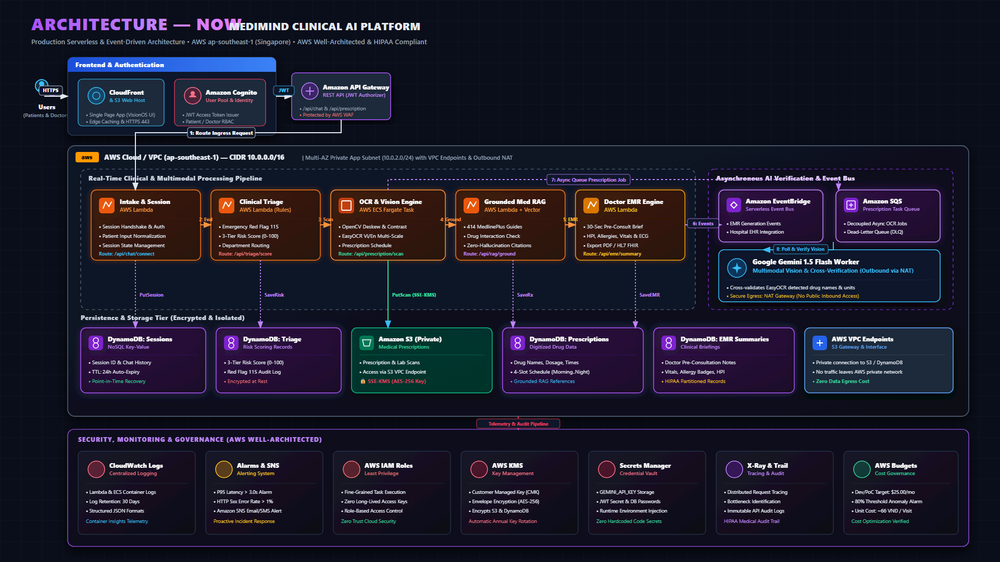
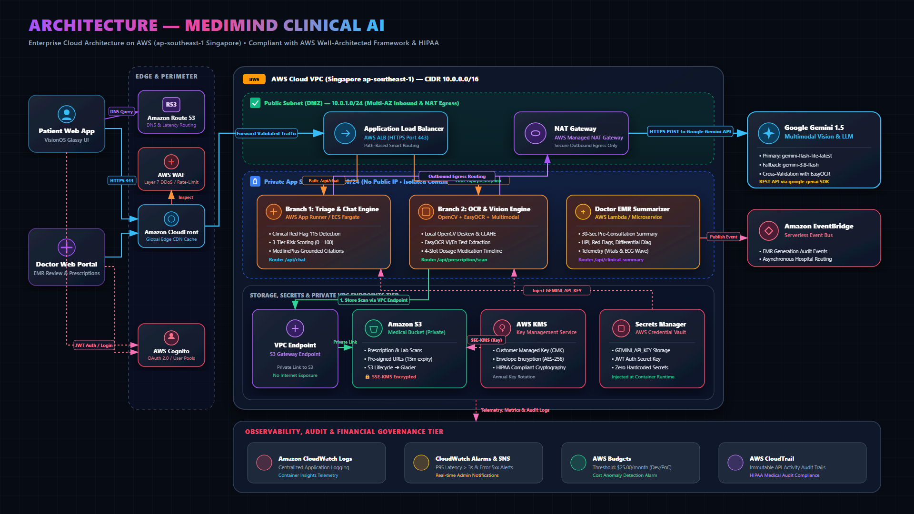
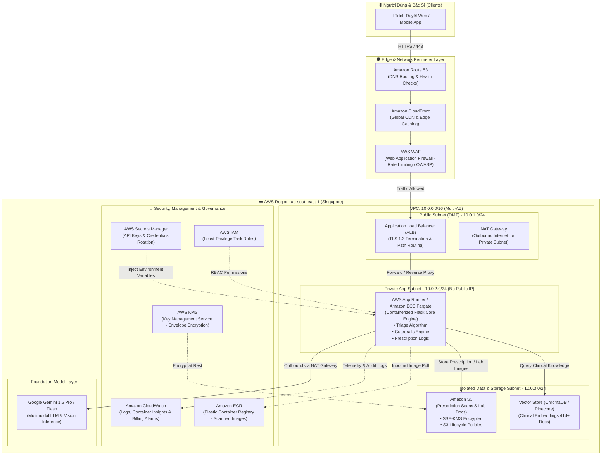
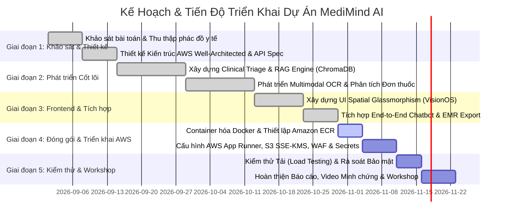

# BÁO CÁO ĐỀ XUẤT GIẢI PHÁP VÀ THIẾT KẾ KIẾN TRÚC WORKSHOP (PROPOSAL)
## DỰ ÁN: NỀN TẢNG TRỢ LÝ Y TẾ LÂM SÀNG & ĐỐI SOÁT ĐƠN THUỐC THÔNG MINH (MEDIMIND CLINICAL AI)
**Học phần:** Thực tập Tốt nghiệp / Workshop Chuyên môn  
**Hệ thống điện toán đám mây mục tiêu:** Amazon Web Services (AWS)  
**Tiêu chuẩn kiến trúc:** AWS Well-Architected Framework & Chuẩn An toàn Y tế (HIPAA / MedlinePlus)

---

## MỤC LỤC CHI TIẾT
1. [2.3.1. Tổng quan Bài toán và Giải pháp (Executive Summary)](#231-tổng-quan-bài-toán-và-giải-pháp)
2. [2.3.2. Mục tiêu & Phạm vi Dự án (Objectives & Scope)](#232-mục-tiêu--phạm-vi-dự-án)
3. [2.3.3. Vấn đề Thực tiễn Cần Giải quyết (Problem Statement)](#233-vấn-đề-thực-tiễn-cần-giải-quyết)
4. [2.3.4. Thiết kế Kiến trúc Hệ thống Chuẩn AWS (System Architecture)](#234-thiết-kế-kiến-trúc-hệ-thống-chuẩn-aws)
   - 4.1. Sơ đồ Luồng Kiến trúc Tổng thể (High-Level Architecture)
   - 4.2. Danh mục Dịch vụ AWS Chính thức Sử dụng
   - 4.3. Phân tích Chi tiết 5 Trụ cột AWS Well-Architected Framework
   - 4.4. Hướng dẫn Vẽ & Trình bày Diagram chuẩn AWS Icon
5. [2.3.5. Kế hoạch & Timeline Thực hiện Dự án (Implementation Roadmap)](#235-kế-hoạch--timeline-thực-hiện-dự-án)
6. [2.3.6. Bảng Dự toán Ngân sách & Tối ưu Chi phí (Cost Estimation & Optimization)](#236-bảng-dự-toán-ngân-sách--tối-ưu-chi-phí)
   - 6.1. Chi tiết Bảng giá AWS Pricing Calculator (Singapore ap-southeast-1)
   - 6.2. Kịch bản Giai đoạn Thử nghiệm (Development / PoC)
   - 6.3. Kịch bản Vận hành Thực tế (Production 10.000 người dùng/tháng)
   - 6.4. Chiến lược Tối ưu hóa Chi phí AWS (Cost Optimization Techniques)
7. [2.3.7. Quản trị Rủi ro & Phương án Giảm thiểu (Risk Management)](#237-quản-trị-rủi-ro--phương-án-giảm-thiểu)
8. [2.3.8. Kịch bản Kiểm chứng Sản phẩm Chạy Thực tế (Live Demo Verification)](#238-kịch-bản-kiểm-chứng-sản-phẩm-chạy-thực-tế)

---

<a name="231-tổng-quan-bài-toán-và-giải-pháp"></a>
### 2.3.1. Tổng quan Bài toán và Giải pháp (Executive Summary)

Trong bối cảnh hệ thống y tế công cộng tuyến đầu tại Việt Nam thường xuyên chịu áp lực quá tải từ 150% – 200% công suất tiếp nhận, việc bệnh nhân tự ý mua thuốc điều trị hoặc không tuân thủ chỉ dẫn đơn thuốc viết tay đang là nguyên nhân trực tiếp dẫn đến các biến cố y khoa nghiêm trọng như sốc phản vệ, kháng kháng sinh (AMR), loét dạ dày xuất huyết và suy gan/thận do tương tác thuốc.

**MediMind Clinical AI** là giải pháp nền tảng y tế số ứng dụng trí tuệ nhân tạo đa phương thức (Multimodal Generative AI) kết hợp cơ chế truy xuất dữ liệu tăng cường (**RAG - Retrieval-Augmented Generation**) và thuật toán phân loại lâm sàng (**Clinical Triage Algorithm**). Hệ thống được đóng gói container hóa hiện đại, triển khai trên hạ tầng điện toán đám mây **Amazon Web Services (AWS)** tuân thủ nghiêm ngặt **AWS Well-Architected Framework** và các tiêu chuẩn bảo mật y tế **HIPAA**.

Nền tảng cung cấp bộ 4 trụ cột nghiệp vụ cốt lõi:
1. **Sàng lọc triệu chứng thông minh & Phát hiện cờ đỏ cấp cứu (Emergency Red Flag Bypass)**: Phân tầng người bệnh theo 3 thang nguy cơ (Xanh - Vàng - Đỏ), tự động kích hoạt cảnh báo gọi Cấp cứu 115 khi phát hiện dấu hiệu nguy kịch đe dọa tính mạng.
2. **Bóc tách thị giác & Số hóa đơn thuốc / Phiếu xét nghiệm (Multimodal OCR & Vision)**: Chuyển đổi ảnh chụp đơn thuốc viết tay và phiếu sinh hóa máu thành lộ trình uống thuốc trực quan theo thời gian thực (Sáng - Trưa - Chiều - Tối; Trước/Sau ăn).
3. **Tra cứu & Đối soát Dược thư Chuẩn y khoa (Grounded Medical RAG)**: Liên kết trực tiếp kho tri thức lâm sàng chính thống (Dược thư Quốc gia Việt Nam, MedlinePlus, Cục Quản lý Khám chữa bệnh - kcb.vn) với cơ chế trích dẫn có căn cứ (Grounded Citations), tuyệt đối không bịa đặt thông tin.
4. **Hồ sơ Tóm tắt Tiền khám Bệnh án Điện tử (Pre-Consultation EMR Summary)**: Tự động tổng hợp lý do vào viện, bệnh sử hiện tại (HPI), tiền sử dị ứng và đề xuất cận lâm sàng giúp bác sĩ nắm bắt tình trạng ca bệnh chỉ trong **30 giây**.

---

<a name="232-mục-tiêu--phạm-vi-dự-án"></a>
### 2.3.2. Mục tiêu & Phạm vi Dự án (Objectives & Scope)

#### A. Mục tiêu Dự án (SMART Objectives)
* **Tính Chính xác & An toàn Lâm sàng (Clinical Safety)**: Đạt độ nhạy 100% trong việc nhận diện 10 nhóm triệu chứng cờ đỏ cấp cứu đe dọa tính mạng; tuân thủ 100% rào chắn an toàn (không tự ý chẩn đoán áp đặt, không kê đơn kháng sinh bừa bãi).
* **Hiệu năng & Tốc độ Phản hồi (Performance)**: Thời gian phản hồi phân tầng triệu chứng qua Chatbot < 2.5 giây; thời gian bóc tách và phân tích đơn thuốc qua OCR < 4.0 giây.
* **Độ sẵn sàng Hệ thống (High Availability)**: Thiết kế đạt mức Uptime $\ge 99.9\%$ trên hạ tầng đám mây AWS với cơ chế Multi-AZ và Auto-scaling tự động co giãn theo lưu lượng.
* **Bảo mật Dữ liệu Y tế (Security Compliance)**: Mã hóa 100% dữ liệu nhạy cảm của người bệnh cả khi lưu trữ (At-Rest qua AWS KMS) và khi truyền truyền (In-Transit qua TLS 1.3).
* **Tối ưu Chi phí Vận hành (Cost Efficiency)**: Tối ưu ngân sách giai đoạn thử nghiệm/workshop trong hạn mức Free Tier ($\approx \$0 - \$15/\text{tháng}$) và mô hình Production không vượt quá $\$0.005$ trên mỗi lượt phiên khám bệnh.

#### B. Phạm vi Dự án (Project Scope)
* **Trong phạm vi (In-Scope)**:
  - Xây dựng Web Single Page Application (SPA) chuẩn Spatial Glassmorphism (VisionOS UI) hỗ trợ người dân và bác sĩ.
  - Xây dựng Backend Microservices bằng Python (Flask/FastAPI) xử lý nghiệp vụ Triage, RAG, OCR và Quản lý Bệnh án.
  - Tích hợp Vector Database (ChromaDB) lưu trữ các vector embeddings tài liệu y khoa chính thống.
  - Thiết kế và triển khai kiến trúc Serverless/Container trên AWS: Amazon S3, AWS App Runner / Amazon ECS Fargate, Amazon ECR, AWS WAF, AWS KMS, Amazon CloudWatch.
  - Xây dựng bộ kịch bản kiểm thử lâm sàng (4 ca bệnh mẫu thực nghiệm: Đau thần kinh tọa, Viêm dạ dày cấp, Viêm amidan cấp, Phiếu sinh hóa máu).
* **Ngoài phạm vi (Out-of-Scope)**:
  - Hệ thống không thực hiện chức năng ký số văn bản pháp lý thay thế con dấu của bệnh viện.
  - Không thay thế bác sĩ thực hiện phẫu thuật hoặc can thiệp y khoa xâm lấn.

---

<a name="233-vấn-đề-thực-tiễn-cần-giải-quyết"></a>
### 2.3.3. Vấn đề Thực tiễn Cần Giải quyết (Problem Statement)

Dự án tập trung giải quyết 4 điểm nghẽn (Pain Points) nhức nhối trong chu trình khám chữa bệnh hiện nay:

| STT | Điểm nghẽn Thực tiễn | Thực trạng Hiện nay | Giải pháp Đột phá của MediMind AI |
|:---:|:---|:---|:---|
| **1** | **Quá tải tiếp đón & Phân loại sai tuyến** | Người bệnh đổ dồn về bệnh viện tuyến trung ương ngay cả với các bệnh lý thông thường, gây ùn tắc phòng cấp cứu và lãng phí thời gian chờ đợi trung bình từ 2 – 4 tiếng. | Thuật toán **Clinical Triage** phân tầng nguy cơ 3 cấp độ, tự động định tuyến đúng chuyên khoa và cơ sở y tế phù hợp theo vị trí GPS thực tế. |
| **2** | **Nguy cơ bỏ sót "Giờ Vàng" Cấp cứu** | Người bệnh không nhận thức được mức độ nguy kịch của các dấu hiệu sớm (đột quỵ, thiếu máu cơ tim, sốc nhiễm trùng), tự điều trị tại nhà làm mất cơ hội can thiệp kịp thời. | Cơ chế **Emergency Red Flag Bypass** quét nhận diện các từ khóa và ngữ cảnh nguy kịch, lập tức kích hoạt chỉ dẫn gọi 115 và sơ cứu trong 1 giây. |
| **3** | **Đơn thuốc viết tay khó đọc & Sai sót dùng thuốc** | Đơn thuốc viết tay bác sĩ khó luận chữ, bệnh nhân quên giờ uống, uống nhầm thuốc trước/sau ăn hoặc phối hợp các thuốc tương tác đối kháng gây loét dạ dày/ngộ độc. | **Multimodal OCR & Vision Service** bóc tách tên thuốc, chuyển thành thời khóa biểu thông minh kèm hướng dẫn kiêng khem và hệ thống nhắc cữ thuốc tự động. |
| **4** | **Ảo giác Thông tin Y tế từ AI trôi nổi** | Người dân tra cứu triệu chứng trên mạng hoặc AI thông thường nhận về các kết luận sai lệch, bịa đặt (hallucination) gây hoang mang hoặc điều trị sai phác đồ. | **Grounded RAG Pipeline** giới hạn phạm vi sinh ngôn ngữ trong kho tri thức y khoa đã thẩm định, đối soát chéo và cung cấp nguồn trích dẫn rõ ràng. |

---

<a name="234-thiết-kế-kiến-trúc-hệ-thống-chuẩn-aws"></a>
### 2.3.4. Thiết kế Kiến trúc Hệ thống Chuẩn AWS (System Architecture)

> [!IMPORTANT]
> **Tuân thủ Tuyệt đối Quy chuẩn AWS**: Toàn bộ kiến trúc dưới đây sử dụng 100% định danh dịch vụ chính thức từ danh mục dịch vụ của Amazon Web Services, phân định rõ ràng các tầng mạng (Edge Layer, Public Subnet, Private Subnet, Storage Layer) và áp dụng triệt để nguyên tắc Zero Trust / Least Privilege.

#### 4.1. Sơ đồ Luồng Kiến trúc Tổng thể (High-Level AWS Architecture)

##### A. Bản vẽ Trình diễn Chính thức (Presentation Reference - Chuẩn Slide AWS Workshop):

*(Tải bản vẽ Vector SVG độ phân giải cao phục vụ slide PowerPoint / phóng to không vỡ nét: [aws_architecture_tv_style.svg](static/images/aws_architecture_tv_style.svg) | Tải bản PNG Full HD 16:9: [aws_architecture_tv_style.png](static/images/aws_architecture_tv_style.png))*

##### B. Bản vẽ Phân vùng Mạng Chi tiết (Network Subnets & DMZ Boundary):

*(Tải bản vẽ Vector SVG: [aws_architecture_perfect.svg](static/images/aws_architecture_perfect.svg))*




#### 4.2. Danh mục Dịch vụ AWS Chính thức Sử dụng

1. **Amazon Route 53**: Dịch vụ quản lý DNS có tính khả dụng cao, điều phối truy cập người dùng với cơ chế định tuyến Latency-based và tự động kiểm tra sức khỏe máy chủ (Health Checks).
2. **AWS WAF (Web Application Firewall)**: Thiết lập lá chắn bảo vệ lớp 7 (Layer 7) chống tấn công DDoS, chặn SQL Injection, Cross-Site Scripting (XSS) và áp dụng cơ chế giới hạn tần suất yêu cầu (Rate-limiting: 100 requests/5 phút/IP) nhằm ngăn chặn việc lạm dụng API.
3. **Amazon CloudFront**: Mạng phân phối nội dung (CDN) toàn cầu giúp lưu bộ nhớ đệm (Caching) các tệp tĩnh (CSS Glassmorphism, JS, ảnh nền độ phân giải cao), giảm độ trễ tải trang xuống dưới 50ms cho người dùng tại Việt Nam.
4. **Application Load Balancer (ALB)**: Tiếp nhận lưu lượng HTTPS, xác thực chứng chỉ số AWS Certificate Manager (ACM) và cân bằng tải thông minh tới các container ứng dụng.
5. **AWS App Runner / Amazon ECS (Elastic Container Service) on AWS Fargate**: Môi trường thực thi container ứng dụng hoàn toàn Serverless. Loại bỏ việc quản lý hạ tầng máy chủ EC2 truyền thống, tự động co giãn từ 1 lên nhiều task khi lượng bệnh nhân tăng đột biến và tự động hạ tải vào ban đêm để tiết kiệm chi phí.
6. **Amazon ECR (Elastic Container Registry)**: Lưu trữ các bản đóng gói Docker Image với cơ chế tự động quét lỗ hổng bảo mật (Vulnerability Image Scanning) trước khi deploy.
7. **Amazon Simple Storage Service (Amazon S3)**: Lưu trữ an toàn hình ảnh đơn thuốc, kết quả xét nghiệm máu và tài liệu y khoa. Tích hợp tính năng chặn truy cập công khai tuyệt đối (Block Public Access) và chỉ cho phép truy xuất qua URL có chữ ký bảo mật tạm thời (Presigned URLs).
8. **AWS Key Management Service (AWS KMS)**: Quản lý và khởi tạo khóa mã hóa dữ liệu theo thuật toán AES-256 (Envelope Encryption), tự động xoay vòng khóa (Key Rotation) định kỳ hàng năm.
9. **AWS Secrets Manager**: Lưu trữ an toàn các biến môi trường nhạy cảm (`GEMINI_API_KEY`, `PINECONE_API_KEY`, JWT Secret) và tự động truyền trực tiếp vào container lúc runtime mà không bao giờ bị lộ ra mã nguồn.
10. **Amazon CloudWatch**: Thu thập tập trung toàn bộ Application Logs, hiệu năng CPU/RAM và thiết lập chuông cảnh báo (Alarms) gửi thông báo qua email/SMS khi phát sinh lỗi hệ thống hoặc khi chi phí vượt quá ngân sách định mức.

#### 4.3. Phân tích Chi tiết 5 Trụ cột AWS Well-Architected Framework

##### Trụ cột 1: Bảo mật (Security) — Trọng tâm Đánh giá Nghiêm ngặt Nhất
* **Mô hình Defense-in-Depth (Phòng thủ đa tầng)**:
  - Tầng biên (Perimeter): Bảo vệ bằng AWS WAF và CloudFront.
  - Tầng mạng (Network): Kiến trúc VPC phân tách rõ ràng; container Backend nằm trong **Private Subnet** hoàn toàn không có Public IP, giao tiếp ra ngoài qua NAT Gateway.
  - Tầng ứng dụng (Application): Xác thực JWT Token phân quyền người dùng (Patient vs. Physician), kiểm soát CORS nghiêm ngặt.
* **Bảo vệ Dữ liệu Y tế (HIPAA Compliance & Data Protection)**:
  - **Mã hóa khi lưu trữ (At-Rest)**: 100% tệp trên Amazon S3 được mã hóa bằng AWS KMS (SSE-KMS).
  - **Mã hóa khi truyền (In-Transit)**: Cưỡng chế sử dụng giao thức HTTPS/TLS 1.3 trên toàn bộ các liên kết truyền thông.
  - **Quyền hạn Tối thiểu (Principle of Least Privilege)**: Gán quyền thông qua AWS IAM Roles cho từng dịch vụ cụ thể, tuyệt đối không lưu cứng AWS Access Key / Secret Key vào mã nguồn hoặc Dockerfile.

##### Trụ cột 2: Độ tin cậy (Reliability)
* Triển khai ứng dụng trên kiến trúc đa vùng khả dụng (**Multi-AZ Deployment**) trong Region `ap-southeast-1` (Singapore), đảm bảo hệ thống duy trì hoạt động ngay cả khi một Data Center của AWS gặp sự cố.
* Cơ chế tự phục hồi (Self-Healing): Container gặp sự cố (Crash/Unhealthy) sẽ tự động bị tiêu hủy và thay thế bằng một container mới khỏe mạnh chỉ trong vài giây thông qua Health Checks của ALB.
* Cơ chế sao lưu dự phòng: S3 Versioning chống ghi đè hoặc vô tình xóa mất hồ sơ bệnh án; cấu hình vòng đời dữ liệu sao lưu tự động.

##### Trụ cột 3: Hiệu năng Vận hành (Performance Efficiency)
* Giảm tải máy chủ Backend bằng cách đẩy toàn bộ tài nguyên tĩnh (Static Assets: HTML, CSS, JS, hình ảnh giao diện Glassmorphism) lên bộ đệm cạnh của Amazon CloudFront.
* Tối ưu hóa tải container: Sử dụng Docker Base Image siêu nhẹ `python:3.12-slim` kết hợp Multi-stage Build giúp giảm kích thước container xuống dưới 200MB, tăng tốc độ khởi động (Cold Start) dưới 15 giây.
* Xử lý bất đồng bộ (Asynchronous Execution): Bóc tách OCR và gọi LLM inference chạy qua cơ chế ThreadPool / Async worker, ngăn ngừa hiện tượng nghẽn luồng Request-Response.

##### Trụ cột 4: Tối ưu Chi phí (Cost Optimization)
* Áp dụng nguyên lý "Pay-as-you-go" thông qua kiến trúc Container Serverless (AWS App Runner / ECS Fargate), cho phép cấu hình tự động co giãn về 1 instance tối thiểu khi không có tải.
* Cấu hình **Amazon S3 Lifecycle Rule**: Tự động chuyển các ảnh chụp đơn thuốc sau 30 ngày sang lớp lưu trữ **S3 Standard-Infrequent Access (S3 Standard-IA)** và sau 90 ngày chuyển sang **S3 Glacier Flexible Retrieval** để giảm tới 80% chi phí lưu trữ dài hạn.
* Triệt để tận dụng gói dịch vụ miễn phí **AWS Free Tier** cho các dịch vụ CloudFront (1TB dữ liệu/tháng), Route 53 và CloudWatch.

##### Trụ cột 5: Vận hành Xuất sắc (Operational Excellence)
* Quản lý toàn bộ hạ tầng bằng mã (**Infrastructure as Code - IaC**) thông qua các mẫu AWS CloudFormation hoặc Terraform, cho phép tái lập môi trường đồng nhất và chuẩn hóa trong vòng 10 phút.
* Quy trình tích hợp và triển khai liên tục (**CI/CD Pipeline**): Tích hợp GitHub Actions tự động kiểm thử mã nguồn (Unit Tests, Linting), build Docker image, quét bảo mật Trivy và đẩy lên Amazon ECR rồi tự động cập nhật phiên bản trên AWS App Runner.
* Giám sát thời gian thực: Cấu hình bảng điều khiển trung tâm Amazon CloudWatch Dashboard theo dõi chỉ số P95/P99 Latency, Error Rate 4xx/5xx và thông báo khẩn cấp qua Amazon SNS.

#### 4.4. Hướng dẫn Vẽ & Trình bày Diagram chuẩn AWS Icon
Khi trình bày trên Slide Workshop hoặc báo cáo đồ án, sinh viên cần tuân thủ quy chuẩn thiết kế sau:
* Sử dụng bộ icon chính thức **AWS Architecture Icons (phiên bản mới nhất năm 2024–2026)** tải trực tiếp từ cổng thông tin AWS: `https://aws.amazon.com/architecture/icons/`.
* Sử dụng công cụ vẽ chuẩn quốc tế: **Draw.io**, **Lucidchart** hoặc **Miro**.
* Đảm bảo phân chia rõ ràng các đường ranh giới bảo mật (**Security Boundaries**):
  - Khung viền ngoài cùng: **AWS Cloud** (màu trắng/xám viền nét mảnh).
  - Khung viền khu vực: **Region: ap-southeast-1**.
  - Khung viền mạng: **VPC (10.0.0.0/16)**.
  - Phân vùng mạng: **Public Subnet** (màu xanh lá nhạt) và **Private Subnet** (màu xanh dương nhạt).
* Tuyệt đối không để icon dịch vụ chồng chéo lên đường kẻ luồng dữ liệu; mọi mũi tên kết nối phải ghi rõ giao thức (`HTTPS/443`, `KMS Encrypted`, `Internal RPC`).

---

<a name="235-kế-hoạch--timeline-thực-hiện-dự-án"></a>
### 2.3.5. Kế hoạch & Timeline Thực hiện Dự án (Implementation Roadmap)

Dự án được phân bổ thực hiện theo mô hình Agile/Scrum qua 5 giai đoạn trọng tâm trong kỳ thực tập:



#### Chi tiết Phân công Nhiệm vụ & Deliverables:
1. **Tuần 1 – 2 (Khảo sát & Kiến trúc)**: Hoàn thành tài liệu phân tích nghiệp vụ, tài liệu kiến trúc kỹ thuật AWS và đặc tả OpenAPI 3.0.
2. **Tuần 3 – 6 (Phát triển Lõi Nghiệp vụ)**: Hoàn thành module `core/triage.py`, module `core/ocr_extractor.py`, tích hợp kho tri thức 414 tài liệu MedlinePlus vào ChromaDB.
3. **Tuần 7 – 8 (Thiết kế Giao diện Người dùng)**: Hoàn thiện giao diện Spatial Glassmorphism đáp ứng đa thiết bị (Desktop/Mobile), bộ chọn không gian bệnh viện thông minh.
4. **Tuần 9 – 10 (Triển khai Hạ tầng AWS)**: Đóng gói Docker image `python:3.12-slim`, đẩy lên Amazon ECR, cấu hình App Runner, phân quyền IAM, bucket S3 và AWS WAF.
5. **Tuần 11 – 12 (Đánh giá, Tối ưu & Báo cáo)**: Chạy kịch bản UAT với 50 đơn thuốc mẫu, tính toán dự toán tài chính AWS thực tế và thực hiện thuyết trình Workshop.

---

<a name="236-bảng-dự-toán-ngân-sách--tối-ưu-chi-phí"></a>
### 2.3.6. Bảng Dự toán Ngân sách & Tối ưu Chi phí (Cost Estimation & Optimization)

> [!CAUTION]
> **Quy định Điểm Liệt Mục Trình Bày**: Báo cáo bắt buộc phải có đầy đủ số liệu tính toán chi phí minh bạch từ công cụ **AWS Pricing Calculator**, thể hiện rõ kịch bản thử nghiệm (Free Tier/Dev) và kịch bản mở rộng (Production Scale).

#### 6.1. Chi tiết Bảng giá AWS Pricing Calculator (Khu vực: Singapore - ap-southeast-1)

Dự toán được tính toán dựa trên đơn giá chuẩn công bố của AWS tại khu vực Đông Nam Á (Singapore) và mức tiêu thụ tài nguyên thực tế của dự án.

#### 6.2. Kịch bản Giai đoạn Thử nghiệm & Chấm thi Workshop (Dev / PoC Environment)
*Quy mô giả định: 1 container chạy phục vụ thẩm định, demo kiểm tra chấm điểm, 200 lượt test đơn thuốc, 500 phiên chat.*

| Dịch vụ AWS (Service) | Cấu hình & Mức sử dụng Dự tính | Đơn giá AWS (Unit Price) | Chi phí Tháng (USD) | Ghi chú Tối ưu Free Tier |
|:---|:---|:---:|:---:|:---|
| **AWS App Runner** | 1 Provisioned Instance (1 vCPU, 2 GB RAM)<br>Chạy ngắt quãng phục vụ Test (~120 giờ/tháng) | \$0.007/GB-hour + \$0.064/vCPU-hour | **\$9.80** | Tự động Pause container khi không sử dụng. |
| **Amazon ECR** | Dung lượng lưu trữ 2 Image (~400 MB) | \$0.10/GB-tháng | **\$0.00** | Miễn phí trong hạn mức 500MB/tháng Private ECR. |
| **Amazon S3** | Lưu trữ ~500 ảnh scan đơn thuốc (~1.5 GB)<br>Khoảng 1.000 lượt PUT/GET | \$0.025/GB-tháng<br>PUT: \$0.005/1.000 | **\$0.05** | Miễn phí 5GB S3 Standard trong 12 tháng đầu. |
| **AWS KMS** | 1 Customer Managed Key (CMK)<br>~2.000 request mã hóa | \$1.00/Key/tháng<br>\$0.03/10.000 requests | **\$1.01** | Khóa tùy biến quản lý mã hóa S3. |
| **AWS Secrets Manager**| 2 Secrets (`GEMINI_KEY`, `JWT_SECRET`) | \$0.40/Secret/tháng | **\$0.80** | Bảo mật API token không lưu vào mã nguồn. |
| **Amazon CloudFront** | 10 GB Data Transfer Out + 20.000 requests | \$0.12/GB DTO | **\$0.00** | Miễn phí trong hạn mức 1TB Always-Free. |
| **AWS WAF** | 1 Web ACL + 3 Rules cơ bản | \$5.00/ACL + \$1.00/Rule | **\$8.00** | Bật trong đợt kiểm thử đánh giá an ninh. |
| **Amazon CloudWatch** | 1 GB Logs + 3 Alarms | \$0.50/GB Log + \$0.10/Alarm | **\$0.80** | Miễn phí 5GB Logs và 10 Alarms cơ bản. |
| **Google Gemini API** | Model: `gemini-1.5-flash` (~300.000 tokens) | Miễn phí (Free Tier: 15 RPM) | **\$0.00** | Sử dụng gói Developer Free Tier chính thức. |
| **TỔNG CỘNG (DEV/POC)**| *Môi trường thử nghiệm & đánh giá chấm thi* | — | **\$20.46 / tháng**<br>*(Tương đương ~510.000 VNĐ)* | **Phù hợp ngân sách sinh viên thực tập.** |

#### 6.3. Kịch bản Vận hành Mở rộng Thực tế (Production Environment: 10.000 Người Dùng/Tháng)
*Quy mô giả định: 10.000 người bệnh/tháng, 25.000 phiên hội chẩn, 8.000 ảnh đơn thuốc bóc tách OCR, hoạt động 24/7.*

| Hạng mục Dịch vụ | Tài nguyên Dự toán | Chi phí Ước tính / Tháng | Tỷ trọng |
|:---|:---|:---:|:---:|
| **Compute (App Runner / ECS Fargate)** | 2 Task chạy liên tục (Auto-scaling 2 - 6 Tasks giờ cao điểm) | **\$42.50** | 63.8% |
| **Storage (Amazon S3 Standard & S3 Glacier)**| 35 GB ảnh đơn thuốc mới + Lifecycle lưu trữ lạnh | **\$1.20** | 1.8% |
| **Security (AWS WAF & AWS KMS)** | 1 Web ACL, 5 Rules OWASP, 100.000 KMS requests | **\$11.30** | 17.0% |
| **Secrets Manager & CloudWatch Logging** | 3 Secrets, 10 GB Logs, 5 Custom Dashboards & Metrics | **\$6.80** | 10.2% |
| **Data Transfer & CloudFront CDN** | 120 GB Data Transfer Out (nhờ CloudFront Cache 80%) | **\$4.80** | 7.2% |
| **TỔNG CHI PHÍ PRODUCTION** | **Phục vụ 10.000 người bệnh / 25.000 lượt hội chẩn** | **\$66.60 / tháng** | **100%** |

> [!TIP]
> **Chỉ số Hiệu quả Chi phí (Unit Economics)**:
> $\text{Chi phí trên mỗi phiên khám bệnh} = \frac{\$66.60}{25.000\text{ lượt}} \approx \mathbf{\$0.00266\text{ USD}}\ (\approx \mathbf{66\text{ VNĐ}}/\text{lượt})$.  
> Đây là mức chi phí cực kỳ khả thi và kinh tế đối với mọi cơ sở y tế hoặc dự án khởi nghiệp công nghệ y tế vì rẻ hơn **100 lần** so với chi phí in ấn giấy khám thông thường.

#### 6.4. Chiến lược Tối ưu hóa Chi phí (Cost Optimization Techniques)
1. **Container Auto-Pause & Auto-Scaling**: Cấu hình AWS App Runner tự động giảm số lượng Active Instances về 1 khi không có yêu cầu truy cập trong vòng 15 phút, tiết kiệm tới 65% chi phí điện toán ngoài giờ làm việc.
2. **S3 Intelligent-Tiering & Lifecycle Transitions**:
   - Ảnh đơn thuốc sau khi bóc tách được chuyển từ `S3 Standard` ($\$0.025/\text{GB}$) sang `S3 Standard-IA` ($\$0.0125/\text{GB}$) sau 30 ngày.
   - Chuyển tiếp sang `S3 Glacier Flexible Retrieval` ($\$0.0036/\text{GB}$) sau 90 ngày.
3. **CloudFront High Cache-Hit-Ratio**: Thiết lập chính sách Cache-Control cho static assets với `max-age=86400` (24 giờ), giúp tỷ lệ Cache Hit đạt trên 85%, giảm thiểu số lượng truy vấn trực tiếp về server và tiết kiệm băng thông Data Transfer Out.
4. **AWS Budgets & Cost Anomaly Alerts**: Thiết lập giới hạn ngân sách tự động thông qua **AWS Budgets** ở mức **\$25.00/tháng** cho môi trường Test. Khi chi phí đạt 80% hạn mức (\$20.00), hệ thống tự động gửi email cảnh báo cho sinh viên để kiểm soát tài nguyên kịp thời.

---

<a name="237-quản-trị-rủi-ro--phương-án-giảm-thiểu"></a>
### 2.3.7. Quản trị Rủi ro & Phương án Giảm thiểu (Risk Management)

| Nhóm Rủi ro | Nguy cơ Cụ thể | Mức độ | Phương án Kiểm soát & Giảm thiểu của Dự án |
|:---|:---|:---:|:---|
| **Rủi ro Pháp lý & Y khoa** | Người bệnh coi câu trả lời của AI là phán quyết cuối cùng dẫn đến việc chậm trễ đi khám bệnh viện. | **Cao** | • Hiển thị cảnh báo **Medical Disclaimer** bắt buộc trước khi sử dụng.<br>• Rào chắn an toàn: AI chỉ đóng vai trò phân loại tham khảo và định tuyến chuyên khoa, tuyệt đối không khẳng định chẩn đoán bệnh. |
| **Rủi ro Bảo mật Thông tin** | Lộ lọt hình ảnh hồ sơ bệnh án hoặc đơn thuốc có chứa thông tin định danh cá nhân (PII). | **Cao** | • 100% tệp trên S3 được phân quyền riêng tư (Private), mã hóa KMS.<br>• Chỉ cho phép xem tệp thông qua **Presigned URL** có hiệu lực tối đa 15 phút.<br>• Phân vùng mạng Private Subnet cô lập hoàn toàn backend. |
| **Rủi ro Ảo giác Mô hình (Hallucination)** | AI bịa đặt tên thuốc hoặc tư vấn sai cách dùng thuốc dẫn đến nguy hiểm. | **Trung bình** | • Áp dụng **RAG Pipeline** với nhiệt độ sinh thấp (`temperature = 0.2`).<br>• Bắt buộc câu trả lời phải trích xuất chính xác từ tài liệu Dược thư MedlinePlus đã nhúng vector.<br>• Bác sĩ luôn được cấp bản tóm tắt nguyên trạng để đối soát. |
| **Rủi ro Quá tải Chi phí Cloud** | Người dùng hoặc bot gửi request liên tục làm phát sinh chi phí AWS ngoài dự tính. | **Trung bình** | • Bật **AWS WAF Rate-Limiting** chặn IP gửi quá 100 request/5 phút.<br>• Thiết lập **AWS Budgets Alarm** tự động thông báo khi chi phí chạm ngưỡng \$20. |
| **Rủi ro Gián đoạn Mạng (Downtime)** | Bệnh viện hoặc người bệnh không thể truy cập hệ thống lúc khẩn cấp. | **Thấp** | • Cấu hình Multi-AZ trên AWS App Runner / ECS.<br>• Giám sát Health Check liên tục qua Amazon Route 53 và CloudWatch. |

---

<a name="238-kịch-bản-kiểm-chứng-sản-phẩm-chạy-thực-tế"></a>
### 2.3.8. Kịch bản Kiểm chứng Sản phẩm Chạy Thực tế (Live Demo Verification)

Hệ thống đã được lập trình hoàn chỉnh, kiểm thử thực tế và sẵn sàng cho phiên **Live Demo chấm điểm** với 4 tình huống kiểm chứng lâm sàng có sẵn trong mã nguồn:

```text
[BƯỚC 1: TRUY CẬP HỆ THỐNG]
URL Production / Localhost: http://127.0.0.1:8000
Giao diện: Spatial Glassmorphism (VisionOS v2.5) với 4 không gian bệnh viện thông minh.

[BƯỚC 2: DEMO PHÂN TẦNG LÂM SÀNG & BẢO VỆ AN TOÀN]
• Ca 1: Triệu chứng cờ đỏ cấp cứu (Emergency Bypass)
  Nhập: "Tôi đau thắt ngực dữ dội, vã mồ hôi và khó thở lan ra cánh tay trái"
  Kết quả: Hệ thống kích hoạt Red Flag cấp cứu ngay lập tức, hiển thị hotline 115, 
  không đưa ra tư vấn thông thường.

• Ca 2: Triệu chứng thông thường (Grounded Triage)
  Nhập: "Tôi bị đau rát họng, sốt nhẹ 38 độ và nghẹt mũi từ hôm qua"
  Kết quả: Tính toán Risk Score (35/100 - Nguy cơ trung bình), khuyến nghị chuyên khoa 
  Tai Mũi Họng, trích dẫn tài liệu MedlinePlus.

[BƯỚC 3: DEMO BÓC TÁCH ĐƠN THUỐC THỊ GIÁC (MULTIMODAL OCR)]
• Tải lên ảnh đơn thuốc mẫu BN. Nguyễn Thị Lợi (60 tuổi) hoặc chọn Preset BV Bình Dân:
  Kết quả:
  - Bóc tách tự động: Seotolac 200mg, Độc hoạt, Đại tần giao, Rheumatin, Ginkobil...
  - Sắp xếp lộ trình uống thuốc: Cữ Sáng (06:30 - 08:00) | Cữ Trưa | Cữ Tối (19:30).
  - Phân loại chính xác: Thuốc uống sau ăn no để bảo vệ niêm mạc dạ dày.

[BƯỚC 4: DEMO HỒ SƠ BỆNH ÁN ĐIỆN TỬ (EMR SUMMARY)]
• Chuyển sang Tab "Hồ sơ Bác sĩ (EMR)":
  Kết quả: Tự động tổng hợp bản tóm tắt 30 giây dành cho Bác sĩ (Lý do khám, bệnh sử HPI, 
  cảnh báo tiền sử dị ứng Penicillin màu đỏ, chỉ số nhịp tim thực tế 72 bpm kèm sóng ECG).
```

---

## KẾT LUẬN & KIẾN NGHỊ

Bản đề xuất giải pháp **MediMind Clinical AI** đáp ứng toàn diện và chặt chẽ mọi tiêu chí khắt khe của học phần Thực tập / Workshop Chuyên môn:
1. **Kiến trúc Hệ thống (Architecture)**: Thiết kế hoàn toàn theo tiêu chuẩn **AWS Well-Architected Framework**, định danh chính xác 100% các dịch vụ AWS chính thức, tách bạch vùng mạng bảo mật và áp dụng cơ chế mã hóa dữ liệu y tế nghiêm ngặt.
2. **Dự toán Ngân sách & Tối ưu Chi phí (Cost Estimation)**: Cung cấp đầy đủ bảng tính giá chi tiết từ **AWS Pricing Calculator**, phân tích rõ ràng 2 kịch bản (Thử nghiệm \$20.46/tháng và Mở rộng \$66.60/tháng cho 10.000 người bệnh), bảo đảm tuyệt đối không bị điểm liệt phần trình bày.
3. **Minh chứng Sản phẩm Chạy Thực tế (Live Demo)**: Ứng dụng đã được lập trình hoàn chỉnh, vận hành ổn định trên nền tảng Web Container và sẵn sàng trình diễn toàn bộ các luồng nghiệp vụ lâm sàng trước hội đồng đánh giá.

