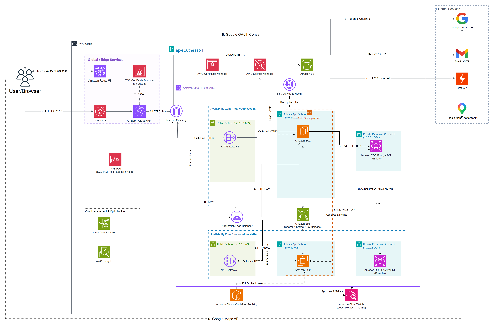

# 🩺 MediMind Clinical AI — Nền tảng Trợ lý Y tế Lâm sàng & Chăm sóc Sức khỏe Thông minh

> **Trợ lý AI Y tế Đa phương thức (Multimodal Clinical Assistant)** kết hợp **Clinical Triage & Double Guardrails**, **Grounded Hybrid RAG (364 tài liệu chuẩn)**, **Vision OCR Đối soát Đơn thuốc**, **Dinh dưỡng Lâm sàng (2.500 món Việt)** và **Đặt lịch tại 2.144 Cơ sở Y tế** — triển khai Live HTTPS trên kiến trúc **AWS VPC 3 tầng Multi-AZ (`ap-southeast-1`)**.

[](https://d2typ9pphzk4as.cloudfront.net)
[](https://www.youtube.com/watch?v=vF3kyvuShqo)
[](https://www.python.org/)
[](https://flask.palletsprojects.com/)
[](https://fastapi.tiangolo.com/)
[](https://www.uvicorn.org/)
[](https://docs.pydantic.dev/)
[](https://groq.com/)
[](https://ai.google.dev/)
[](https://www.trychroma.com/)
[](https://opencv.org/)
[](https://www.postgresql.org/)
[](https://www.sqlite.org/)
[](https://www.sqlalchemy.org/)
[](https://aws.amazon.com/)
[](https://developers.google.com/identity)
[](https://developers.google.com/maps)
[](https://www.docker.com/)
[](tests/)
[](https://docs.astral.sh/ruff/)
[](LICENSE)

- 🌐 **Ứng dụng Live (HTTPS):** https://d2typ9pphzk4as.cloudfront.net
- 🎬 **Video Demo End-to-End (YouTube):** https://www.youtube.com/watch?v=vF3kyvuShqo
- 📚 **Hồ sơ Kiến trúc & Workshop AWS:** https://github.com/NitaxIso/aws-worklog-fcaj

---

## 1. Tổng quan & 5 Phân hệ Cốt lõi

**MediMind Clinical AI** được xây dựng nhằm hỗ trợ người dân sàng lọc triệu chứng ban đầu an toàn, đọc hiểu đơn thuốc tại nhà, xây dựng thực đơn phù hợp với bệnh nền và chuẩn bị hồ sơ tiền khám trước khi tới bệnh viện.

| Phân hệ | Mô tả tính năng chính | Quy mô dữ liệu & An toàn |
| :--- | :--- | :--- |
| **1. Trợ lý Sức khỏe & Clinical Triage** | Hỏi đáp triệu chứng qua Khung chat nổi & Tab chuyên biệt (tự đồng bộ lịch sử); phát hiện cờ đỏ cấp cứu (đau thắt ngực, đột quỵ, khó thở...); xử lý câu phủ định & từ chối câu hỏi ngoài phạm vi y tế. | **Double Guardrails** (Pre/Post check), chặn tự kê đơn kháng sinh, cảnh báo **Nguy cơ cao / Cấp cứu 115**. |
| **2. Hybrid Medical RAG Có căn cứ** | Kết hợp truy xuất từ khóa **BM25** + **ChromaDB** + **Cross-Encoder Reranker** (`BAAI/bge-reranker-v2-m3`, tùy chọn) để đối soát nguồn y khoa chính thống. | **364 tài liệu y khoa chuẩn** từ *MedlinePlus NIH* và hướng dẫn *Bộ Y Tế* (kèm nguồn trích dẫn thực tế). |
| **3. Đọc Đơn Thuốc Lâm Sàng (Vision OCR)** | Quét ảnh đơn thuốc bệnh viện/phòng khám (hỗ trợ dual-crop), bóc tách tên thuốc, hàm lượng, số lượng, cách dùng; màn hình xác nhận tương tác (*Human-in-the-Loop*) trước khi tạo **Lịch uống thuốc theo buổi** & **Nhắc nhở uống thuốc**. | **Groq Vision LLM (4-Key Pool Failover)** + cơ chế tự thử lại khi gặp HTTP 429, kiểm tra định dạng/kích thước tệp tải lên. |
| **4. Dinh Dưỡng & Pha Chế Cá Nhân Hóa** | Khảo sát **BMR / TDEE** tự đồng bộ chỉ số từ hồ sơ sức khỏe; gợi ý linh hoạt theo 2 chế độ (**Món lẻ** & **Combo mâm cơm**), hỗ trợ **Đổi thực đơn** và popup xem nguyên liệu, kcal & cách nấu chi tiết. | **2.500 công thức món Việt thật** (*Món Ngon Mỗi Ngày*) với bộ lọc đa bệnh nền & dị ứng tất định (*Fail-Closed Filtering*). |
| **5. Cơ Sở Y Tế, Tiền Khám & Đặt Lịch** | Tra cứu bệnh viện/phòng khám, chỉ đường trực tiếp qua **Google Maps**, khai **Hỏi bệnh tiền khám (Pre-Visit Intake)**, xuất **Bản tóm tắt tiền khám**, lưu tại **Lịch hẹn của tôi** và gửi **Email xác nhận tự động**. | **2.144 cơ sở khám chữa bệnh** chuẩn hóa (*1.505 TP.HCM & 639 Hà Nội*), chuông thông báo `/api/notifications`, song ngữ **VI / EN**. |

> **Xác thực & Bảo mật tài khoản:** Hỗ trợ đăng nhập **Google OAuth 2.0**, đăng ký xác thực **Email OTP 6 số (Gmail SMTP)** / **SpeedSMS**, **Onboarding hồ sơ sức khỏe lần đầu**, đổi mật khẩu, quên mật khẩu, bảo vệ **CSRF Origin/Referer**, **Rate Limiting** và **HTTP Security Headers** (`CSP`, `X-Frame-Options: SAMEORIGIN`).

---

## 2. Kiến trúc Hệ thống & Luồng Hoạt động (Architecture & End-to-End Flow)

### 2.1. Sơ đồ Kiến trúc AWS Multi-AZ (`ap-southeast-1`)



### 2.2. Luồng Hoạt động Chính (Request & Data Flow)

| Tầng xử lý | Thành phần chính | Luồng hoạt động ngắn gọn |
| :--- | :--- | :--- |
| **1. Biên mạng & Chia tải** | CloudFront · AWS WAF · ALB | Lọc tấn công lớp 7 (OWASP, SQLi, Rate Limit), lưu đệm `/static/*` tại Edge và chia tải `/api/*` sang 2 nút EC2 (`2/2 Healthy`). |
| **2. Nghiệp vụ & AI** | 2 × EC2 Private · Groq 4-Key Pool | Chạy 5 phân hệ (**Chat/RAG 364 tài liệu**, **OCR Đơn thuốc**, **Dinh dưỡng 2.500 món**, **Đặt lịch 2.144 cơ sở**) kèm Double Guardrails, Retry & Circuit Breaker. |
| **3. Dữ liệu & Lưu trữ** | RDS PostgreSQL · EBS/EFS · S3 | Lưu hồ sơ, lịch sử chat, đơn thuốc & lịch hẹn trên RDS cô lập (Private DB); dùng chung file qua EFS và sao lưu nội bộ sang S3 qua S3 Endpoint. |
| **4. Bảo mật & Vận hành** | Secrets Manager · ECR · CloudWatch · Budgets | Nạp bí mật động qua IAM Role (Zero-SSH), đóng gói container qua CodeBuild/ECR, đẩy log ẩn danh PII về CloudWatch (14 ngày) và kiểm soát ngân sách `$20/tháng`. |

---

## 3. Cấu trúc Mã nguồn

```text
chatbot_medical/
├── app.py                     # Entrypoint Flask chính & đăng ký route
├── main_fastapi.py            # Entrypoint FastAPI ASGI gateway
├── Dockerfile                 # python:3.11-slim (non-root appuser, Auto-RAG entrypoint)
├── docker-compose.yml         # Khởi chạy toàn bộ dịch vụ bằng 1 lệnh
├── .env.example               # Mẫu biến môi trường (Database, Groq/Gemini, OAuth, SMTP)
├── LICENSE                    # Giấy phép MIT License
├── routes/                    # Các tuyến đường API tách module (auth, chat, clinical, ocr, nutrition, facilities, notifications)
├── core/
│   ├── ai/                    # Multi-provider LLM Gateway, Circuit Breaker, Retry Policy, Prompts
│   ├── auth/                  # Email/SMS OTP, CSRF Protection, Security Headers, Rate Limiting
│   ├── chat/                  # Triage & Double Guardrails, Intake, Grounded Hybrid RAG (ChromaDB + BM25)
│   ├── facilities/            # Dịch vụ tra cứu 2.144 cơ sở y tế & đặt lịch khám
│   ├── nutrition/             # Bộ luật bệnh nền/dị ứng, BMR/TDEE & danh mục 2.500 món Việt
│   ├── ocr/                   # Pipeline OCR đa bố cục, dual-crop & đối soát đơn thuốc
│   ├── routers/               # Các router nghiệp vụ FastAPI
│   └── shared/                # SQLAlchemy ORM models, migrations, storage hardening, PII redaction
├── frontend/
│   ├── templates/             # Giao diện Web SPA song ngữ VI/EN
│   └── static/                # CSS, JS tương tác & tài nguyên giao diện
├── data/                      # Corpus 364 tài liệu y khoa, 2.144 cơ sở y tế & kho công thức món ăn
├── docs/                      # Tài liệu kiến trúc & sơ đồ hệ thống (docs/assets/medimind-aws-architecture.png)
├── evaluation/                # Bộ dữ liệu kiểm định an toàn lâm sàng & chất lượng RAG
├── scripts/                   # Docker entrypoint (Auto-RAG), kiểm tra cấu hình & quality gates
└── tests/                     # 94 tệp kiểm thử tự động (pytest)
```

---

## 4. Hướng dẫn Cài đặt & Chạy Cục bộ

### Cách 1: Chạy nhanh bằng Docker Compose (Khuyến nghị)

```bash
# 1. Sao chép và điền khóa API cần thiết vào .env
cp .env.example .env

# 2. Khởi chạy container trên cổng 8000 (tự động nạp chỉ mục RAG lần đầu)
docker compose up -d --build

# 3. Kiểm tra trạng thái sẵn sàng
curl http://localhost:8000/health
curl http://localhost:8000/ready
```

### Cách 2: Chạy trực tiếp bằng Python Local

```bash
# 1. Tạo và kích hoạt môi trường ảo
python -m venv venv
.\venv\Scripts\Activate.ps1    # Windows PowerShell
# source venv/bin/activate     # Linux / macOS

# 2. Cài đặt thư viện & cấu hình .env
pip install -r requirements.txt
cp .env.example .env

# 3. Khởi chạy máy chủ (Flask hoặc FastAPI gateway)
python app.py
# Hoặc: uvicorn core.main_fastapi:app --host 0.0.0.0 --port 8000
```

Truy cập giao diện Web tại: **`http://localhost:8000`** *(Swagger UI tại `/docs` ở chế độ development)*.

---

## 5. Nhóm API Chính

| Nhóm API | Tiền tố Endpoint | Chức năng chính |
| :--- | :--- | :--- |
| **Xác thực & Hồ sơ** | `/api/auth/*` | Đăng nhập/Đăng ký, Google OAuth 2.0, Email/SMS OTP, Hồ sơ sức khỏe, Đổi/Quên mật khẩu |
| **Tư vấn & Triage** | `/api/chat`, `/api/consultations/*`, `/api/intake/*` | Sàng lọc triệu chứng, Double Guardrails, RAG trích dẫn, lịch sử hội thoại & tóm tắt tiền khám |
| **Đọc Đơn Thuốc OCR** | `/api/ocr/*`, `/api/prescriptions/*` | Tải ảnh đơn thuốc, bóc tách & đối soát tương tác, xác nhận lưu lịch uống thuốc |
| **Dinh Dưỡng Lâm Sàng** | `/api/nutrition/*` | Khảo sát BMR/TDEE, lọc dị ứng/bệnh nền, gợi ý món lẻ / combo mâm cơm & công thức nấu |
| **Cơ Sở Y Tế & Lịch Hẹn** | `/api/facilities/*`, `/api/appointments/*`, `/api/notifications/*` | Tra cứu 2.144 cơ sở y tế, đặt lịch khám đính kèm tiền khám, gửi email xác nhận & thông báo |
| **Sức khỏe dịch vụ** | `/health`, `/ready` | Kiểm tra Liveness & Readiness (RAG ChromaDB, AI Provider, trạng thái Circuit Breaker) |

---

## 6. Kiểm thử Tự động & Chất lượng (Quality Gates)

```bash
# Chạy kiểm tra linter & toàn bộ 94 tệp kiểm thử tự động
ruff check .
pytest -q
```

- Bao phủ kiểm thử: phân quyền & bảo mật xác thực, cờ đỏ cấp cứu & phủ định triệu chứng, đồng bộ lịch sử chat, quy trình OCR đa bố cục, lọc dị ứng dinh dưỡng, tương thích PostgreSQL/RDS và sẵn sàng triển khai AWS.

---

## 7. Tuyên bố Miễn trừ Trách nhiệm Y tế (Medical Disclaimer)

> **CẢNH BÁO QUAN TRỌNG:**  
> **MediMind Clinical AI** là công cụ hỗ trợ tham khảo, sàng lọc triệu chứng ban đầu và quản lý thông tin sức khỏe cá nhân — **hoàn toàn không thay thế** việc thăm khám, chẩn đoán xác định hoặc kê đơn trực tiếp từ bác sĩ và nhân viên y tế có chứng chỉ hành nghề.  
> Khi xuất hiện dấu hiệu nguy kịch đe dọa tính mạng (đau thắt ngực dữ dội, khó thở nặng, dấu hiệu đột quỵ, co giật, sốc phản vệ...), hãy gọi ngay **Cấp cứu 115** hoặc di chuyển khẩn cấp tới cơ sở y tế gần nhất.

---

## 8. Giấy phép (License)

Dự án được phát hành theo giấy phép **MIT License** — cho phép sử dụng, sao chép, chỉnh sửa và phân phối lại phục vụ mục đích học tập, nghiên cứu và phát triển cộng đồng với điều kiện giữ nguyên thông báo bản quyền gốc. Xem chi tiết tại tệp [LICENSE](LICENSE).
