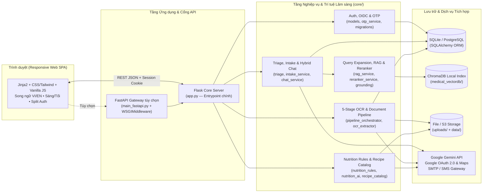

# MediMind Clinical AI

<p align="left">
  
  
  
  
  
</p>

**MediMind Clinical AI** là nền tảng web hỗ trợ tra cứu tri thức y khoa, sàng lọc và thu thập bệnh sử triệu chứng đa lượt, bóc tách đơn thuốc/phiếu xét nghiệm bằng thị giác máy tính kết hợp AI, gợi ý thực đơn dinh dưỡng cá nhân hóa và kết nối danh bạ cơ sở khám chữa bệnh.

Hệ thống được thiết kế theo triết lý **An toàn Lâm sàng Trước tiên (Safety-First Clinical Architecture)**: kết hợp bộ lọc cảnh báo cấp cứu tất định, truy xuất tri thức có kiểm chứng (Hybrid RAG + Reranker), hợp đồng dữ liệu có cấu trúc (JSON Schema) và quy trình xác nhận kết quả bởi người dùng (Human-in-the-Loop).

> [!IMPORTANT]
> **Tuyên bố miễn trừ trách nhiệm y tế:** MediMind Clinical AI là nguyên mẫu công nghệ (Proof of Concept) phục vụ mục đích tham khảo thông tin sức khỏe và hỗ trợ chuẩn bị thông tin trước buổi khám. Mọi phản hồi từ AI hoặc kết quả bóc tách OCR **không thay thế** việc thăm khám trực tiếp, chẩn đoán chuyên khoa hay chỉ định điều trị của bác sĩ. Khi xuất hiện dấu hiệu cấp cứu đe dọa tính mạng tại Việt Nam, vui lòng gọi ngay **115** hoặc đến khoa cấp cứu gần nhất.

---

## Mục lục

1. [Các phân hệ chức năng cốt lõi](#1-các-phân-hệ-chức-năng-cốt-lõi)
2. [Kiến trúc hệ thống & Luồng xử lý](#2-kiến-trúc-hệ-thống--luồng-xử-lý)
3. [Công nghệ sử dụng (Tech Stack)](#3-công-nghệ-sử-dụng-tech-stack)
4. [Cấu trúc thư mục dự án](#4-cấu-trúc-thư-mục-dự-án)
5. [Mô hình cơ sở dữ liệu](#5-mô-hình-cơ-sở-dữ-liệu)
6. [Tổng quan REST API](#6-tổng-quan-rest-api)
7. [Hướng dẫn cài đặt & Khởi chạy cục bộ](#7-hướng-dẫn-cài-đặt--khởi-chạy-cục-bộ)
8. [Cấu hình biến môi trường](#8-cấu-hình-biến-môi-trường)
9. [Kiểm thử tự động & Quản trị chất lượng kho mã](#9-kiểm-thử-tự-động--quản-trị-chất-lượng-kho-mã)
10. [Tài liệu kỹ thuật liên quan](#10-tài-liệu-kỹ-thuật-liên-quan)

---

## 1. Các phân hệ chức năng cốt lõi

### 1.1. Trợ lý Sức khỏe & Phân luồng Triệu chứng Lâm sàng (`Clinical Chat & Triage`)
- **Chốt chặn dấu hiệu nguy cấp (`Red-Flag Triage`):** Kiểm tra tất định các triệu chứng nguy hiểm tính mạng (đau thắt ngực cấp, dấu hiệu đột quỵ, khó thở dữ dội, phản vệ, nguy cơ tự hại...) tại `core/triage.py` để phát cảnh báo khẩn cấp **115** ngay lập tức trước khi chuyển sang mô hình ngôn ngữ.
- **Thu thập bệnh sử đa lượt (`Multi-Turn Clinical Intake`):** Quản lý phiên hỏi bệnh có cấu trúc (`core/intake_service.py`), cho phép hiệu chỉnh từng dữ kiện triệu chứng và tổng hợp **Bản tóm tắt trước buổi khám (`Pre-Visit Clinical Summary`)** hỗ trợ bác sĩ tiếp nhận nhanh thông tin.
- **Truy xuất tri thức lai (`Hybrid RAG + Reranker`):** Mở rộng truy vấn y khoa (`core/query_expansion_service.py`), kết hợp tìm kiếm từ khóa và vector trên chỉ mục `ChromaDB` cục bộ (`core/rag_service.py`), xếp hạng lại ngữ cảnh (`core/reranker_service.py`) và kiểm chứng trích dẫn nguồn (`core/grounding_service.py`).
- **Đầu ra chuẩn hóa & Cơ chế dự phòng:** Ràng buộc phản hồi Gemini theo `Pydantic / JSON Schema` (`core/gemini_schema_service.py`), tự động chuyển sang chế độ phản hồi dự phòng an toàn khi thiếu khóa API hoặc mất kết nối.

### 1.2. Bóc tách Đơn thuốc & Phiếu Xét nghiệm Đa tầng (`5-Stage OCR Pipeline`)
Điều phối qua `core/pipeline_orchestrator.py` với 5 chặng kiểm soát chất lượng tuần tự:
1. **Tiền xử lý ảnh (`Image Preprocessing`):** Khử nhiễu, cân bằng độ tương phản và chuẩn hóa kích thước tài liệu (`JPG`, `PNG`, `PDF`) bằng OpenCV & Pillow (`core/image_preprocessor.py`, `core/preprocessing_service.py`).
2. **Trích xuất song song (`Parallel OCR Extraction`):** Bóc tách văn bản, tên thuốc, liều dùng và chỉ số sinh hóa đa luồng (`core/ocr_extractor.py`, `core/ocr_parallel_service.py`).
3. **Đối soát & Chuẩn hóa (`Reconciliation`):** Hợp nhất dữ liệu trích xuất và xử lý các trường hợp nhập nhằng (`core/reconciliation_service.py`).
4. **Kiểm định hợp đồng dữ liệu (`Schema Validation`):** Rà soát định dạng, đơn vị đo và đánh dấu độ tin cậy (`core/validation_service.py`).
5. **Diễn giải tham khảo & Xác nhận người dùng (`Interpretation & Human-in-the-Loop`):** Giải thích ý nghĩa tham khảo của chỉ số (`core/interpretation_service.py`) và yêu cầu người dùng rà soát, xác nhận trước khi lưu vào hồ sơ cá nhân.

### 1.3. Danh bạ Cơ sở Y tế & Đặt lịch Khám (`Facility Directory & Booking`)
- Tra cứu danh mục cơ sở khám chữa bệnh chuẩn hóa trên toàn quốc (`data/CSKCB_Data/`).
- Bộ lọc đa chiều theo tỉnh/thành phố, quận/huyện, loại hình/tuyến chuyên môn và từ khóa chuyên khoa.
- Tích hợp bản đồ tương tác Google Maps (hỗ trợ cả chế độ nhúng không cần khóa và Maps JavaScript API) kèm luồng tạo, tra cứu và hủy lịch hẹn khám cá nhân.

### 1.4. Tư vấn & Pha chế Dinh dưỡng Cá nhân hóa (`Clinical Nutrition Studio`)
- Kết hợp động cơ quy tắc dinh dưỡng tất định (`core/nutrition_rules.py`, `core/nutrition_options.py`) theo thể trạng, mục tiêu sức khỏe, dị ứng và bệnh lý nền.
- Đối sánh trực tiếp với kho công thức món ăn Việt Nam có kiểm chứng nguồn gốc (`core/recipe_catalog.py`, `core/recipe_features.py` từ dữ liệu *Wikibooks* & *ViFoodRec*) cùng phân tích khẩu phần từ AI (`core/nutrition_ai.py`).

### 1.5. Định danh Đa phương thức & Bảo mật Hồ sơ (`Multi-Provider Auth & Privacy`)
- **Giao diện xác thực tràn viền 2 cột (`Split-Screen Auth Shell`):** Tối ưu trải nghiệm trên cả Desktop và Mobile, hỗ trợ song ngữ `VI / EN` và hoạt động độc lập với chế độ giao diện Sáng/Tối của trang chính.
- **Định danh chuẩn hóa:** Hỗ trợ đăng ký/đăng nhập qua **Email**, **Số điện thoại chuẩn E.164** (lưu trữ tách biệt, không sinh email giả lập), **Google OAuth 2.0 / OIDC** (liên kết qua bảng `auth_identities`) và xác thực **OTP 6 chữ số** qua Email SMTP/SMS (`core/otp_service.py`).
- **Cô lập dữ liệu cá nhân:** Phân quyền truy cập hồ sơ, phiên tư vấn, lịch hẹn và tệp tải lên nghiêm ngặt theo chủ sở hữu phiên đăng nhập; kiểm tra chữ ký tệp và chống tấn công Path Traversal (`core/security_patch.py`, `core/storage_service.py`); đồng bộ phiên đăng nhập đa tab tức thì qua `BroadcastChannel`.

---

## 2. Kiến trúc hệ thống & Luồng xử lý



> [!NOTE]
> `app.py` (Flask) là **điểm khởi chạy chính thức** phục vụ trọn vẹn giao diện web, cơ sở y tế, dinh dưỡng, OCR, tư vấn lâm sàng và tài khoản. `main_fastapi.py` là gateway bất đồng bộ bổ trợ cho một phần luồng chat/xác thực/đơn thuốc thông qua `WSGIMiddleware` và chưa thay thế toàn bộ `app.py`.

---

## 3. Công nghệ sử dụng (Tech Stack)

| Phân tầng | Công nghệ / Thư viện | Vai trò trong hệ thống |
|---|---|---|
| **Backend Web & API** | `Flask 3.1`, `FastAPI`, `Uvicorn`, `Gunicorn` | Phục vụ giao diện SSR/SPA, RESTful API, quản lý phiên và cổng WSGI/ASGI |
| **AI & Truy xuất Tri thức** | `google-genai` (Gemini), `ChromaDB`, `Pydantic v2` | Sinh phản hồi theo JSON Schema, truy xuất tài liệu y khoa (Lexical/Vector RAG), kiểm chứng nguồn |
| **Thị giác & Xử lý Tài liệu** | `OpenCV Headless`, `Pillow`, `pypdf` | Tiền xử lý ảnh chụp y tế, đọc tài liệu PDF và trích xuất thông tin đơn thuốc/xét nghiệm |
| **Cơ sở dữ liệu & Bộ nhớ đệm** | `Flask-SQLAlchemy`, `SQLite` / `PostgreSQL`, `Redis` | Lưu trữ quan hệ chuẩn hóa, tự động migration schema, bộ nhớ đệm & giới hạn tần suất (Rate Limiting) |
| **Giao diện người dùng (Frontend)** | `HTML5 / Jinja2`, `CSS3 / Tailwind Utility`, `Vanilla JS` | Giao diện Spatial Glassy hiện đại, đáp ứng đa thiết bị, đồng bộ đa tab, bản đồ tương tác |
| **Bảo mật & Xác thực** | `Werkzeug Security`, `PyJWT`, `Google OIDC`, `SMTP OTP` | Băm mật khẩu an toàn, định danh đa phương thức, bảo vệ phiên cookie (`HttpOnly`, `SameSite`) |
| **Kiểm thử & Đảm bảo chất lượng** | `Pytest`, `AST Hygiene Checker` | Kiểm thử đơn vị, tích hợp, hồi quy xác thực, hợp đồng AI Schema và vệ sinh kho mã |

---

## 4. Cấu trúc thư mục dự án

```text
Medical ChatBOT/
├── app.py                          # Entrypoint chính (Flask Web Server & toàn bộ REST API)
├── main_fastapi.py                 # Gateway FastAPI tùy chọn (tích hợp Flask qua WSGIMiddleware)
├── ingest.py                       # Công cụ nạp dữ liệu chuẩn hóa vào chỉ mục ChromaDB cục bộ
├── core/                           # Tầng xử lý nghiệp vụ cốt lõi (Domain & AI Services)
│   ├── models.py                   # Các thực thể SQLAlchemy ORM (User, AuthIdentity, Document...)
│   ├── migrations.py               # Cơ chế tự động nâng cấp & chuẩn hóa lược đồ CSDL an toàn
│   ├── triage.py                   # Bộ lọc cờ đỏ cấp cứu (Red-Flag Emergency Triage)
│   ├── intake_service.py           # Quản lý phiên hỏi bệnh đa lượt & tóm tắt trước buổi khám
│   ├── chat_service.py             # Điều phối hội thoại sức khỏe & kết nối ngữ cảnh y khoa
│   ├── health_context.py           # Chuẩn hóa hồ sơ nền của người dùng cho phiên tư vấn
│   ├── rag_service.py              # Truy xuất tri thức từ ChromaDB (Lexical & Vector Search)
│   ├── query_expansion_service.py  # Mở rộng từ đồng nghĩa & thuật ngữ lâm sàng cho truy vấn
│   ├── reranker_service.py         # Xếp hạng lại đoạn tài liệu theo mức độ liên quan lâm sàng
│   ├── grounding_service.py        # Kiểm chứng căn cứ y khoa & gắn nhãn nguồn tham khảo
│   ├── gemini_service.py           # Kết nối Google Gemini API kèm xử lý lỗi & timeout
│   ├── gemini_schema_service.py    # Định nghĩa hợp đồng dữ liệu đầu ra có cấu trúc (Pydantic)
│   ├── pipeline_orchestrator.py    # Nhạc trưởng điều phối quy trình OCR 5 bước
│   ├── image_preprocessor.py       # Tiền xử lý ảnh đơn thuốc/phiếu xét nghiệm bằng OpenCV
│   ├── preprocessing_service.py    # Chuẩn hóa định dạng tệp đầu vào trước khi bóc tách
│   ├── ocr_extractor.py            # Trích xuất thông tin thuốc & chỉ số xét nghiệm
│   ├── ocr_parallel_service.py     # Xử lý bóc tách tài liệu nhiều trang song song
│   ├── reconciliation_service.py   # Đối soát chéo & làm sạch kết quả trích xuất OCR
│   ├── validation_service.py       # Xác thực cấu trúc dữ liệu y tế sau bóc tách
│   ├── interpretation_service.py   # Diễn giải ý nghĩa tham khảo của kết quả xét nghiệm/đơn thuốc
│   ├── prescription_service.py     # Nghiệp vụ quản lý lịch sử đơn thuốc & tài liệu y tế
│   ├── nutrition_rules.py          # Quy tắc dinh dưỡng lâm sàng tất định theo thể trạng/bệnh lý
│   ├── nutrition_options.py        # Cấu hình tùy chọn khẩu phần, dị ứng và mục tiêu dinh dưỡng
│   ├── nutrition_ai.py             # Phân tích & gợi ý thực đơn cá nhân hóa kết hợp AI
│   ├── nutrition_service.py        # Điều phối luồng tư vấn dinh dưỡng tổng hợp
│   ├── recipe_catalog.py           # Truy vấn danh mục công thức món ăn chuẩn hóa
│   ├── recipe_features.py          # Trích xuất đặc trưng dinh dưỡng & nguyên liệu món ăn
│   ├── otp_service.py              # Sinh, băm & xác thực mã OTP 6 chữ số có thời hạn
│   ├── email_service.py            # Gửi mã xác thực OTP qua giao thức SMTP TLS
│   ├── sms_service.py              # Cổng gửi thông báo xác thực qua SMS
│   ├── cache_service.py            # Bộ nhớ đệm Redis / In-Memory phục vụ hiệu năng & Rate Limit
│   ├── storage_service.py          # Lưu trữ tệp tải lên an toàn (Local Filesystem / AWS S3)
│   ├── security_patch.py           # Kiểm tra bảo mật đầu vào & ngăn chặn Path Traversal
│   └── prompts.py                  # Hệ thống System Prompts chuyên biệt theo từng tác vụ
├── templates/                      # Giao diện HTML Jinja2 (index.html, api_docs.html)
├── static/                         # Tài nguyên tĩnh (css/style.css, js/app.js, images/, vendor/)
├── data/                           # Dữ liệu nguồn (CSKCB_Data/, curated/, recipes/, README.md)
├── scripts/                        # Công cụ nhập liệu công thức, khôi phục ảnh & kiểm tra vệ sinh repo
├── evaluation/                     # Dữ liệu & bộ công cụ đánh giá chất lượng truy xuất RAG
├── tests/                          # Bộ kiểm thử tự động toàn diện (Pytest)
├── docs/                           # Tài liệu kiến trúc, RAG reranker, dinh dưỡng & bản thiết kế
├── requirements.txt                # Danh sách thư viện chạy ứng dụng chính
├── requirements-dev.txt            # Thư viện phục vụ kiểm thử tự động
└── requirements-tools.txt          # Thư viện phụ trợ cho các script xử lý dữ liệu trong scripts/
```

---

## 5. Mô hình cơ sở dữ liệu

Mặc định hệ thống khởi tạo cơ sở dữ liệu SQLite tại `instance/medimind.db` (hoặc kết nối `PostgreSQL` qua biến `DATABASE_URL`) và tự động chạy `core/migrations.py` khi khởi động:

| Thực thể ORM (`core/models.py`) | Bảng CSDL | Chức năng lưu trữ |
|---|---|---|
| `User` | `users` | Hồ sơ người dùng, mật khẩu băm, email chữ thường hoặc SĐT chuẩn `E.164`, thông tin sinh trắc cơ bản |
| `AuthIdentity` | `auth_identities` | Liên kết đa phương thức đăng nhập (`email`, `phone`, `google` OIDC `sub`) về cùng một `user_id` |
| `MedicalDocument` | `medical_documents` | Siêu dữ liệu đơn thuốc, phiếu xét nghiệm tải lên và kết quả bóc tách JSON đã xác nhận |
| `ClinicalConsultation` | `clinical_consultations` | Lịch sử các phiên trò chuyện sức khỏe, phân tầng mức độ khẩn cấp và tóm tắt lâm sàng |
| `IntakeSessionRecord` | `intake_sessions` | Trạng thái phiên thu thập bệnh sử đa lượt, danh sách triệu chứng và bản tóm tắt trước khám |
| `MedicalAppointment` | `medical_appointments` | Lịch hẹn khám bệnh tại các cơ sở y tế theo từng tài khoản người dùng |

---

## 6. Tổng quan REST API

| Nhóm nghiệp vụ | Endpoint tiêu biểu | Phương thức | Mô tả |
|---|---|---|---|
| **Xác thực & Hồ sơ** | `/api/auth/register`, `/api/auth/login`, `/api/auth/logout` | `POST` | Đăng ký, đăng nhập (Email / SĐT E.164) và đăng xuất phiên |
| **OTP & Khôi phục** | `/api/auth/otp/send`, `/api/auth/otp/verify`, `/api/auth/reset-password` | `POST` | Gửi/xác minh mã OTP 6 số và đặt lại mật khẩu |
| **Google OAuth / OIDC** | `/api/auth/google/login`, `/api/auth/google/callback`, `/api/auth/google` | `GET`, `POST` | Đăng nhập một chạm và liên kết định danh Google OAuth 2.0 |
| **Tài khoản cá nhân** | `/api/auth/me`, `/api/auth/profile`, `/api/auth/change-password` | `GET`, `PUT`, `POST` | Truy vấn phiên hiện tại, cập nhật hồ sơ y tế cá nhân và đổi mật khẩu |
| **Tư vấn & Hỏi bệnh** | `/api/chat`, `/api/intake/session`, `/api/intake/message`, `/api/intake/confirm-summary` | `POST` | Trò chuyện sức khỏe Hybrid RAG, hỏi bệnh đa lượt và chốt tóm tắt trước khám |
| **Lịch sử lâm sàng** | `/api/clinical-summary`, `/api/consultations`, `/api/consultations/<id>` | `GET`, `DELETE` | Xem bản tóm tắt sức khỏe tổng hợp và quản lý lịch sử tư vấn |
| **OCR & Tài liệu y tế** | `/api/prescription/scan`, `/api/upload-lab`, `/api/prescription/history` | `POST`, `GET`, `DELETE` | Tải lên, bóc tách đơn thuốc/xét nghiệm 5 bước và quản lý kho hồ sơ |
| **Cơ sở y tế & Đặt lịch** | `/api/facilities`, `/api/facilities/filters`, `/api/facilities/map-markers`, `/api/appointments` | `GET`, `POST`, `DELETE` | Tìm kiếm bệnh viện/phòng khám, lấy tọa độ bản đồ và đặt/hủy lịch hẹn |
| **Dinh dưỡng lâm sàng** | `/api/nutrition/options`, `/api/nutrition/analyze` | `POST` | Lấy bộ tham số dinh dưỡng và phân tích thực đơn món ăn cá nhân hóa |

---

## 7. Hướng dẫn cài đặt & Khởi chạy cục bộ

### Yêu cầu môi trường
- **Python:** `3.11` trở lên
- **Git** và kết nối mạng (để cài đặt gói phụ thuộc, tải mô hình embedding lần đầu hoặc gọi Gemini / Google Maps API)

### Bước 1: Sao chép mã nguồn & Khởi tạo môi trường ảo

**Trên Windows (PowerShell):**
```powershell
git clone https://github.com/khiemdong2005/chatbot_medical.git
cd chatbot_medical
python -m venv .venv
.\.venv\Scripts\Activate.ps1
python -m pip install --upgrade pip
python -m pip install -r requirements.txt
Copy-Item .env.example .env
```

**Trên Linux / macOS (Bash / Zsh):**
```bash
git clone https://github.com/khiemdong2005/chatbot_medical.git
cd chatbot_medical
python3 -m venv .venv
source .venv/bin/activate
python -m pip install --upgrade pip
python -m pip install -r requirements.txt
cp .env.example .env
```

### Bước 2: Thiết lập khóa bảo mật & Biến môi trường

Sinh khóa ký phiên `SECRET_KEY` ngẫu nhiên độ dài 64 ký tự hex:
```bash
python -c "import secrets; print(secrets.token_hex(32))"
```
Mở tệp `.env`, điền giá trị `SECRET_KEY` vừa tạo và bổ sung `GEMINI_API_KEY` để kích hoạt đầy đủ năng lực phân tích AI & OCR.

### Bước 3: Xây dựng chỉ mục tri thức y khoa cục bộ (`ChromaDB`)

Kho mã chỉ lưu trữ tập tài liệu nguồn đã chuẩn hóa tại `data/curated/ready_documents/`; chỉ mục cơ sở dữ liệu vector `medical_vectordb/` được sinh cục bộ trên máy:

```bash
python ingest.py
```
- Script sẽ chia nhỏ tài liệu, tạo collection mới trong `medical_vectordb/`, kiểm tra toàn vẹn số lượng bản ghi và cập nhật `medical_vectordb/active_collection.json`.
- Nếu máy đã có sẵn thư mục `medical_vectordb/` đang vận hành, hãy **sao lưu toàn bộ thư mục ra ngoài dự án** trước khi nạp lại (không sao lưu rời rạc từng tệp `.bin`).

### Bước 4: Khởi chạy ứng dụng

```bash
python app.py
```
Mở trình duyệt tại địa chỉ **[http://127.0.0.1:8000](http://127.0.0.1:8000)**.

> [!TIP]
> Dữ liệu SQLite cục bộ được tự động tạo trong `instance/` và tài liệu tải lên được lưu tại `uploads/`. Tuyệt đối không đưa `.env`, `instance/`, `uploads/` hoặc `medical_vectordb/` vào Git commit.

---

## 8. Cấu hình biến môi trường

Chi tiết mẫu cấu hình nằm tại [.env.example](.env.example):

| Biến môi trường | Mặc định | Ý nghĩa cấu hình |
|---|---|---|
| `HOST`, `PORT` | `127.0.0.1`, `8000` | Địa chỉ lắng nghe và cổng mạng của máy chủ Flask |
| `FLASK_DEBUG` | `false` | Chế độ gỡ lỗi phát triển (`true` / `false`); luôn tắt trên môi trường thực tế |
| `SECRET_KEY` | *(Bắt buộc đặt riêng)* | Khóa mật mã ký cookie phiên đăng nhập; cần giữ ổn định giữa các lần khởi động |
| `SESSION_COOKIE_SECURE` | `false` | Bật `true` khi triển khai sau HTTPS / Reverse Proxy |
| `GEMINI_API_KEY` | *(Để trống)* | Khóa API Google Gemini phục vụ hội thoại y khoa, OCR nâng cao và dinh dưỡng |
| `GEMINI_MODEL` | `gemini-flash-lite-latest` | Tên model Gemini sử dụng (phải khả dụng với tài khoản API của bạn) |
| `DATABASE_URL` | `sqlite:///medimind.db` | Chuỗi kết nối SQLAlchemy (`SQLite` trong `instance/` hoặc `postgresql://...`) |
| `SEED_DEMO_ACCOUNTS` | `false` | Tự động khởi tạo tài khoản mẫu phục vụ thử nghiệm cục bộ khi bật `true` |
| `RAG_VECTOR_SEARCH_ENABLED` | `false` | Bật truy vấn tương đồng vector trên ChromaDB (mặc định dùng Lexical Retrieval ổn định) |
| `RAG_ACCEPTANCE_THRESHOLD` | `1.35` | Ngưỡng khoảng cách chấp nhận kết quả truy xuất ngữ cảnh RAG |
| `GOOGLE_MAPS_API_KEY` | *(Tùy chọn)* | Khóa Maps JavaScript API; khi để trống giao diện tự dùng bản đồ nhúng tiêu chuẩn |
| `GOOGLE_CLIENT_ID`, `GOOGLE_CLIENT_SECRET` | *(Tùy chọn)* | Thông tin ứng dụng Google Cloud OAuth 2.0 cho tính năng Đăng nhập bằng Google |
| `GOOGLE_REDIRECT_URI` | `http://127.0.0.1:8000/api/auth/google/callback` | URI phản hồi OAuth đã đăng ký khớp chính xác trên Google Cloud Console |
| `SMTP_SERVER`, `SMTP_PORT`, `SMTP_USERNAME`, `SMTP_PASSWORD` | *(Tùy chọn)* | Cấu hình máy chủ SMTP (`TLS`, cổng `587`) để gửi mã xác thực OTP qua email thật |

---

## 9. Kiểm thử tự động & Quản trị chất lượng kho mã

Cài đặt gói phụ thuộc phát triển trước khi chạy kiểm thử:

```bash
python -m pip install -r requirements-dev.txt
```

### Chạy toàn bộ bộ kiểm thử tự động (`Pytest`)
```bash
python -m pytest tests -q
```
Bộ kiểm thử bao phủ các luồng trọng yếu:
- **Xác thực & Phân quyền (`test_auth_regression.py`, `test_auth_and_permissions.py`):** Chuẩn hóa SĐT `E.164`, đăng nhập Google OIDC, OTP, migration dữ liệu cũ và cô lập quyền truy cập hồ sơ.
- **An toàn Lâm sàng & Hợp đồng AI (`test_safety_guardrails.py`, `test_ai_contract_and_schema.py`, `test_clinical_intake.py`):** Phát hiện cờ đỏ cấp cứu, tuân thủ JSON Schema và luồng thu thập bệnh sử.
- **Tài liệu Y tế & Bảo mật Tải tệp (`test_review_workflows.py`, `test_upload_security.py`):** Quy trình xác nhận OCR và chặn tệp độc hại/sai định dạng.
- **RAG, Dinh dưỡng & Giao diện (`test_rag_and_ingestion.py`, `test_nutrition_rules.py`, `test_nutrition_studio.py`, `test_facility_page_layout.py`).**

### Kiểm tra vệ sinh kho mã & Cú pháp Python (`Repository Hygiene`)
Trước khi tạo commit hoặc gửi Pull Request, chạy công cụ kiểm tra tự động:
```bash
python scripts/check_repository_hygiene.py
```
Công cụ sẽ phân tích cú pháp AST của toàn bộ tệp `.py` được theo dõi bởi Git và đảm bảo không có tệp cấu hình cá nhân, cơ sở dữ liệu cục bộ, bộ nhớ đệm hay tệp tải lên của người dùng bị lọt vào kho mã.

*(Khi cần chạy các công cụ thu thập/đồng bộ dữ liệu công thức trong `scripts/`, cài đặt thêm `python -m pip install -r requirements-tools.txt`).*

---

## 10. Tài liệu kỹ thuật liên quan

- [Kiến trúc hệ thống hiện tại (`docs/architecture.md`)](docs/architecture.md)
- [Quy chuẩn dữ liệu nguồn & Lưu trữ cục bộ (`data/README.md`)](data/README.md)
- [Cơ chế truy xuất RAG & Xếp hạng lại ngữ cảnh (`docs/rag-reranker.md`)](docs/rag-reranker.md)
- [Hệ thống gợi ý dinh dưỡng lâm sàng (`docs/nutrition-recommendations.md`)](docs/nutrition-recommendations.md)
- [Bảo trì kho mã & Quy trình dọn dẹp (`docs/repository-maintenance.md`)](docs/repository-maintenance.md)
- [Hướng dẫn đóng góp mã nguồn (`CONTRIBUTING.md`)](CONTRIBUTING.md)
