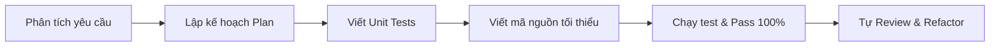

# 10. Superpowers — Quy trình lập kế hoạch, TDD, review

## 📌 Tổng quan
Superpowers là bộ nguyên tắc phương pháp luận nâng cao giúp biến AI Agent từ một người "chỉ viết code" thành một "Senior Tech Lead":
1. **Planning First**: Luôn lập kế hoạch chi tiết (Plan) trước khi sửa đổi bất kỳ file nào.
2. **Test-Driven Development (TDD)**: Viết test case kiểm thử trước khi viết code logic.
3. **Rigorous Review**: Tự rà soát kiểm tra lỗi cú pháp, bảo mật và hiệu năng trước khi báo cáo hoàn thành.

## 🔄 Chu trình làm việc chuẩn

## 💡 Mẹo dùng với Antigravity
* Gõ slash command `/plan` khi bắt đầu một tính năng mới phức tạp.
* Yêu cầu Agent: *"Hãy dùng phương pháp TDD, viết bài test pytest trước rồi mới triển khai hàm xử lý."*
