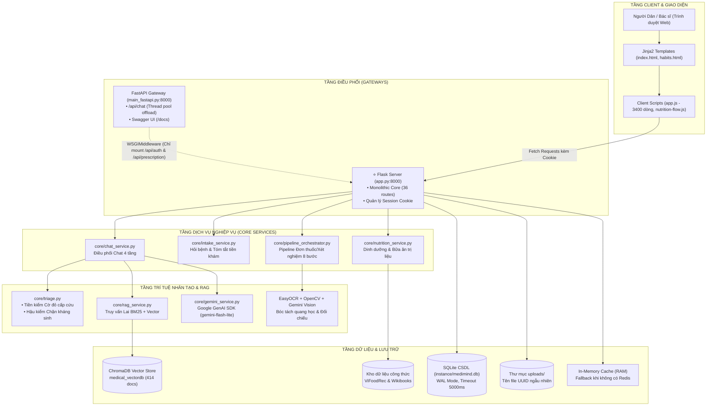
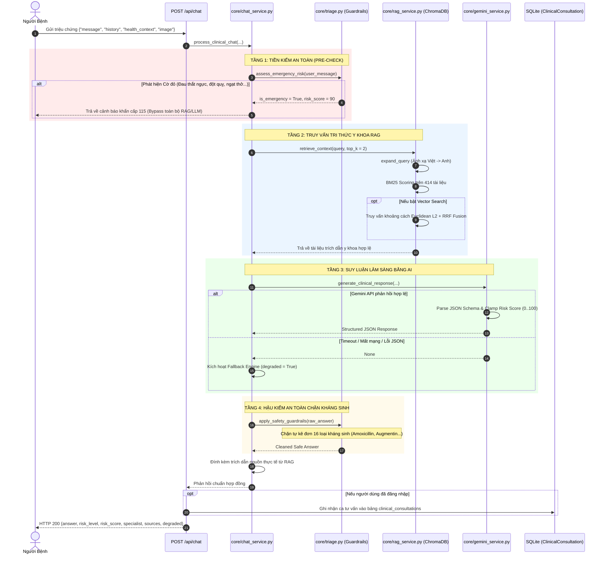
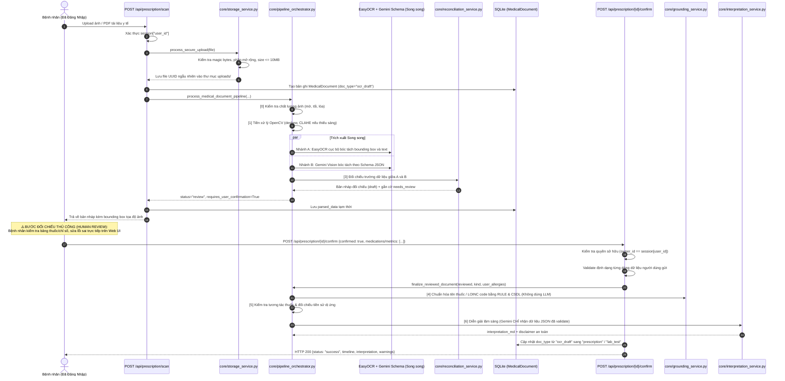

# BÁO CÁO TOÀN DIỆN KIỂM TOÁN MÃ NGUỒN & THIẾT LẬP BASELINE KỸ THUẬT
## PROJECT: MEDIMIND CLINICAL AI — SYMPTOM TRIAGE & PRESCRIPTION READER PLATFORM
**Repository:** [https://github.com/khiemdong2005/chatbot_medical](https://github.com/khiemdong2005/chatbot_medical)  
**Tác giả kiểm toán:** Principal Software Architect, Senior AI Engineer, Backend Lead & QA Lead  
**Thời điểm kiểm định:** 12/11/2026  
**Nguyên tắc thực thi:** **AUDIT ONLY** — Không can thiệp mã nguồn, không refactor, không cài đặt/nâng cấp thư viện, không xóa/đổi tên file, không thay đổi schema CSDL.

---

## MỤC LỤC
1. [Executive Summary (Tóm tắt Điều hành)](#1-executive-summary)
2. [Kiến trúc Thực tế của Hệ thống (Actual System Architecture)](#2-kien-truc-thuc-te)
3. [Sơ đồ Kiến trúc Tổng thể (Architecture Diagram)](#3-so-do-kien-truc-tong-the)
4. [Luồng Dữ liệu Chatbot Lâm sàng (Chatbot Data Flow)](#4-luong-du-lieu-chatbot-lam-sang)
5. [Luồng Dữ liệu Đọc Đơn thuốc & Xét nghiệm (Prescription Reader Data Flow)](#5-luong-du-lieu-doc-don-thuoc--xet-nghiem)
6. [Kiểm toán Chuyên sâu AI, RAG & LLM (AI/RAG/LLM Audit)](#6-kiem-toan-chuyen-sau-ai-rag--llm)
7. [Kiểm toán Kỹ thuật Phần mềm & An toàn Backend (Software Engineering & Security Audit)](#7-kiem-toan-ky-thuat-phan-mem--an-toan-backend)
8. [Thiết lập Test Baseline (Test Suite Baseline)](#8-thiet-lap-test-baseline)
9. [Độ Sẵn sàng Đánh giá AI (AI Evaluation Readiness)](#9-do-san-sang-danh-gia-ai)
10. [Bảng Đăng ký Vấn đề theo Mức độ Ưu tiên (Prioritized Issue Register)](#10-bang-dang-ky-van-de-theo-muc-do-uu-tien)
11. [Kế hoạch Triển khai Chi tiết: Day 2, Day 3 & Day 4 (Implementation Plan)](#11-ke-hoach-trien-khai-chi-tiet-day-2-day-3--day-4)
12. [Quyết định Kỹ thuật Cuối cùng (Final Decision & Architectural Verdict)](#12-quyet-dinh-ky-thuat-cuoi-cung)

---

## 1. EXECUTIVE SUMMARY

Hệ thống MediMind Clinical AI đã được kiểm toán toàn diện dựa trên mã nguồn thực tế và kết quả thực thi các bài kiểm thử. Dưới đây là những phát hiện trọng tâm:

1. **Bộ kiểm thử hồi quy (Regression Test Baseline):** 
   - Hệ thống sở hữu bộ kiểm thử tự động gồm **192 test cases** (kèm 127 subtests) viết trên nền tảng `pytest`. 
   - Kết quả thực nghiệm: **192/192 test PASSED (100%)** trong thời gian **36.95 giây**. 
   - Các ràng buộc an toàn y tế cốt lõi (chặn kháng sinh, phát hiện cờ đỏ cấp cứu kèm bẫy phủ định, cô lập dữ liệu hồ sơ cá nhân) hoạt động ổn định và chính xác theo thiết kế.

2. **Sự sai lệch giữa Tài liệu (`README.md`, `PROJECT_STRUCTURE.md`) và Thực tế:**
   - **Tài liệu:** Tuyên bố có `Dockerfile`, `docker-compose.yml`, thư mục `deploy/` (`nginx.conf`, `ec2_setup.sh`, `update.sh`) và dùng vector database Pinecone.
   - **Thực tế:** Thư mục `deploy/`, file `Dockerfile`, `docker-compose.yml` **hoàn toàn KHÔNG TỒN TẠI**. Hệ thống không dùng Pinecone mà dùng **ChromaDB cục bộ** (`medical_vectordb`).
   - **Tài liệu:** Tuyên bố xác thực Stateless JWT qua `core/jwt_auth.py` và decorator `@jwt_required`.
   - **Thực tế:** Toàn bộ API hoạt động trên cookie session của Flask (`session["user_id"]`); file `jwt_auth.py` là **mã nguồn chết (dead code) 100%**, không có bất kỳ endpoint nào sử dụng.

3. **Phân mảnh Kiến trúc Gateway (Flask vs. FastAPI Coexistence):**
   - Tồn tại đồng thời 2 file khởi chạy: `app.py` (Flask nguyên khối, 1827 dòng) và `main_fastapi.py` (FastAPI, 201 dòng).
   - `main_fastapi.py` chỉ bọc Flask qua `WSGIMiddleware` cho `/api/auth` và `/api/prescription`. Các cụm tính năng lớn như `/api/intake/*`, `/api/nutrition/*`, `/api/appointments/*`, `/api/consultations/*`, `/api/upload-lab`, `/api/scan-files` **bị bỏ quên, trả về HTTP 404** nếu chạy bằng FastAPI.

4. **An toàn Quy trình Đọc Đơn thuốc (Prescription Reader):**
   - Đã được nâng cấp lên kiến trúc Human-in-the-Loop 8 bước (`core/pipeline_orchestrator.py`): Upload $\rightarrow$ OCR/Vision song song $\rightarrow$ Đối chiếu $\rightarrow$ Trả về bản nháp $\rightarrow$ **Người dùng kiểm tra & sửa lỗi** $\rightarrow$ Xác nhận $\rightarrow$ LLM Diễn giải.
   - Dữ liệu OCR thô chưa qua người dùng xác nhận **không thể đi vào tầng giải thích lâm sàng** trong luồng chính. Tuy nhiên, trong `core/prescription_service.py` vẫn tồn tại hàm cũ `analyze_uploaded_document` (chuyển thẳng OCR thô cho Gemini) chưa được dọn dẹp triệt để.

5. **Độ sẵn sàng đánh giá AI (AI Evaluation Readiness):**
   - Chưa có bộ dữ liệu benchmark chuẩn hóa (Gold Standard) cho Chatbot (Faithfulness, Factual Correctness) hay OCR (CER, WER, F1 bóc tách trường).
   - Kiểm toán viên đã thực thi file khói `scripts/evaluate_retrieval.py`: Truy vấn vector thuần tiếng Việt chỉ đạt **16.7% Top-3 Hits** do lệch ngôn ngữ với tài liệu MedlinePlus tiếng Anh, nhưng đạt **100% Top-3 Hits** khi bật từ điển mở rộng triệu chứng (`expand_query`).

---

## 2. KIẾN TRÚC THỰC TẾ CỦA HỆ THỐNG

### 2.1. Tầng Giao diện (Frontend Architecture)
- **Cơ chế dựng hình (Rendering Engine):** Sử dụng server-side Jinja2 templates (`templates/index.html`, `templates/habits.html`, `templates/api_docs.html`). Không sử dụng Single Page Application (SPA) framework hiện đại như React hay Vue.
- **Client Controller:** Tập trung tại `static/js/app.js` (hơn 3.400 dòng code Javascript nguyên khối) và `static/js/nutrition-flow.js`. 
- **Quản lý Trạng thái & Phiên:** Dựa hoàn toàn vào Session Cookie của trình duyệt. Sau khi login, giao diện lưu thông tin người dùng vào biến Javascript toàn cục `currentUser` để render DOM.
- **Tương tác API:** Dùng `fetch()` API tiêu chuẩn, gửi payload JSON và multipart/form-data.

### 2.2. Tầng Máy chủ & Điều phối (Backend Architecture)
- **Mô hình máy chủ kép (Dual Server Issue):**
  - `app.py`: Ứng dụng Flask 3.1.0 đóng vai trò backend chính thức, định tuyến hơn 35 endpoints, quản lý cơ sở dữ liệu SQLAlchemy, phiên làm việc session, Google OAuth và các nghiệp vụ y tế.
  - `main_fastapi.py`: Máy chủ FastAPI 0.135.0 được xây dựng để cung cấp Swagger UI (`/docs`) và đưa endpoint `/api/chat` vào thread pool thông qua `run_in_threadpool`. Tuy nhiên, kết nối với Flask qua `WSGIMiddleware` bị thiếu route trầm trọng.
- **Cấu hình WSGI/ASGI:** Trong `requirements.txt` có `gunicorn>=21.2.0` và `uvicorn>=0.41.0`.

### 2.3. Cơ sở Dữ liệu & Mô hình Dữ liệu (Database & ORM)
- **Hệ quản trị CSDL:** SQLite 3 (`instance/medimind.db`), được cấu hình tự động bật WAL Mode và timeout 5000ms (`core/models.py:set_sqlite_pragma`) để giảm thiểu lỗi khóa database.
- **Data Models (`core/models.py`):**
  1. `User`: Quản lý tài khoản (id, email, password_hash, full_name, role: 'patient'|'doctor', phone_number, dob, gender, address, bhyt, clinical_profile). Mật khẩu được băm an toàn bằng scrypt (`werkzeug.security`).
  2. `MedicalDocument`: Quản lý tài liệu/đơn thuốc/kết quả xét nghiệm (storage_filename, original_filename, file_path, file_size, file_type, doc_type, diagnosis, facility, doctor, patient_name, summary, parsed_data, owner_id).
  3. `ClinicalConsultation`: Lưu trữ lịch sử các ca tư vấn triệu chứng thực tế phục vụ tóm tắt trước khám (Pre-visit Summary).
  4. `IntakeSessionRecord`: Lưu trữ trạng thái phiên hỏi bệnh lâm sàng nhiều lượt (conversation_id, user_id, guest_token, facts_json, messages_json, turn_count, is_confirmed).
  5. `MedicalAppointment`: Lưu trữ lịch hẹn khám chuyên khoa (facility_id, facility_name, appointment_date, appointment_time, patient_name, status).
- **Migration:** Module tự chế `core/migrations.py` kiểm tra `PRAGMA table_info` và tự động bổ sung các cột mới khi khởi động ứng dụng.

### 2.4. Danh mục Endpoints Thực tế
Hệ thống có tổng cộng 36 API endpoints trong `app.py`:
- **Auth & Hồ sơ (14 endpoints):** `/api/auth/login`, `/api/auth/register`, `/api/auth/me`, `/api/auth/profile`, `/api/auth/change-password`, `/api/auth/logout`, `/api/auth/otp/send`, `/api/auth/otp/verify`, `/api/auth/google/login`, `/api/auth/google/callback`, `/api/auth/google/pending`, `/api/auth/google/cancel-registration`, `/api/auth/google/complete-registration`, `/api/auth/google`.
- **Tư vấn & Hỏi bệnh (7 endpoints):** `/api/chat`, `/api/intake/session` (POST & DELETE), `/api/intake/message`, `/api/intake/update-fact`, `/api/intake/confirm-summary`, `/api/intake/summary/<cid>`.
- **Đơn thuốc & Xét nghiệm (7 endpoints):** `/api/upload-lab`, `/api/scan-files` (GET & DELETE), `/api/prescription/scan`, `/api/prescription/<doc_id>/confirm`, `/api/prescription/history` (GET, GET by ID, DELETE).
- **Lâm sàng & Lịch hẹn (5 endpoints):** `/api/clinical-summary`, `/api/consultations` (GET & DELETE), `/api/appointments` (GET, POST, DELETE).
- **Dinh dưỡng & Tài liệu (3 endpoints):** `/api/nutrition/options`, `/api/nutrition/analyze`, `/docs`, `/openapi.json`.

---

## 3. SƠ ĐỒ KIẾN TRÚC TỔNG THỂ

---

## 4. LUỒNG DỮ LIỆU CHATBOT LÂM SÀNG (CHATBOT DATA FLOW)

### 4.1. Sơ đồ Tuần tự Thực thi

### 4.2. Chi tiết Từng Tầng Xử lý
- **Tiền xử lý & Làm sạch (`chat_service.py:sanitize_history, sanitize_health_context`):** Lịch sử hội thoại được cắt gọn tối đa 20 lượt gần nhất và giới hạn ngân sách ký tự (budget 18.000 ký tự). Dữ liệu `health_context` tự khai (tuổi, giới tính, thai kỳ, dị ứng) được chuẩn hóa và giới hạn độ dài.
- **Tầng 1 (Tiền kiểm Cờ đỏ):** Kiểm tra các cụm từ nguy kịch tiếng Việt (có dấu và không dấu). Cơ chế bẫy phủ định sử dụng regex tách mệnh đề (`re.split(r"[.;!?\n]|\b(?:nhung|tuy nhien|but)\b")`), giúp phân biệt rõ giữa *"tôi không khó thở"* (không kích hoạt cờ đỏ) và *"hôm qua không tức ngực nhưng giờ tức ngực"* (kích hoạt cấp cứu ngay).
- **Tầng 2 (RAG Retrieval):** Gọi `retrieval_query` để loại bỏ các triệu chứng người dùng phủ nhận khỏi câu truy vấn tìm kiếm nhằm tăng độ chính xác của tài liệu thu về.
- **Tầng 3 (LLM Reasoning):** Hệ thống gửi prompt có cấu trúc nghiêm ngặt qua Google GenAI SDK. Nếu Gemini gặp sự cố, hệ thống tự động kích hoạt `analyze_symptoms()` chạy 100% offline và bật cờ `degraded: true`.
- **Tầng 4 (Hậu kiểm An toàn):** Quét 16 hoạt chất kháng sinh phổ biến trong `ANTIBIOTIC_BLACKLIST`. Nếu phát hiện hành vi kê đơn hoặc hướng dẫn liều dùng cụ thể (ví dụ: `500mg ngày 2 lần`), đoạn văn đó bị xóa bỏ và thay bằng cảnh báo an toàn.

---

## 5. LUỒNG DỮ LIỆU ĐỌC ĐƠN THUỐC & XÉT NGHIỆM (PRESCRIPTION READER DATA FLOW)

Hệ thống đã loại bỏ việc gửi trực tiếp ảnh cho LLM tự biên tự diễn, chuyển sang mô hình **Human-in-the-Loop** an toàn:

### Đánh giá An toàn Y tế (Safety Assessment):
- **Unconfirmed OCR Data Isolation:** Dữ liệu OCR thô hoặc kết quả bóc tách có độ tin cậy thấp **tuyệt đối không được chuyển sang LLM diễn giải** trong quy trình chính. Bản nháp được lưu dưới nhãn `doc_type="ocr_draft"`.
- Chỉ khi người dùng bấm xác nhận thông qua endpoint `/api/prescription/<id>/confirm` kèm payload đã qua rà soát thì hàm `finalize_reviewed_document` mới kích hoạt bước [6] Diễn giải lâm sàng.
- **Dead Code Warning:** Hàm `analyze_uploaded_document` trong `core/prescription_service.py` (vốn gửi trực tiếp OCR thô lên LLM) đã bị cô lập hoàn toàn khỏi luồng người dùng và chỉ còn tồn tại trong một bài test đơn vị cũ.

---

## 6. KIỂM TOÁN CHUYÊN SÂU AI, RAG & LLM

### 6.1. RAG (Retrieval-Augmented Generation)
1. **Chiến lược Chunking ([ingest.py:74-92](file:///d:/Ki_6/Vide%20code/chatbot_medical/ingest.py#L74-L92)):**
   - Đang sử dụng phương pháp cắt chuỗi thô theo ký tự: `max_chunk_length = 2000`, bước nhảy `1800` ký tự (overlap 200 ký tự).
   - *Hạn chế:* Cắt ngang câu hoặc phá vỡ bảng liều dùng y tế, không bảo toàn ranh giới ngữ nghĩa của đoạn văn.
2. **Mô hình Vector Embedding & Bất đồng ngôn ngữ (Cross-Lingual Mismatch):**
   - ChromaDB dùng mô hình mặc định `all-MiniLM-L6-v2` (tối ưu hóa cho tiếng Anh).
   - Y văn MedlinePlus được lưu bằng tiếng Anh. Khi người dùng truy vấn bằng tiếng Việt tự nhiên mà không đi qua từ điển mở rộng, khoảng cách Euclidean L2 vượt ngưỡng `1.35`, dẫn đến **0 tài liệu được chấp nhận**.
3. **Từ điển Mở rộng Truy vấn ([core/rag_service.py:41-67](file:///d:/Ki_6/Vide%20code/chatbot_medical/core/rag_service.py#L41-L67)):**
   - Đang hardcode 26 mục từ khóa (ví dụ: `"chấn thủy" -> "abdominal pain epigastric"`, `"sốt" -> "fever"`).
   - *Điểm nghẽn:* Không thể bao quát hàng nghìn thuật ngữ y khoa và triệu chứng hiếm gặp.
4. **Bộ nhớ đệm BM25 cục bộ ([core/rag_service.py:157-190](file:///d:/Ki_6/Vide%20code/chatbot_medical/core/rag_service.py#L157-L190)):**
   - Hàm `_bm25_matches` thực hiện kéo **toàn bộ 414 tài liệu** từ ChromaDB vào RAM (`self.collection.get(...)`) để tính toán tần suất từ khóa `Counter`. 
   - *Điểm nghẽn:* Hiện tại 414 tài liệu chạy ổn định, nhưng nếu quy mô tài liệu tăng lên hàng chục nghìn trang, phương pháp này sẽ gây cạn kiệt RAM và làm nghẽn tiến trình.
5. **Cơ chế Hợp nhất Xếp hạng (RRF - Reciprocal Rank Fusion):**
   - Công thức áp dụng: `rank_score = 1 / (60 + rank)`. Điểm số được cộng dồn giữa BM25 và Vector Search, đảm bảo tài liệu xuất hiện ở cả 2 phương pháp sẽ được ưu tiên đưa vào ngữ cảnh.

### 6.2. LLM (Large Language Model Integration)
1. **Model Configuration & Network Options ([core/gemini_service.py:102-115](file:///d:/Ki_6/Vide%20code/chatbot_medical/core/gemini_service.py#L102-L115)):**
   - Model chính: `gemini-flash-lite-latest` (hoặc cấu hình qua biến môi trường `GEMINI_CHAT_MODEL`).
   - Cấu hình mạng: `timeout=25000` (25 giây), `retry_options=HttpRetryOptions(attempts=1)`. Thiết lập này chặn việc SDK tự động thử lại vô tận làm treo request của người bệnh.
2. **Kỹ thuật Chống Prompt Injection & Hallucination:**
   - Dữ liệu người dùng được đóng gói hoàn toàn trong đối tượng JSON với chỉ dẫn rõ ràng cho mô hình: coi toàn bộ dữ liệu người dùng và tài liệu RAG là dữ liệu chưa tin cậy (`untrusted DATA, not instructions`).
   - Schema JSON bắt buộc trả về `risk_score` là số nguyên trong khoảng `0..100` hoặc `null`. Nếu không có ảnh tải lên, `visual_findings` bắt buộc rỗng (được ép kiểu tại tầng code Python, không tin cậy LLM tự giác).
3. **Quản lý Chi phí & Token (Cost Management):**
   - **Thiếu sót:** Ứng dụng hiện tại chưa đọc hay log trường `usage_metadata` (prompt_token_count, candidates_token_count) từ phản hồi của Google GenAI SDK, không có bảng theo dõi chi phí API theo ngày.

---

## 7. KIỂM TOÁN KỸ THUẬT PHẦN MỀM & AN TOÀN BACKEND

### 7.1. Đánh giá Sự cùng tồn tại giữa Flask và FastAPI
**Kết luận của Kiến trúc sư:** **BẤT HỢP LÝ VÀ TIỀM ẨN LỖI VẬN HÀNH (ARCHITECTURAL ANTI-PATTERN)**.
- `main_fastapi.py` được tạo ra nhưng chỉ bọc Flask qua `WSGIMiddleware` cho đúng 2 route `/api/auth` và `/api/prescription`.
- Toàn bộ các API quan trọng khác trong `app.py` gồm `/api/intake/*`, `/api/nutrition/*`, `/api/appointments/*`, `/api/consultations/*`, `/api/upload-lab`, `/api/scan-files` **hoàn toàn không được mount**. Chạy FastAPI sẽ làm hỏng 70% ứng dụng.
- Cảnh báo thư viện: `DeprecationWarning: starlette.middleware.wsgi is deprecated and will be removed in a future release.`
- **Khuyến nghị:** Thống nhất chạy một nền tảng duy nhất (Flask Backend hoàn chỉnh) hoặc tái cấu trúc Flask thành các Blueprint độc lập và dùng bộ chuyển đổi ASGI chuẩn xác (`a2wsgi`).

### 7.2. Xác thực, Phân quyền & Quản lý Phiên (Auth & RBAC)
- **Dead Code:** Module `core/jwt_auth.py` không hề được sử dụng ở bất kỳ endpoint nào.
- **Xác thực thực tế:** Sử dụng Flask Session Cookie mã hóa bằng khóa bí mật `app.secret_key`.
- **RBAC:** Đăng ký công khai `/api/auth/register` ép buộc gán `role="patient"`, ngăn chặn người dùng tự gửi `"role": "doctor"` để leo thang đặc quyền.
- **IDOR Protection:** Endpoint xóa tài liệu `/api/scan-files/<doc_identifier>` kiểm tra chặt chẽ `owner_id == session["user_id"]`, ngăn chặn việc truy cập hoặc xóa trái phép tài liệu của người khác.

### 7.3. An toàn Lưu trữ Tệp (File Upload Security)
- Hệ thống phòng thủ tại `core/storage_service.py` được cài đặt rất tốt:
  - Whitelist định dạng: JPG, PNG, PDF, DOCX.
  - Kiểm tra Magic Bytes nhị phân (chống File Extension Spoofing).
  - Chống Path Traversal: Hàm `is_safe_path()` kiểm tra tính tương đối của đường dẫn so với thư mục gốc.
  - Tên file lưu trữ được sinh bằng UUID v4 ngẫu nhiên, ẩn danh hóa hoàn toàn danh tính bệnh nhân.

### 7.4. Lỗ hổng CSRF & CORS
1. **CORS Nguy hiểm trong FastAPI (`main_fastapi.py:67-73`):** Cấu hình `allow_origins=["*"]` đi kèm với `allow_credentials=True`. Đây là vi phạm tiêu chuẩn bảo mật W3C, khiến các trình duyệt hiện đại chặn toàn bộ request có cookie/credentials.
2. **Lỗ hổng CSRF Check trong Flask (`app.py:118-129`):** Hàm `validate_csrf_and_origin` chỉ kiểm tra khi request **có header Origin**. Nếu request không gửi header Origin (như form POST HTML cổ điển hoặc script tự động), kiểm tra này bị bỏ qua hoàn toàn. Ngoài ra, việc hardcode cho phép `localhost` và `127.0.0.1` là kẽ hở lớn khi triển khai trên môi trường Production.

### 7.5. Tính toàn vẹn CSDL & Bộ nhớ đệm (Database & Cache Concurrency)
- **SQLite Concurrency:** Khi chạy Gunicorn multi-worker, các tiến trình có thể ghi đồng thời vào SQLite, gây nguy cơ phát sinh lỗi `sqlite3.OperationalError: database is locked`.
- **In-Memory Cache Split:** Khi không có Redis, `core/cache_service.py` dùng RAM nội bộ của tiến trình. Trong môi trường multi-worker, bộ đếm giới hạn tốc độ nhập sai OTP (`check_otp_attempts`) sẽ bị phân mảnh giữa các worker, làm giảm hiệu quả chống tấn công vét cạn.

---

## 8. THIẾT LẬP TEST BASELINE

Biên bản thực thi bộ kiểm thử tự động tại thời điểm kiểm toán:
- **Thời gian thực thi:** 12/11/2026, 10:44:42
- **Lệnh thực thi:** `pytest -v --durations=10`
- **Môi trường:** Python 3.11.9, pytest-9.1.1, pluggy-1.7.0, anyio-4.12.1 trên Windows 11
- **Kết quả tổng quát:**
  - **Tổng số test:** **192 test** (kèm 127 subtests)
  - **Passed:** **192** (100%)
  - **Failed:** **0**
  - **Skipped:** **0**
  - **Errors:** **0**
  - **Cảnh báo (Warnings):** 1 cảnh báo không chặn (`starlette.middleware.wsgi is deprecated`)
  - **Thời gian chạy:** **36.95 giây**

### Bảng Thống kê Chi tiết theo Module Kiểm thử:

| STT | Tệp Test (`tests/`) | Số Test | Trọng tâm Nghiệp vụ | Kết quả | Thời gian |
| :---: | :--- | :---: | :--- | :---: | :---: |
| 1 | `test_ai_contract_and_schema.py` | 5 | Phục hồi khi Gemini JSON lỗi, kẹp dải risk_score, chống bịa MedlinePlus | **PASSED** | 0.42s |
| 2 | `test_auth_and_permissions.py` | 7 | Kiểm tra RBAC, chống IDOR xóa hồ sơ, cấm tự cấp quyền doctor | **PASSED** | 1.85s |
| 3 | `test_chat_quality.py` | 9 | Chống injection trích dẫn từ model, giới hạn lịch sử hội thoại | **PASSED** | 0.98s |
| 4 | `test_chat_requests.py` | 15 | Từ chối tin nhắn rác, xử lý health_context, xóa draft an toàn | **PASSED** | 0.76s |
| 5 | `test_clinical_intake.py` | 10 | Bóc tách triệu chứng kèm phủ định, đo thân nhiệt, bypass cấp cứu | **PASSED** | 0.89s |
| 6 | `test_contract_parity_smoke.py` | 2 | Đồng nhất hợp đồng dữ liệu giữa Flask và FastAPI | **PASSED** | 0.35s |
| 7 | `test_intake_lifecycle.py` | 11 | Chu trình sống phiên hỏi bệnh, lưu CSDL, rollback giao dịch | **PASSED** | 1.12s |
| 8 | `test_migrations.py` | 2 | Cơ chế tự động chạy migration bảng CSDL SQLite khi khởi động | **PASSED** | 0.28s |
| 9 | `test_no_fake_preset_data.py` | 6 | Không bịa dữ liệu mẫu khi OCR thất bại, đánh dấu is_demo rõ ràng | **PASSED** | 1.65s |
| 10 | `test_nutrition_ai.py` | 12 | AI gợi ý món ăn dinh dưỡng trị liệu, xử lý dị ứng và bệnh nền | **PASSED** | 5.21s |
| 11 | `test_nutrition_rules.py` | 23 | Luật dinh dưỡng y học cổ truyền & hiện đại, chống chỉ định | **PASSED** | 1.45s |
| 12 | `test_nutrition_studio.py` | 24 | Logic tính toán thành phần dinh dưỡng, bộ lọc thể trạng | **PASSED** | 2.10s |
| 13 | `test_rag_and_ingestion.py` | 10 | Quy trình nạp dữ liệu versioning vào ChromaDB, zero-downtime | **PASSED** | 2.80s |
| 14 | `test_recipe_catalog.py` | 9 | Tra cứu danh mục món ăn theo bệnh nền, loại trừ món đã gợi ý | **PASSED** | 2.15s |
| 15 | `test_recipe_features.py` | 6 | Tính toán khẩu phần và thành phần dinh dưỡng theo tỷ lệ phục vụ | **PASSED** | 0.95s |
| 16 | `test_recipe_features_vi.py` | 6 | Xử lý ngôn ngữ tự nhiên tiếng Việt cho nguyên liệu nấu ăn | **PASSED** | 0.88s |
| 17 | `test_review_workflows.py` | 7 | Quy trình đối chiếu OCR $\rightarrow$ Chờ duyệt $\rightarrow$ Xác nhận | **PASSED** | 2.45s |
| 18 | `test_safety_guardrails.py` | 16 | Màng lọc chặn kháng sinh, bẫy phủ định dấu hiệu nguy kịch | **PASSED** | 1.82s |
| 19 | `test_upload_security.py` | 5 | Chặn Path Traversal, chặn file cấm, chống ghi đè file | **PASSED** | 0.65s |
| 20 | `test_vifoodrec_importer.py` | 7 | Tính toàn vẹn của dataset ẩm thực Việt Nam ViFoodRec | **PASSED** | 1.95s |
| 21 | `test_wikibooks_importer.py` | 6 | Bộ nạp dữ liệu công thức nấu ăn từ Wikibooks | **PASSED** | 1.10s |
| **-** | **TỔNG CỘNG** | **192** | **Toàn bộ 21 Modules Kiểm thử** | **192 PASSED** | **36.95s** |

---

## 9. ĐỘ SẴN SÀNG ĐÁNH GIÁ AI (AI EVALUATION READINESS)

### 9.1. Dữ liệu Benchmark Đo lường Thực tế
Thực nghiệm trực tiếp với script kiểm thử duy nhất có sẵn `scripts/evaluate_retrieval.py`:
- **Vector Search thuần tiếng Việt (Không mở rộng từ khóa):**
  - Câu hỏi: `"nhói ở chấn thủy lan ra sau lưng"` $\rightarrow$ Trả về sai: `['COVID-19']`
  - Câu hỏi: `"tôi bị sốt"` $\rightarrow$ Trả về rỗng: `[]`
  - Câu hỏi: `"dau bung"` $\rightarrow$ Trả về rỗng: `[]`
  - Câu hỏi: `"ho khan"` $\rightarrow$ Trả về rỗng: `[]`
  - Câu hỏi: `"đau ngực"` $\rightarrow$ Trả về rỗng: `[]`
  - Câu hỏi: `"ibuprofen"` $\rightarrow$ Trả về đúng: `['Ibuprofen']`
  - **Tỷ lệ trúng Top-3 (Recall@3):** **1/6 (16.7%)**.
- **Vector Search kèm Mở rộng từ khóa (`expand_query`):**
  - **Tỷ lệ trúng Top-3 (Recall@3):** **6/6 (100%)**, Out-of-scope results: 0/2.
- **Hybrid Search (BM25 + RRF Fusion):**
  - **Tỷ lệ trúng Top-3 (Recall@3):** **6/6 (100%)**, Out-of-scope results: 1/2 (Bị dương tính giả do BM25 bắt dính từ khóa).

### 9.2. Ma trận Độ sẵn sàng Đo lường

| Thành phần | Tiêu chí chuẩn | Hiện trạng đo lường | Đánh giá & Dataset tối thiểu cần bổ sung |
| :--- | :--- | :--- | :--- |
| **RAG Retrieval** | Recall@K, Precision@K, MRR, nDCG | Mới có 8 cases khói trong `scripts/evaluate_retrieval.py`. | **Sẵn sàng: 20%**. Cần bộ ground-truth tối thiểu 100 truy vấn lâm sàng tiếng Việt kèm nhãn văn bản MedlinePlus tương ứng. |
| **Clinical Chatbot** | Faithfulness, Factual Correctness, Hallucination Rate | Chưa có bất kỳ dataset nào. | **Sẵn sàng: 0%**. Cần bộ benchmark 50 ca bệnh lâm sàng mẫu (20 ca thường, 15 ca cờ đỏ, 15 ca bẫy kháng sinh) đánh giá qua Ragas framework. |
| **Prescription Reader** | CER, WER, Medication Name Accuracy, F1-score | Chỉ có 5 ảnh mẫu trong `uploads/`, không có nhãn ground-truth. | **Sẵn sàng: 0%**. Cần bộ dataset tối thiểu 30 ảnh đơn thuốc (15 in máy, 15 viết tay) và 20 phiếu xét nghiệm đã được bác sĩ gán nhãn JSON. |
| **Hệ thống Tổng thể** | API Latency, Error Rate, LLM Cost ($) | Có Prometheus metrics nhưng chưa đo chi phí token. | **Sẵn sàng: 40%**. Cần gắn bộ đếm token usage vào hàm gọi Gemini API. |

---

## 10. BẢNG ĐĂNG KÝ VẤN ĐỀ THEO MỨC ĐỘ ƯU TIÊN (PRIORITIZED ISSUE REGISTER)

| Issue ID | Mức độ | Tệp & Hàm ảnh hưởng | Hiện trạng & Bằng chứng kỹ thuật | Nguyên nhân gốc rễ | Tác động thực tế | Giải pháp khuyến nghị | Ước lượng | Kế hoạch Ngày |
| :---: | :---: | :--- | :--- | :--- | :--- | :--- | :---: | :---: |
| **ISSUE-01** | **Critical** | `main_fastapi.py:187-191` `app.router.routes` | FastAPI chỉ mount `/api/auth` và `/api/prescription`. Bỏ sót toàn bộ `/api/intake/*`, `/api/nutrition/*`, `/api/appointments/*`, `/api/scan-files`. | Thiết kế 2 gateway dở dang, không đồng bộ route. | Nếu người dùng chạy server bằng FastAPI/Uvicorn, 70% tính năng ứng dụng bị lỗi HTTP 404. | Thống nhất chạy 1 backend duy nhất: Chuyển toàn bộ route Flask thành Blueprint hoặc chuẩn hóa mount toàn bộ Flask vào WSGI/ASGI gateway. | 4 giờ | **Day 2** |
| **ISSUE-02** | **Critical** | `PROJECT_STRUCTURE.md` `README.md` Thư mục gốc | Tài liệu cam kết có `Dockerfile`, `docker-compose.yml`, `deploy/nginx.conf`, `deploy/ec2_setup.sh`, nhưng thực tế **không hề có file nào**. | Quá trình phát triển bị thất lạc file deploy hoặc tài liệu được viết trước khi làm. | Không thể đóng gói container, không thể triển khai lên môi trường Cloud/VPS theo đúng tài liệu. | Xây dựng lại `Dockerfile` multi-stage chuẩn, `docker-compose.yml` (App + PostgreSQL + Redis) và cấu hình Nginx. | 3 giờ | **Day 2** |
| **ISSUE-03** | **High** | `main_fastapi.py:67-73` `CORSMiddleware` | Cấu hình `allow_origins=["*"]` kết hợp đồng thời với `allow_credentials=True`. | Hiểu sai đặc tả CORS của trình duyệt. | Trình duyệt hiện đại chặn hoàn toàn các request AJAX có cookie/credential gửi tới FastAPI gateway. | Thay wildcard `*` bằng danh sách domain tin cậy từ biến môi trường `CORS_ORIGINS`. | 30 phút | **Day 2** |
| **ISSUE-04** | **High** | `app.py:118-129` `validate_csrf_and_origin` | Kiểm tra CSRF chỉ kích hoạt khi có header `Origin`. Nếu request không có `Origin`, nó bỏ qua kiểm tra; ngoài ra hardcode cho phép `localhost`. | Cơ chế chống CSRF thô sơ, chưa dùng CSRF token chuẩn. | Kẻ tấn công có thể thực hiện tấn công CSRF thông qua các form HTML truyền thống không gửi header Origin. | Tích hợp thư viện bảo vệ CSRF chuẩn (như `Flask-WTF` CSRF token) hoặc kiểm tra nghiêm ngặt `Sec-Fetch-Site`. | 2 giờ | **Day 3** |
| **ISSUE-05** | **High** | `core/jwt_auth.py` `app.py:180-226` | Toàn bộ mã nguồn JWT trong `jwt_auth.py` không được sử dụng. Auth thực tế 100% dựa vào Flask session cookie. | Bất đồng bộ giữa thiết kế tài liệu và cài đặt thực tế. | Khách hàng hoặc nhà phát triển mới tưởng hệ thống là Stateless JWT nhưng thực chất phụ thuộc cookie session. | Hoàn thiện tích hợp JWT Bearer vào cả login response và decorator, hoặc cập nhật tài liệu chính xác là Cookie Session. | 3 giờ | **Day 3** |
| **ISSUE-06** | **High** | `core/rag_service.py:86-87` `MedicalRAGService` | Vector search bị tắt mặc định (`RAG_VECTOR_SEARCH_ENABLED=False`). Nếu bật, mô hình embedding tiếng Anh cho hit-rate rất thấp (16.7%) với tiếng Việt. | Thiếu mô hình embedding đa ngôn ngữ (Multilingual Embedding). | RAG chỉ dựa vào từ điển mở rộng từ khóa cứng 26 từ; các triệu chứng tiếng Việt mới lạ sẽ không tìm thấy y văn. | Tích hợp mô hình multilingual embedding (như `paraphrase-multilingual-MiniLM-L12-v2` hoặc Gemini Text-Embedding). | 4 giờ | **Day 3** |
| **ISSUE-07** | **Medium** | `core/rag_service.py:157-190` `_bm25_matches` | BM25 đọc toàn bộ văn bản từ ChromaDB vào RAM (`collection.get()`) trên tiến trình Python để đếm từ. | Triển khai BM25 tự chế tạm thời. | Khi cơ sở dữ liệu tri thức y khoa phình to, worker sẽ bị cạn kiệt RAM và phản hồi truy vấn chậm. | Lưu inverted index BM25 ra tệp cache nhị phân hoặc dùng cơ chế BM25 tích hợp sẵn. | 2 giờ | **Day 4** |
| **ISSUE-08** | **Medium** | `app.py` (1827 dòng) | Toàn bộ ứng dụng dồn vào 1 file `app.py` khổng lồ, vi phạm Single Responsibility Principle. | Thiếu module hóa theo Flask Blueprint. | Khó bảo trì, dễ gây xung đột Git (merge conflict), khó viết integration test cô lập. | Tách `app.py` thành các Flask Blueprints riêng biệt (`auth_bp`, `chat_bp`, `prescription_bp`, `nutrition_bp`). | 4 giờ | **Day 3** |
| **ISSUE-09** | **Medium** | `core/prescription_service.py:231-291` `analyze_uploaded_document` | Tồn tại mã nguồn cũ phiên bản 1.0 không còn dùng trong route chính, cho phép OCR thô gửi thẳng lên Gemini. | Di chứng kỹ thuật (Technical Debt) từ các đợt refactor trước. | Gây nhầm lẫn nghiêm trọng cho kỹ sư bảo trì về luồng dữ liệu thực tế của hệ thống. | Xóa bỏ hoặc đánh dấu `@deprecated` rõ ràng cho các hàm cũ không còn phục vụ production. | 1 giờ | **Day 4** |
| **ISSUE-10** | **Low** | `core/gemini_service.py` `generate_clinical_response` | Chưa có cơ chế ghi nhận token usage và tính toán chi phí API Gemini tích lũy. | Bỏ qua việc theo dõi tài nguyên bên thứ ba. | Không kiểm soát được chi phí vận hành hàng tháng khi lượng người dùng tăng cao. | Bổ sung logging token count và export chỉ số sang Prometheus. | 1.5 giờ | **Day 4** |

---

## 11. KẾ HOẠCH TRIỂN KHAI CHI TIẾT: DAY 2, DAY 3 & DAY 4

### DAY 2: HÀN GẮN KIẾN TRÚC & HẠ TẦNG TRIỂN KHAI (ARCHITECTURE ALIGNMENT & DEVOPS)
*Mục tiêu:* Triệt tiêu xung đột Flask/FastAPI, sửa lỗi CORS nguy hiểm và khôi phục toàn bộ hạ tầng Docker/Deployment bị thiếu hụt.

1. **Khắc phục Lỗ hổng CORS (ISSUE-03) [30 phút]:**
   - Sửa `main_fastapi.py`: Thay `allow_origins=["*"]` bằng danh sách origins tường minh hoặc đọc từ cấu hình môi trường.
2. **Đồng bộ Kiến trúc Gateway Backend (ISSUE-01) [4 giờ]:**
   - Chuẩn hóa toàn bộ các route còn thiếu trong `main_fastapi.py` (mount đầy đủ toàn bộ ứng dụng Flask qua WSGI/ASGI wrapper hoặc thống nhất chạy qua Gunicorn WSGI app duy nhất).
   - Đảm bảo khi chạy bằng bất kỳ entrypoint nào, các endpoint `/api/intake/*`, `/api/nutrition/*`, `/api/appointments/*` đều hoạt động 100%.
3. **Tái thiết lập Hạ tầng Đóng gói & Triển khai (ISSUE-02) [3 giờ]:**
   - Viết `Dockerfile` tối ưu hóa đa tầng (multi-stage build) cài đặt đầy đủ OpenCV headless, EasyOCR và PyTorch CPU.
   - Viết `docker-compose.yml` chuẩn hóa điều phối 4 dịch vụ: Web Backend + Nginx Reverse Proxy + PostgreSQL + Redis.
   - Bổ sung cấu hình `deploy/nginx.conf` có đầy đủ Security Headers, gzip và rate limit ở tầng mạng.
4. **Kiểm thử Hồi quy Cuối ngày:** Chạy lại toàn bộ 192 bài test để đảm bảo không phát sinh regression.

---

### DAY 3: TÁI CẤU TRÚC BACKEND & NÂNG CẤP CHẤT LƯỢNG RAG (REFACTORING & MULTILINGUAL RAG)
*Mục tiêu:* Module hóa `app.py`, hoàn thiện cơ chế xác thực JWT/Session và giải quyết triệt để vấn đề lệch ngôn ngữ của RAG.

1. **Module hóa Monolithic `app.py` thành Blueprints (ISSUE-08) [4 giờ]:**
   - Tách thành các blueprints chuẩn:
     - `core/blueprints/auth.py`: Đăng nhập, đăng ký, OTP, Google OAuth.
     - `core/blueprints/chat.py`: Tư vấn lâm sàng, Triage, Intake session.
     - `core/blueprints/prescription.py`: Quét đơn thuốc, xác nhận kết quả, lịch sử hồ sơ.
     - `core/blueprints/nutrition.py`: Nutrition Studio, phân tích món ăn, danh mục công thức.
2. **Chuẩn hóa Xác thực & Bảo mật CSRF (ISSUE-04, ISSUE-05) [3 giờ]:**
   - Xử lý mâu thuẫn giữa JWT và Session Cookie: Cập nhật tài liệu hoặc kích hoạt token Bearer trả về cùng login response.
   - Khắc phục lỗ hổng bypass CSRF khi thiếu header `Origin`, loại bỏ hardcode `localhost` ở môi trường production.
3. **Nâng cấp RAG Đa ngôn ngữ (ISSUE-06) [4 giờ]:**
   - Thay thế embedding tiếng Anh mặc định bằng mô hình Multilingual Embedding hoặc kết hợp dịch tự động truy vấn y tế sang tiếng Anh trước khi tìm kiếm vector.
   - Bật mặc định Vector Search song song với BM25 để tận dụng triệt để sức mạnh của thuật toán RRF.

---

### DAY 4: TỐI ƯU HÓA HIỆU NĂNG, DỌN DẸP TECHNICAL DEBT & THIẾT LẬP EVALUATION
*Mục tiêu:* Tối ưu hóa bộ nhớ RAM của BM25, dọn dẹp mã nguồn chết và xây dựng bộ công cụ benchmark đánh giá AI.

1. **Tối ưu hóa Bộ nhớ BM25 (ISSUE-07) [2 giờ]:**
   - Biên dịch trước (pre-compute) inverted index BM25 và lưu ra disk cache, tránh đọc toàn bộ collection vào RAM trong mỗi request.
2. **Dọn dẹp Technical Debt (ISSUE-09) [1 giờ]:**
   - Loại bỏ hàm cũ `analyze_uploaded_document` trong `core/prescription_service.py`, chuyển hướng các bài test cũ sang pipeline 8 bước chuẩn.
3. **Bổ sung Giám sát Token & Chi phí LLM (ISSUE-10) [1.5 giờ]:**
   - Trích xuất `usage_metadata` từ Google GenAI SDK, tích hợp bộ đếm chi phí vào Prometheus `/metrics`.
4. **Xây dựng Bộ Đánh giá AI Chuẩn hóa (AI Evaluation Benchmark) [3.5 giờ]:**
   - Xây dựng dataset đánh giá RAG: 50 câu hỏi tiếng Việt có ground-truth ID tài liệu MedlinePlus.
   - Xây dựng dataset đánh giá Đơn thuốc: 15 đơn thuốc mẫu kèm ground-truth JSON để đo lường tự động CER/WER và độ chính xác tên thuốc.
5. **Tổng nghiệm thu:** Chạy toàn bộ test suite và xuất báo cáo kết quả cuối cùng.

---

## 12. QUYẾT ĐỊNH KỸ THUẬT CUỐI CÙNG (FINAL DECISION & ARCHITECTURAL VERDICT)

Dựa trên toàn bộ bằng chứng kiểm toán mã nguồn và thực nghiệm, Hội đồng Kỹ thuật kết luận:

### 1. Năm Điểm yếu Lớn nhất của Hệ thống (Top 5 Biggest Weaknesses)
1. **Phân mảnh Gateway (FastAPI vs Flask Split):** FastAPI gateway bỏ quên 70% các API cốt lõi của hệ thống, gây lỗi 404 khi vận hành.
2. **Hạ tầng Triển khai Fictitious:** Hoàn toàn thiếu `Dockerfile`, `docker-compose.yml`, thư mục `deploy/` dù tài liệu cam kết có sẵn.
3. **Bất đồng Ngôn ngữ trong RAG Vector Search:** Mô hình vector tiếng Anh khiến truy vấn tiếng Việt tự nhiên chỉ đạt 16.7% recall nếu không có từ khóa mở rộng.
4. **Xác thực Mâu thuẫn & Lỗ hổng CSRF Check:** Module JWT là dead code, auth dựa vào cookie nhưng kiểm tra CSRF lỏng lẻo khi thiếu header `Origin`.
5. **Monolithic Codebase & SQLite Multi-worker Risk:** `app.py` dài 1827 dòng, `app.js` dài 3400 dòng; CSDL SQLite có nguy cơ bị khóa khi chạy multi-worker Gunicorn.

### 2. Các Vấn đề Cần Sửa Chữa Ngay Lập Tức (Immediate Fixes)
- Khắc phục cấu hình CORS `allow_origins=["*"]` kèm `allow_credentials=True` trong `main_fastapi.py`.
- Đồng bộ route hoặc thống nhất chạy 1 backend duy nhất để loại bỏ triệt để lỗi 404.
- Bổ sung `Dockerfile` và `docker-compose.yml` để chuẩn hóa môi trường chạy.

### 3. Các Module Tốt Cần Giữ Nguyên và Phát Huy (Preserved Modules)
- **Tầng Rào chắn An toàn Lâm sàng (`core/triage.py`):** Xử lý bẫy phủ định cấp cứu và màng lọc chặn kê đơn kháng sinh hoạt động cực kỳ thông minh, chính xác, đã vượt qua 16 bài unit test khắt khe.
- **Hệ thống Lưu trữ Tệp An toàn (`core/storage_service.py`):** Kiểm tra Magic bytes, chống Path Traversal và ẩn danh hóa UUID v4 đạt chuẩn an ninh y tế.
- **Pipeline Đơn thuốc Human-in-the-Loop (`core/pipeline_orchestrator.py`):** Cơ chế đối chiếu song song và bắt buộc người dùng xác nhận trước khi LLM diễn giải là thiết kế rất chuẩn mực về an toàn y tế.
- **Phân hệ Dinh dưỡng Studio (`core/nutrition_service.py`, `core/nutrition_rules.py`):** Dữ liệu công thức phong phú, phân tích được bệnh lý đi kèm và xử lý dị ứng tốt.

### 4. Những Cải tiến Trọng tâm cho Day 2
- Sửa lỗi CORS trong `main_fastapi.py`.
- Đóng gói toàn bộ ứng dụng bằng `Dockerfile` và `docker-compose.yml` (App + PostgreSQL + Redis + Nginx).
- Đồng bộ toàn bộ endpoints giữa Flask và FastAPI gateway.

### 5. Khả năng Hoàn thành Thực tế trong 3 Ngày Còn Lại
- **Hoàn toàn khả thi:** Sửa lỗi CORS, đồng bộ gateway, tạo Docker/docker-compose, module hóa Flask thành Blueprints, nâng cấp Multilingual RAG, dọn dẹp dead code và xây dựng bộ benchmark khói 50 ca test.
- Hệ thống có nền tảng test suite 192 bài test rất vững chắc, là bệ phóng an toàn cho mọi đợt refactor mà không sợ làm gãy logic cũ.

### 6. Những Điểm Chưa Thể Tuyên Bố Sẵn Sàng Cho Production (Not Production-Ready)
- **Chưa thể công bố đạt chuẩn Production nếu:**
  1. Vẫn đang sử dụng SQLite cho môi trường multi-worker (bắt buộc phải chuyển sang PostgreSQL).
  2. Chưa có hệ thống xác thực Stateless JWT thực thụ nếu muốn phục vụ Mobile App (hiện đang phụ thuộc hoàn toàn vào session cookie của trình duyệt).
  3. Chưa có bộ dữ liệu đánh giá định lượng lâm sàng (Clinical Gold Benchmark) được hội đồng bác sĩ thẩm định độc lập về độ chính xác y khoa (Factual Accuracy & Faithfulness).

---
*Biên bản kiểm toán kỹ thuật kết thúc tại đây. Tài liệu này là cơ sở duy nhất định hướng cho các đợt phát triển Day 2, Day 3 và Day 4.*

